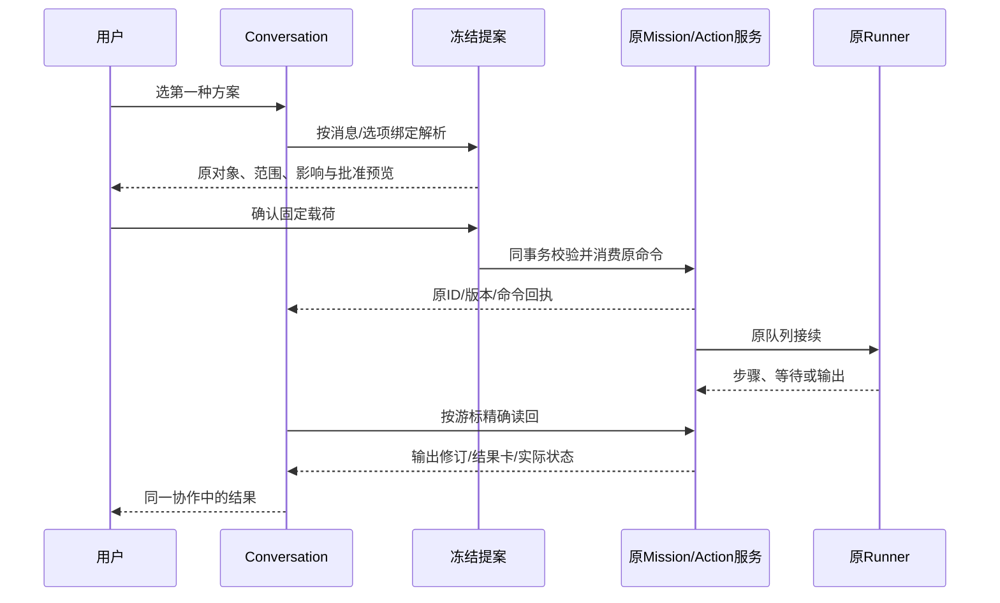
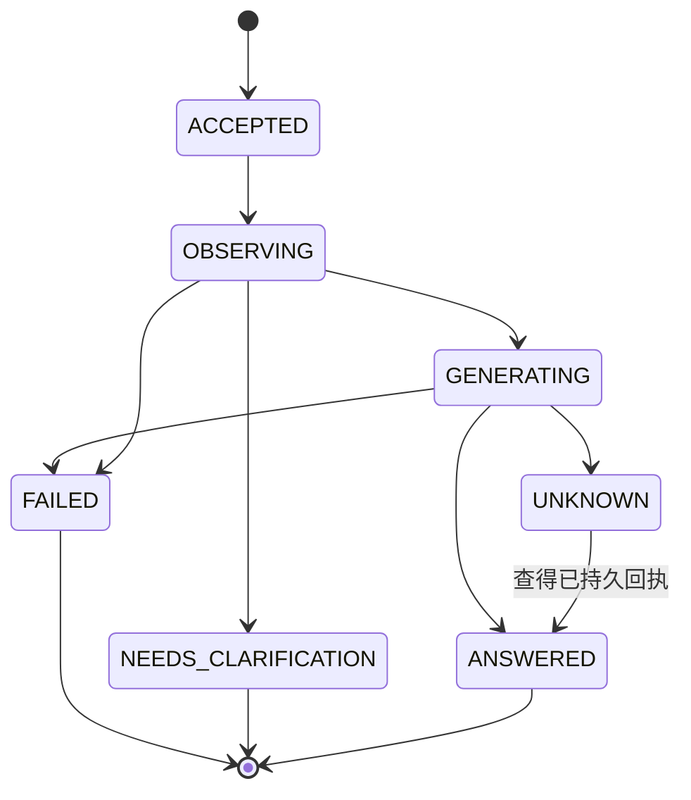
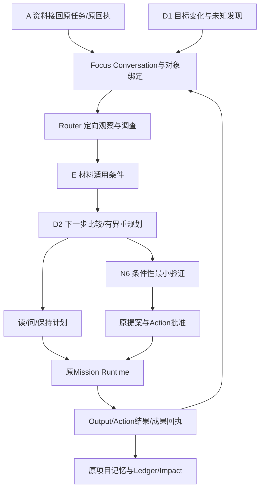

# Focus Agent：长期项目协作的统一交互架构

日期：2026-10-26 修订。面向产品负责人及开发者。实施顺序与验收见 [路线图](FOCUS_AGENT_ROADMAP.md)，实际交付见 [实施记录](FOCUS_AGENT_IMPLEMENTATION_NOTES.md)。

> 2026-10-26：已实现首个 F1 + 协作窄切片及两端入口；真实模型质量和设备旅程尚未验收。下面代码能力矩阵保留初次规划快照，当前实现和实际差异以实施记录为准。

## 1. 方案裁决

**将焦点升级为面向个人全部授权项目的持续协作入口。新增轻量 Conversation 层，以跨项目 Context Router 获取问题所需观察，通过冻结提案连接原 Decision、Mission、Action 与回执。**

用户应能在一段协作中完成“了解现在 → 追问原因 → 调查已有资料 → 选择下一步 → 批准必要操作 → 查看实际结果”，离开、重进和切换设备后仍能继续。主动发现进入同一条对象链，项目详情仍承担深入阅读和专业操作。

采用 **B 为主、兼容性扩展 A 的混合方案**：Conversation 拥有会话身份和讨论焦点；复用 AgentMessage 存消息、AgentRun 存执行审计。业务执行只进入既有 Mission Runtime；一次跨项目问答不强制创建 Mission。确需持续调查时，绑定或经确认新建原项目 Mission。

近期首个产品交付是 **F1 + F2 窄切片：跨项目理解 → 连续指代 → 原任务接续 → 确认创建真实 Action → 同会话状态读回**。F1 只读路由作为技术里程碑，不能单独代表首个完整产品版本。已有提醒的手动追问也在首包内；完整自动事件更新、D1/D2 重规划仍在 F3。

### 2026-10-26 四项产品合同

1. PROJECT/WORKSPACE 是会话范围。同一用户从 Focus 打开项目知识页或 Mission，URL/路由保留 conversationId、originMessageId 和对象绑定；项目内可打开原私有会话，也可新建 PROJECT 会话。返回 Focus 仍是原会话。跨项目全文不写项目公共历史，项目关联不等于有权读取整段私聊。
2. Router 决定读取什么，Priority Reasoning 决定为何先做什么。后者输出目标重要性、时效性、阻塞/依赖、投入和用户偏好的逐项依据、未知与备选；不直接按 deadline 或 primaryContext.priority 排名。用户可明确记录项目重要性、长期目标和预估投入；模型推断不能冒充用户偏好。五分钟临期任务可与长期科研形成“先处理短任务，再保留科研投入”的组合建议。
3. F1 即支持手动点击 Intervention/GoalQuestion/Impact → 核查原 ID、项目、来源及修订 → 打开/接入会话。新增最小入口锚只去重用户显式进入，不自动推送、不转录全部通知；原延后/停止语义保留。F3 再增加自动修订投影与后台策略。
4. 首个业务写入仅为确认创建 Action，复用现有冻结、来源校验、createActionInTx 和幂等回执。已有 Mission 绑定/阅读先行，只有原状态可恢复且用户确认才走原 resume；不提前实现全部动态方案、结果写回或通用工具执行。

## 2. 当前基线与有效规划

### 2.1 初次规划核查快照（2026-10-25）

当前分支 `codex/r3-runtime-research`，HEAD `7f7582ad6cb92b328f18b72b3d26759a824f72f9`，最近提交为 `feat(missions): add reviewed evidence fit and unify material intake`。任务给出的 `0b289a2` 是其上一提交。

核查开始时已有五个 tracked 修改：`AGENTS.md`、`docs/FINAL/AGENT_REVIEW/AGENT_EVOLUTION_ROADMAP.md`、`harmonyos/build-profile.json5`、`next-env.d.ts`、`tsconfig.json`；另有未跟踪 evidence、工具目录、migration lock 与 UI 参考包。本文不修改这些文件。

收尾时工作树另出现 `harmonyos/entry/src/main/ets/common/Constants.ets` 的开发 flavor 切换，以及 `components/MissionEvidenceReview.ets` 的 Select 显示/尺寸调整；本轮未写入两文件。它们不改变本方案的服务契约，下一轮设备验收仍须重新核对当时地址和界面。开始时五个修改文件与原实施计划/记录的哈希经本轮比对未变。

| 依据 | 当前用途与判断 |
| --- | --- |
| [下一阶段实施计划](docs/FINAL/AGENT_REVIEW/NEXT_PHASE_IMPLEMENTATION_PLAN.md)及[实施记录](docs/FINAL/AGENT_REVIEW/NEXT_PHASE_IMPLEMENTATION_NOTES.md) | 前者保留旧设计并在页首指向最新实施记录；当前 P1-A 与 P2-A/B 窄域 E0 已有工程实现，真实效果和设备 Gate 尚有未完成项 |
| [D1/D2 技术附录](docs/FINAL/AGENT_REVIEW/NEXT_PHASE_AGENT_DEEPENING_DESIGN.md) | D1/D2、E1、N6 仍为设计；复用其 purpose、局部 read-set、预算及 KEEP_PLAN 约束 |
| [决策摘要](docs/FINAL/AGENT_REVIEW/NEXT_PHASE_DECISION_BRIEF.md)、[研究对照](docs/FINAL/AGENT_REVIEW/NEXT_PHASE_RESEARCH_RECONCILIATION.md)、[评测协议](docs/FINAL/AGENT_REVIEW/NEXT_PHASE_EVALUATION_PROTOCOL.md) | 明确 A/E 是保障，D1/D2 是能力深化；摘要开头“Phase 1–3 均未开发”已落后于最新实施记录，不据此重领 P1-A |
| [旧演进路线](docs/FINAL/AGENT_REVIEW/AGENT_EVOLUTION_ROADMAP.md) | 已标为历史研究，其中“Copilot 不含历史/Mission”等旧事实不能用于当前设计 |
| 本文及路线图 | 新的统一交互层候选；不覆盖上述底层能力计划，也不将全部旧路线视为本轮开发授权 |

本次现有隔离回归：`npm.cmd test -- tests/copilotPersistence.test.ts tests/copilotContinuation.test.ts tests/projectAgentContext.test.ts tests/globalFocusPresentation.test.ts`，4 文件、47 项通过。此结果验证当前复用基础，不构成拟议 Focus Agent 的实现或模型效果证据。

### 2.2 当前能力矩阵

以下行号对应上述 HEAD 的当前工作树，后续按函数名重新定位。

| 能力 | 已有实现与代码依据 | Focus Agent 的实际缺口 |
| --- | --- | --- |
| 全局焦点 | [globalFocus.ts](lib/server/globalFocus.ts):11–53；每类查 7 条展示 6 条，记录查 4 展示 3；另查全量计数 | UI 摘要无问题路由、跨项目材料调查、长期会话 |
| primaryContext | 同文件:37–39；按 waiting/running/reminders/actions 顺序去重，先截 6 个项目，再取项目 Context，以 priority、observedAt、ID 排序 | 未进入列表的项目不能参加比较；没有事项的项目也可能被漏掉。观察时间用于并列排序，不能解释为项目重要性 |
| 项目下一步 | [projectAgentContextService.ts](lib/services/projectAgentContextService.ts):7 起；每生命周期一条、用户关注 Mission、提醒和行动；[选择器](lib/projectAgentContext.ts)稳定归并 | 是生命周期注意力投影，不是完整目标理解、资料覆盖或全局排名 |
| 对话历史与上下文 | [copilotService.ts](lib/services/copilotService.ts):139–168、[agent.ts](lib/repositories/agent.ts):379–403；GET 最近 20 消息；模型取最近 12 个 ANSWERED 消息中的 6 条，每条最多 1000 字，另从这 12 条抽显式否决 | 已有有限多轮，缺会话 ID、长期约束、结构化指代、独立主题和跨项目历史 |
| 消息/调用归属 | [schema.prisma](prisma/schema.prisma):300–372；AgentMessage、AgentRun 的 projectId 均必填；消息 ownerUserId 可空 | 不能用某个项目承载整个工作区；旧无 owner 消息不能猜归属或直接并入用户私聊 |
| 来源与 Claim | Copilot 复用 hybridSearch、Temporal Ledger、TrustReceipt 及可选语义核验；[prompts.ts](lib/agent/prompts.ts):20 起；[claimVerifier.ts](lib/mission/claimVerifier.ts)按原文范围核验 Mission 输出 | 不能把卡 ID 换成任意项目 ID 就获得跨项目核验；需统一带 projectId 的来源信封及类型分派 |
| 操作预览/确认 | [confirmation.ts](lib/copilot/confirmation.ts)冻结 CopilotToolExecution、来源 manifest、载荷 hash，事务消费/重放；成果生成在事务外 | 新会话需冻结目标对象和选项次序；不能只沿用 title 作为自然语言方案身份 |
| 行动与成果 | Copilot 主要提出 create_action / generate_artifact；[actionService.ts](lib/services/actionService.ts)完成行动并原子保存 resultCardId；[artifactService.ts](lib/services/artifactService.ts)生成成果 | 缺会话到原对象的结果链接；Action 完成服务还需适配 actor、局部版本与确认载荷的事务校验，不能认为所有写服务已经满足新入口要求 |
| 转 Mission | [continuation.ts](lib/copilot/continuation.ts):26–105、214 起；关键词识别明确任务；有活动 Mission 就建议打开，创建需 preview/confirm | 不是基于目标语义的任务匹配，不能准确执行“继续刚才那个”“第一种方案” |
| Mission Runtime | [runner.ts](lib/mission/runner.ts)、[runtimeStore.ts](lib/mission/runtimeStore.ts)、[missionService.ts](lib/mission/missionService.ts)具备逐步选工具、租约、预算、命令、步骤/事件/输出 | 复用执行核心；增加适配器，不新增会话任务引擎 |
| 资料接续/E0/读回 | [continuationService.ts](lib/mission/continuationService.ts)、[evidenceFitService.ts](lib/mission/evidenceFitService.ts)、[materialUseProjection.ts](lib/mission/materialUseProjection.ts)、[readback.ts](lib/mission/readback.ts) | 已支持关联/核对及同对象阅读；Focus 需要在对话内呈现原表单/回执；E0 默认开关关闭，窄域实现不是通用适用性推理 |
| 主动发现 | [questions.ts](lib/decision/questions.ts):36 起：WAITING_INPUT 或显式受影响 PAUSED；有 UNKNOWN/LATER/STOP、个人偏好和打扰预算；[impactJobs.ts](lib/decision/impactJobs.ts)消费显式依赖变化 | 当前 GoalQuestion 不是任意新未知发现器；全局焦点还排除 goal: 提醒。需结构化入口，不能抓提醒文本作新聊天事实 |
| 方案选择 | [scenarios.ts](lib/decision/scenarios.ts):20–50、90 起；BASELINE/VERIFY_FIRST/DELIVER_FIRST、冻结快照、同 Mission 采用/拒绝 | 当前不是项目特定动态规划；D2 将扩 purpose 和 V2 schema，Focus 只引用其提案 |
| 经验/感知 | [experience](lib/experience/service.ts)、[trajectoryIndex.ts](lib/experience/trajectoryIndex.ts)、[repoSource.ts](lib/sensing/repoSource.ts) | 经验为建议，采纳仓库信号生成 Capture，不自动完成行动、建立支持关系或产生新结论 |
| Web/鸿蒙 | [FocusPage](app/focus/page.tsx)、[样式](components/FocusDashboard.module.css)、[GlobalFocusPanel](harmonyos/entry/src/main/ets/components/GlobalFocusPanel.ets)、[CopilotService](harmonyos/entry/src/main/ets/services/CopilotService.ets) | 两端已有同后端和业务 DTO；缺会话/事件/提案的共享协议，不能复用 TSX 到 ArkTS |
| 模型额度 | [cloudQuota.ts](lib/auth/cloudQuota.ts):10 起和[llmAgent.ts](lib/agent/llmAgent.ts):13 起；按项目 Owner 扣次，projectId 为空直接返回 | 用户级对话须新增明确 billing actor；不能省略 projectId 绕额度，也不能随意选一个项目给其他 Owner 计费 |

核心差距是会话身份、问题驱动观察、对象绑定、事件接入和结果连续性。新增 Prompt 无法补齐这五个持久化和权限边界。

## 3. 产品旅程和职责

用户问“最近先处理哪个项目”，Agent 先比较授权范围的目标、截止、等待和风险，再定向读必要依据；建议卡明确项目、理由和观察范围。用户说“继续这个”，绑定前一张建议卡的对象，展示原 Mission 的当前状态及可用命令。

用户从一条变化点击“聊聊这件事”，进入以该变化为锚的已有会话，或新建会话。调查所得方案在会话中展示；确认后的执行继续原 Mission。真实结果到达时更新同一结果卡，必要时追加一条结果消息。

| 层 | 唯一职责 | 数据所有者 |
| --- | --- | --- |
| Conversation / Focus Agent | 讨论、上下文路由、指代、提案展示、回执投影 | 用户私有会话 |
| 项目 Copilot | 当前项目的就地阅读/讨论入口 | 同一会话服务的 PROJECT 范围，旧历史兼容保留 |
| D1 / E / D2 / N6 | 发现目标相关变化 / 核对材料 / 比较下一步 / 设计必要验证 | 原 decision 服务与提案；N6 是 D2 的一种候选 |
| Mission Runtime | 持续调查、工具步骤、预算、等待、批准、恢复 | AgentMission 及原步骤/事件/输出 |
| Action / Artifact / Ledger | 行动结果、成果版本、长期事实关系 | 现业务对象与原始资料 |

**不是第二个 Copilot**：Focus 与项目 Copilot 使用同一会话内核、同一引用组件语义和提案服务，入口范围不同。**不是第二个 Runtime**：ConversationTurn 记录一次请求及其有限读取，不管理长期目标、工具步骤队列、成功条件或后台执行；持续工作交给 AgentMission。

| 复用方式 | 代码裁决 |
| --- | --- |
| 直接调用 | auth guard、ownedMission、sourceHash/Temporal Ledger、原记忆/资料读取、Mission events/readback、批准与成果回执。原服务仍重查自己的业务权限 |
| 提取后复用 | Copilot 来源/Claim 投影、冻结确认、provider 元数据与额度算法、可传 tx 的命令提交、Action 完成准备/提交、两端来源/方案卡片 |
| 必须新增 | 用户 Conversation、请求账本、Context Router、QualifiedSourceRef、结构化焦点/指代、主动 Anchor。现有摘要和组件没有这些持久职责 |
| 不直接搬用 | readCopilotContext 的全项目卡片扫描/全上下文 hash、关键词转委托、最新活动 Mission 兜底、Focus 六项候选。它们可保留服务旧入口，不能成为 workspace 内核 |

## 4. Conversation 模型裁决与迁移

### 4.1 备选比较

| 方案 | 收益 | 代价 | 裁决 |
| --- | --- | --- | --- |
| A：只给 AgentMessage/AgentRun 加 scope 字段 | 改动集中 | 会话、焦点、成员范围和提案状态散在消息 JSON；无法清晰分页、恢复与隔离 | 单独采用不足 |
| B：用户 Conversation，复用消息和调用 | 会话/任务职责明确；旧历史可渐进接入 | 必要表与 nullable 迁移；必须梳理旧查询 | 采用 |
| C：独立全套 workspace 消息、执行、工具系统 | 旧表完全不动 | 两套消息、审计和确认长期分叉 | 不采用；只有旧表无法兼容的经验证据才重议 |
| 虚拟 workspace Project | 看似免迁移 | 归属、删除、额度、来源和项目事实语义错误 | 排除 |

### 4.2 F1 的最小新增结构（拟议）

| 表/扩展 | 关键字段与约束 | 用途 |
| --- | --- | --- |
| Conversation | id、ownerUserId、createRequestId、createInputHash、scope=WORKSPACE/PROJECT、homeProjectId?、title、status、version、nextSeq、focusJson、pinnedStateJson、summaryJson、summaryThroughSeq、summarySourceHash；unique(ownerUserId, createRequestId) | 私有持续主题。PROJECT 必须 homeProjectId；WORKSPACE 无固定项目。scope 不在已有会话上暗改 |
| ConversationProject | conversationId、projectId、origin、linkedAt；unique(conversationId, projectId) | 已讨论项目目录，不构成授权；每次读写重查 membership |
| ConversationTurn | id、conversationId、kind=CHAT/CONTEXT、requestId、inputHash、baseVersion、status、parentTurnId?、rootTurnId、attempt、reservationJson、readManifestJson、usageJson、errorJson、startedAt、finishedAt；unique(conversationId, requestId) | 有限请求账本：相同请求读同一回答/失败；上下文切换同样幂等；网络未知不自动再计费；不复制 MissionStep |
| ConversationBinding | id、conversationId、ownerUserId、projectId?、kind、entityId、revisionKey、role、originMessageId?、originRefJson；unique(conversationId, kind, entityId, revisionKey) | 指向原 Mission/Action/Proposal/Output/事件，保留修订与来源。多态 kind 走严格判别 schema 和服务端归属校验 |
| AgentMessage 增量 | conversationId?、turnId?、seq?、blocksJson?；projectId 改可空；unique(conversationId, seq)、unique(turnId, role) | 消息仍一份；blocks 含正文、范围、来源、建议、原对象回执引用。旧枚举 USER/ASSISTANT 保留，事件投影使用带 origin 的 ASSISTANT block |
| AgentRun 增量 | conversationId?、turnId?；projectId 改可空；trace 增 purpose、actorUserId、billingActor、模型/协议版本、manifest、usage/unknown | workspace 调用 projectId=null；原 Mission/项目调用仍要求真实 projectId。不创建伪项目 |

Conversation.status 只有 ACTIVE/ARCHIVED 这类讨论管理状态，不能承担任务运行状态。Conversation 对 owner 建外键与索引；会话内 seq 在短事务分配。消息与 Run 的 conversation/turn/actor 一致性由服务端校验，不能让客户端提交任意 runId。workspace 消息引用多个项目时，其 projectId=null，出处在带 projectId 的 blocks/bindings 中表达。

新会话请求以 ConversationTurn 为幂等主键，新消息的旧 requestId 留空；旧 API 仍用旧 requestId 合同及原唯一索引。这样不同 PROJECT 会话可使用相同客户端请求编号而不撞旧项目级唯一键。每个 CHAT turn 最多一条 USER 和一条最终 ASSISTANT；状态卡投影不伪造新的用户 turn。

项目内 Runner 的 AgentRun 可通过 ConversationBinding 被多个会话观察，**不回填为某一个会话独占**。新 F1 请求的调用才写直接 conversationId/turnId。

`pinnedStateJson` 保存否决、只读约束、选中对象、未决 proposalId 与待答问题，条目带原消息 seq、适用项目/主题、有效状态。约束容量不足时提示整理或开启新主题，不能静默丢弃最早否决；会话约束只收紧执行许可，放宽仍需原业务授权。

### 4.3 F2/F3 的增量结构

不建立新任务/结果主表。会话命令信封包含 targetProjectId/qualified ref、冻结命令与 read-set、expiresAt、schemaVersion；保留 CopilotToolExecution 的旧列和唯一(sourceRunId, proposalKey)。2026-10-26 F2 本地实现先将这些字段保存在既有 proposalJson，目标项目同时记在私有 AgentRun trace；后续按检索需要再提取为可空列。已有 DecisionScenarioProposal、MissionApproval、continuation assessment 本体只被引用，不复制一套可采用状态。

若信封转发原提案，冻结 `proposalId + candidateId/scenarioKey + proposalHash + target refs`，其状态由原服务裁定。会话信封的 PENDING/PREPARING/COMMITTED 与原业务命令通过同事务消费；返回原 effect ID。新工具采用服务端稳定 proposalKey，旧 title key 兼容只用于旧 Copilot。

F1 新增最小 ConversationAnchor：ownerUserId、conversationId、projectId、originKind、originId、topicKey、originRevision；unique(ownerUserId, originKind, originId, topicKey)，仅供用户手动追问去重。F3 增加 rootMessageId、lastProjectedRevision、lastEventSeq 及自动投影去重。延后/停止优先调用原 GoalQuestionPreference/提醒反馈，不新建通知中心。

### 4.4 兼容、权限撤销和压缩

1. 先部署能读取 nullable projectId 的仓储和 DTO，再允许 workspace 写入。SQLite 可能重建 AgentRun/AgentMessage 表；迁移在空库与旧库副本上验证外键、唯一索引、行数、旧回执和事务回滚，不对开发真实库跑 seed。
2. 旧项目 API 继续 `where projectId + ownerUserId`，不得误读 workspace 消息。对可证明 owner 的历史，可按 `(ownerUserId, projectId)` 幂等建立“历史项目对话”并关联原行；无 owner 的行保留原位，不猜归属。原 message/run/sourceRunId/receipt ID 均不改。
3. 迁移只关联已有行，不复制对话文本。原历史入口可继续读旧 contract；开启会话版后同一消息经新 DTO 投影。项目中可以打开“来自焦点的讨论”，带 conversationId 返回；不会将整段跨项目私聊写入项目公共历史。
4. 最近 12 条完整消息加结构化 pinned state；超过预算再压缩较早正文。summary 带 covered seq、原消息 hash、项目权限范围和未解决项引用；摘要不是事实来源，引用仍回原资料。选择/否决/待批准不依赖摘要提取。
5. 所有 GET、历史摘要构建、模型提交前后、提案确认和结果返回都验证会话 owner 与最新项目权限。被撤权项目的 block 和绑定不返回；混合正文无法安全拆分则整条隐藏为“部分历史不可用”，并废弃包含该项目的摘要。不得将旧回答中的已撤权信息再次送入模型。
6. 逻辑回滚关闭新入口与写开关，保留新表和历史，回到已兼容 nullable 的上一版读取器。已有 workspace 行时不直接回退到旧 Prisma schema，更不删除新会话做回滚。

## 5. Workspace Context Router

### 5.1 问题驱动的三级观察

**L0 授权目录**：从 ProjectMembership 查真实可读项目。默认活动项目；显式“上次暂停”“历史决定”可纳入授权归档项目。用户锁定项目集则先相交，模型生成的 projectId 必须在当前允许集合。目录按稳定 ID 分页，不只选最近更新或焦点有事项项目。

**L1 有界摘要**：拟 `workspaceContextService.ts` 为每个候选提供目标、deadline、真实待办计数、本人可读 Mission 状态计数、当前关注对象、相关变化索引和 freshness。ProjectAgentContext 只是其中的“当前下一步”。结构化计数可查完整，文本不将全部项目材料送入模型。

首轮每页最多 20 项摘要、每次最多 3 页；候选超过 60 项就保留 nextCursor，回答限定已观察范围。明确命名的项目必须定向补入，不能因分页未到而回答不存在。全项目比较须完成允许目录的必要摘要扫描，未完成只能说“已观察项目中”。

**L2 定向深入**：路由模型最多提出 3 个项目和各自读取目的，服务器校验并执行最多 6 次本地读取、总计最多 12 个来源片段。状态问题用结构化 SQL；为什么暂停用指定 Mission events/错误及相关修订；历史决定按时间、原决定 ID 定向读取；证据问题用项目记忆检索并按需读取 Capture/附件/成果。

复用 [searchMissionMemory](lib/mission/memorySearch.ts)、[readProjectMaterial](lib/mission/sourceSignals.ts)、Mission detail/events/readback 及 Ledger。必须保留现标题/摘要匹配、归档定向读取、分页及成果附带上限；中文同义匹配失败要记录，不把它当完整语义检索。原工具的 Actor.projectId 由服务器逐项目构造，不接客户端伪造的 actor。

只读工具入口的复用方式是调用同一实现及 effects/schema/来源校验，不直接暴露 projectTools 整个注册表：save_mission_output 等即便 effects 标为 readEffects，仍属于任务成果流程，不能进入 workspace 只读白名单。外部网络读取也有 disclosure 和费用边界，不因“只读”自动获准。

### 5.2 路由与来源合同（拟议）

| 对象 | 必需内容 |
| --- | --- |
| WorkspaceReadManifest | userId、conversationId、turnId、policyVersion、queryHash、scope、observedAt、projectDirectoryCursor、allowed/observed/deepRead 项目集合、每项目 coverage/freshness/失败、tool/schema/model 版本 |
| QualifiedSourceRef | projectId、kind、entityId、revision/hash、observedAt、sourceTime、temporalState、knowledgeClass、textRange/excerptHash、支持的 block/claim ID |
| WorkspaceEvidenceClaim | claimId、text、类型=持久状态/资料陈述/建议、sourceRefs、structuralCheck、semanticVerdict、uncertainty；跨项目比较显式列依据项目 |
| ConversationFocus | focusVersion、originMessageId、focusProjectId?、selectedEntityRef?、activeProposalId?、optionMap、userConfirmed；不直接映射 membership.focusMissionId |
| RoutePlan | candidateProjectIds、每项目 reason/readRequests、excludedReason、budget、complete；模型只提候选，服务器产生最终可执行计划 |

sourceId 的本地格式可继续 card:/capture:/attachment:，跨项目引用身份必须是 `(projectId, sourceId, revision)`。来源存在、Ledger 当前、Evidence Fit 适用、Claim 支持和现实效果分别表达。

结构化“项目有两项待批准”由数据库观察支持，不强迫寻找知识卡；“实验使方案不可行”须资料范围、适用条件及 Claim 核验。“建议先做 A”标为建议，并展示 deadline/阻塞/依赖等理由，不伪造精确优先级概率。

### 5.3 费用与有限自主读取

普通提问视为授权在显示范围内读取已有数据；不同时授权公开网络披露、改任务、后台无限分析。F1 推理内核只做固定“路由 → 有界读取 → 回答/澄清”，没有开放工具循环。首个产品版本另接明确预览/确认的 Action 创建与原 PAUSED Mission 接续；超预算返回覆盖不足及可继续调查的目标。

初始设计上限：每 turn 路由 1 次、最终回答 1 次，可选 Claim Judge 1 次，合计最多 3 次；输入总预算建议 12k tokens、输出合计 4k tokens、服务主动执行上限 60 秒。实际 tokenizer/供应商限制接入统一预算；预占不得只依赖字符估算。无需模型的状态读取可为 0 次。额外嵌入、压缩、协议修复若调用模型也计入，额度不足不隐式增发。

抽取 cloudQuota 的显式 billing context：workspace 计当前用户，项目调用维持既有项目 Owner 规则；调用前在唯一请求身份下预占。模型层只消费已确认预占的上下文，防止上层与 provider 双重扣次。无 billing context 的可信 CLI 通路不能被 HTTP 会话入口使用。记录 provider/model/usage/fallbackReason 和 UNKNOWN 请求，不通过换 requestId 自动重发未知费用。

初次规划时 llmAgent 未完整透传 usage；本次已补输入/输出 token、request identity 与缺失时的 usageUnknown。旧调用签名保留，新 workspace 调用必须传显式账单/预算。当前硬边界是两次模型调用、单 Prompt 字符上限与供应商超时；精确累计 token 预占仍待后续模型验收切口，不将字符上限称作精确 token 预算。

## 6. 对话式决定与原业务对象绑定

首版允许的业务命令为 CREATE_ACTION 与对已绑定 PAUSED Mission 的原 RESUME 预览/确认；其余命令按 F2 门槛逐项启用。用户输入只产生提案，必须显示目标项目、对象、冻结内容并确认。确认后无论在会话还是项目行动页读取，都返回同一个 Action ID 和实时状态，不能停留在“已发送请求”。

### 6.1 从文本意图到受控命令

拟 AgentIntent 使用严格判别联合：ANSWER、CLARIFY、INSPECT、OPEN_EXISTING、PREVIEW_CONTINUATION、PREVIEW_DECISION、PROPOSE_ACTION、PREVIEW_NEW_MISSION、REPORT_RESULT、DECLINE。各意图带 originMessageId、server binding IDs、targetProjectId、解释和所需权限；自然语言只是候选生成输入。

“第一个方案”只解析到当前明确展示的冻结 `optionMap`（proposalId、revision、candidateId/scenarioKey、displayOrdinal、hash）。用户输入保存回复目标；若最近有两组候选、切换过主题、来源已变或焦点不唯一，先返回两项明确选择。模型不能重新生成“第一种”再执行。

“继续这个项目”先定位上一回答的建议 project binding，再列其原任务匹配结果；有多个合理 Mission 就让用户选择。匹配依据包含目标、successCriteria、讨论中的问题与原任务身份，不能仅取最新活动 Mission。无匹配才预览新建；不同目标即使项目已有 Mission 也允许明确创建新任务。SUCCEEDED/CANCELLED 不复活。

用户在另一个设备改焦点：提交携带 expectedConversationVersion/focusVersion；陈旧请求返回冲突和原文本，不将它套用到新焦点。切换讨论上下文不修改业务关注偏好、不启动/恢复任务。

### 6.2 执行适配表

| 用户决定 | 实际服务/对象 | 新入口必须补足的边界 |
| --- | --- | --- |
| 帮我查已有记录 | F1 的确定性读取；需长期调查则绑定已有 Mission，再预览其范围/继续操作 | 用户只读范围内可自主查；不同目标不借用原 Mission 改其成功条件 |
| 继续原委托 | missionDetail + commandMission / 原 input、continuations | PAUSED 可按原 resume；WAITING_INPUT 要绑定当前 question；WAITING_APPROVAL 要原 approval；RUNNING 只观察；FAILED 先说明修复路径，不通用 resume |
| 选第一种方案 | adoptScenario，后续 D2 的 V2 candidate | 原 proposalHash、版本、scope/constraints/read-set 重验；采用计划不隐含批准 Action |
| 把它变成行动 | freeze/confirm CopilotToolExecution → createActionInTx，或原 MissionApproval | targetProject 明确、载荷冻结、效果和回执同事务、重试同 Action ID |
| 生成成果 | 原 prepareArtifactGeneration/savePreparedArtifactInTx；Mission 输出用 artifactAdoptionService | 网络在事务外；精确 Output revision 与来源，不能另生成文本假冒原成果 |
| 验证完成，结果是…… | REPORT_RESULT 先绑定 actionId，展示用户原话和将写入项目；确认后 completeProjectAction 的受保护适配 | 事务内重查 actor、项目、action 状态/版本和冻结结果 hash；保留 resultCardId；用户自述与独立测量分开 |
| 不接受/换一种 | 原 rejectScenario、approval REJECTED 或会话否决 | 拒绝对象准确；明确只读/禁止路径持久 pin；拒绝提案不等于取消整个 Mission |

现 `completeProjectAction` 已有完成结果的事务去重，但在模型结构化调用前后缺新入口所需的 actor/expectedVersion/冻结载荷 guard。F2 应把其准备和提交边界提取到同一服务中供新旧调用方使用，并覆盖并发取消/撤权，不在会话层直接 PATCH DONE 绕过结果链。

### 6.3 原子提交与同步

会话提案确认分为 prepare → 网络（若需）→ finalize。短事务按稳定顺序锁会话信封及目标对象，验证会话 owner、会话焦点、项目/任务权限、提案载荷与版本、相关来源、预算和原批准。业务效果、原命令回执与信封消费同事务写入；消息展示失败不回滚已发生业务效果。

既有命令服务若自己开启事务，先提取有 tx 的内部入口供同事务调用，旧公开包装保留。不能先提交业务，再写“确认成功”信封而无幂等恢复；无法同事务时，信封固定派生原 requestId，重读原命令回执才能补投影，不再次执行。

Mission 结果同步以原 events.seq、Output revision、Action/resultCardId、Artifact receipt 为准。F2 先在会话 GET/前台轮询时有界读回并按来源唯一键补投影；F3 可在现 Worker 增加投影工作，失败可重建，不引入通用事件总线。GET 的纯读取接口保持无副作用；需要落消息的 reconcile 使用明确 POST/worker 操作。

## 7. 主动发现进入同一段协作

拟统一 FocusEntryContext：originKind=INTERVENTION/GOAL_QUESTION/IMPACT/D1_REVIEW、originId、originRevision、projectId、missionId?、questionId?、goalRef、sourceRefs、observedAt、coverage、topicKey。提醒正文仅为展示，不成为新事实来源。

通知不批量灌聊天。用户点击追问，或事先明确开启“该主题值得关注的更新进入此会话”，才建立 Anchor。优先匹配该用户同 origin/topic 的已有会话；不得因 projectId 相同就把所有提醒并入一个永不结束的会话。

| 事件/操作 | 会话行为 | 原对象行为 |
| --- | --- | --- |
| 第一次追问 | 一条引用源事件的入口卡与问题；保存 trigger snapshot | GoalQuestion/提醒的曝光按原接口记账，不批准业务 |
| 同一事件重复到达 | 重放同 Anchor/消息，不新增未读 | 不重复反馈/计费 |
| 同主题相关来源更新 | 原卡显示“依据已更新”和当前 revision；追加不可变修订记录，旧正文不被偷偷替换 | 新提案依相关 read-set 失效；原历史可查 |
| 用户忽略 | 保留焦点条目，不自动扩散到其他会话 | 原提醒状态不因未点击变化 |
| 延后/停止 | 原 preference/disposition 生效，Anchor 只保游标 | 同语义主题和 read-set 不反复推送；实质变化按原策略重判 |
| 拒绝方案 | 在本会话保留否决与替代约束 | 不伪造任务取消或材料不适用 |
| 无关资料/条件不匹配 | 无关不打扰；相关但不适用给出条件差异；信息不足保留 UNKNOWN | E0/E 后续评估，不将不适用当无价值或负结果 |

D1 只产目标相关候选与“为什么现在”，不直接把语义猜测写成 Impact 硬依赖。候选过权限/来源/政策检查后可在焦点讨论；D2 提出读取、追问、验证或 KEEP_PLAN；N6 只在验证有区分力时形成原 Action 提案。新观察后的决定修订属于 D2，Focus 不复制其选择算法。

## 8. API、DTO 与状态

以下为**拟议新合同**；现有 API 保持兼容。所有 route 运行 Node.js、鉴权、strict schema、private/no-store。客户端能力协商返回 schemaVersion、支持 block/intent 列表，未知可执行类型只能只读，不能默认转换为旧动作。

| API | 输入/返回核心 | 阶段 |
| --- | --- | --- |
| POST /api/conversations | requestId、scope、homeProjectId?、entryRef? → conversation；同用户创建请求幂等 | F1 |
| GET /api/conversations | scope/projectId?、cursor、limit≤20 → 私有会话摘要 | F1 |
| GET /api/conversations/:id | afterSeq、limit≤50 → messages、focus、pinned、bindings、coverage、nextCursor | F1 |
| POST /api/conversations/:id/turns | requestId、message、replyToMessageId?、bindingIds、expectedVersion、contextSelection、llmContextApproved → 202/完成回执 | F1 |
| GET /api/conversations/:id/turns/:turnId | 请求状态、失败原因、manifest、已提交回答/Run 引用；不自动重发模型 | F1 |
| PATCH /api/conversations/:id/context | requestId、expectedVersion、selected binding/project refs → 新 focusVersion；不变更 Mission | F1 |
| POST /api/conversations/:id/proposals/:executionId/confirm | requestId、proposalHash、confirmed=true → 原业务回执；当前首包 Action/原 Mission resume，服务端重查焦点、冻结载荷与来源 | F1窄切片，F2再扩 |
| POST /api/conversations/:id/proposals/:executionId/decline | requestId、proposalHash、reason? → 会话否决及原提案拒绝回执 | F2 |
| POST /api/conversations/:id/reconcile | requestId、已知 anchor/event cursor → 原对象更新投影；无模型调用 | F2/F3 |
| POST /api/conversations/entry | entryRef、requestId → 授权且去重的会话/Anchor；与 create 共用内部入口 | F3 |

现 `/api/workspace/focus` 继续提供摘要；只增加可选 conversationEntry，不换成知识库接口。原 `/api/projects/:id/agent/chat` 可逐步作 PROJECT 会话适配入口，旧请求/响应先保持。Mission `/input`、`/resume`、`/approvals/:approvalId`、`/continuations/preview|confirm`、`/readback` 与 `/api/decision-scenarios/:id` 的业务语义继续由原服务负责。

ConversationMessageDTO：`id/seq/turnId/role/origin/content/blocks/observedProjectIds/bindingRefs`。block 判别类型为 TEXT、CONTEXT_SCOPE、EVIDENCE、CHOICE、PROPOSAL_REF、MISSION_REF、RECEIPT_REF、STATUS；不向客户端下发任意可执行 HTML 或工具名。ReceiptRef 带 projectId、entityKind、entityId、revision、commandRequestId、resultCardId? 和 observedAt。

UNKNOWN 代表请求是否完成或计费尚未确定，不能因刷新自动重发。显式重试建带 parent 的 attempt，复查旧回执并消耗同一根预算；同会话同一时刻只接受一个生成 turn，其他设备得到忙碌/版本冲突及原请求状态。业务对象结果更新不阻塞用户下一次提问。

提案另有 PENDING → PREPARING → COMMITTED，以及 DECLINED/STALE/EXPIRED；长期 RUNNING/WAITING/SUCCEEDED/FAILED 始终读取原 Mission，不能用 turn ANSWERED 表示任务完成。

## 9. Web、移动端与 HarmonyOS 信息架构

已检查当前 Focus/Copilot 源码，并视觉查看 2026-10-22 的 [Web 桌面存档](evidence/pre-r4/20261022-focus-final/projectmemo-focus-desktop.png)、[移动存档](evidence/pre-r4/20261022-focus-final/projectmemo-focus-mobile.png)、[鸿蒙存档](evidence/pre-r4/20261022-harmony-reference-v2/user-b1-focus.png)。截图用于理解既有密度与视觉，不作为当前 HEAD 的运行验收。

### 9.1 桌面 Web

焦点维持现一级导航。页头减为“焦点”、范围及会话选择；取消占满首屏的巨型 hero 和重复计数说明。内容采用约 5:7 双区域：左侧事项列表，右侧持续协作，最低宽度不足时切单区域，具体阈值按 1024/1280 等实测调整。

| 区域 | 呈现与联动 |
| --- | --- |
| 左侧项目焦点 | 待回应/主动发现优先，运行中、行动与动态可折叠；每项只有项目、问题/状态及一个主动作。原全量计数保留在简洁筛选中 |
| 右侧协作 | 顶部一行上下文范围；中间正文、证据/可选方案和原 Mission 状态；底部输入。来源和执行明细按需展开，不为每条回答重复附一套技术标签 |
| 点击事项 | 显式选择对应绑定，在右侧打开讨论并显示“围绕 X”；打开本身不触发付费调查。用户追问/原有授权策略才分析 |
| 执行与读回 | 批准仍在原提案卡；效果提交后左侧 invalidate/refetch，右侧更新同对象卡，列表不靠乐观状态宣称完成 |
| 项目深入 | “打开原委托/原资料”保留 conversationId、messageId、精确 output revision 与返回焦点锚；返回恢复滚动和草稿 |

沿用 `--paper/--ink/--teal/--rule/--card-bg`、editorial-button、EvidenceText 与现有暗色主题。提取 MemoryCopilot 中来源、TrustReceipt、提案和状态的可复用展示语义，再由 ConversationPanel 组装；不直接复制整个浮层组件和其项目级状态管理。

### 9.2 移动 Web 与 HarmonyOS

焦点顶部保留主要事项和明确可见的“问忆程”输入/入口，不新增一级聊天导航。轻点展开全屏对话；半屏只用于短预览，键盘弹出后进入全屏，避免长方案在多个嵌套滚动区中操作。

顶部显示当前项目/跨项目范围；切换范围通过可回退选择器，不静默覆盖旧会话。长方案每屏一项，可横向/逐项切换，确认前展开目标对象、影响和来源；底部动作避开系统安全区。来源用阅读页/面板，关闭回同消息。离线显示最后观察时间和未同步草稿，写确认必须联网重验。

鸿蒙拟 `FocusConversation.ets` 页面、`FocusAgentEntry.ets` 组件、`ConversationService.ets` 与 `models/Conversation.ets`；沿用 [DesignTokens](harmonyos/entry/src/main/ets/common/DesignTokens.ets)、PMButton/PMStatusPill、ApiClient、会话过期广播、generation 防迟到模式。注册 pages 路由，ProjectHome/MissionDetail 增返回锚。共享服务端 DTO 的语义与测试夹具，ArkTS 使用具名 class/interface，模型调用、方案判断和权限不落客户端。

360/390/768 宽度、130% 字体、软键盘、深色、读屏和冷启动需独立验收；构建、模拟器、真实设备及生产后端可达分别记录。

## 10. 与 A/E/D1/D2/N6 的依赖和创新

F1 不等待 D1/D2 完工，可真实比较与理解现有项目。F2 先接现有固定方案、资料接续和命令，动态候选只在 D2 V2 可用时开放；F3 将 D1 发现和 D2 反馈通过 Anchor 接入同会话。N6 未过领域/费用 Gate 时，仍能读已有证据、追问或保持原计划。

技术创新候选集中在三处：**带观察覆盖与局部版本的跨项目问题路由；冻结选择与业务对象的多轮指代；主动事件—用户否决—原任务执行—真实结果的持续协作链**。创新是否成立由真实模型消融与用户任务结果检验，不能以消息流畅度、工具数量或 Fit 误判下降代替。

## 11. 开源设计参照与风险裁决

按项目约定只比较两个相关开源实现，没有扩展竞品调研。2026-10-25 通过 GitHub API 核实：LangGraph.js 为 3370 stars、MIT、最近 push 2026-10-24；LibreChat 当前迁至 LibreChat-AI，为 46290 stars、MIT、最近 push 2026-10-25。计数是本次快照。

| 来源 | 借鉴的设计 | 依赖/已知边界与本项目选择 |
| --- | --- | --- |
| [LangGraph.js](https://github.com/langchain-ai/langgraphjs)、[官方 interrupts](https://docs.langchain.com/oss/javascript/langgraph/interrupts) | 持久 thread 身份、等待后按同状态恢复、显式人审 | 图执行及 checkpointer 引入另一套运行状态；官方说明恢复会重跑节点，副作用需幂等。ProjectMemo 已有 Runtime，借鉴合同，不引入依赖 |
| [LibreChat](https://github.com/LibreChat-AI/LibreChat) | 会话与消息独立、工具活动/来源在对话呈现、多设备历史 | 完整应用的数据库/服务栈和通用工具配置不能替代本项目的 Owner、Ledger、原任务/回执模型。借鉴交互分层，不迁入其后台 |

上述参照支持持久会话/恢复的通用设计；具体 Conversation、路由预算和业务绑定是本项目的设计推论。

| 风险 | 架构处理 | 证明位置 |
| --- | --- | --- |
| 跨项目私聊泄漏 | Owner + membership 二次检查；消息分块与摘要权限失效；旧 owner 空行隔离 | F1 撤权、历史/缓存/模型出站断言 |
| 指代误绑与串任务 | 服务端 binding/冻结 optionMap；歧义澄清；conversation/focus CAS | F1/F2 真实多轮与双端并发 |
| “执行成功”掩盖现实未知 | 各状态引用原对象，Action DONE、USER_ATTESTED、成果采用与效果分层 | 三个端到端场景及结果验收 |
| 全量内容与费用失控 | 目录分页、问题驱动下钻、请求预占、次数/token/时间上限 | Router coverage 与费用账本 |
| 复用代码时带入粗粒度失效 | 旧 Copilot 全上下文 hash 保持兼容；新提案用服务端相关 read-set，决策变更前重验 | 无关变更保持有效/相关变更失效成对测试 |
| 通知与聊天双状态 | Anchor 引用原 origin；偏好、执行状态不复制；投影去重与可重建 | F3 重放、延后、修订和恢复 |
| 流式响应/掉线重发 | 首版持久提交+轮询；流式只传状态或已确认 block，最终回执落库后读回 | 断网、进程中断、UNKNOWN 与重试测试 |

必要升级是用户会话、用户计费、跨项目观察合同和冻结业务绑定。暂不引入多 Agent 调度、通用 Planner、向量数据库、事件总线或全量聊天消息转长期知识；这些设施没有当前独立必要性。聊天内容只有经用户确认保存为项目资料，或经原行动/成果流程产生回执时，才进入原项目长期记忆。
