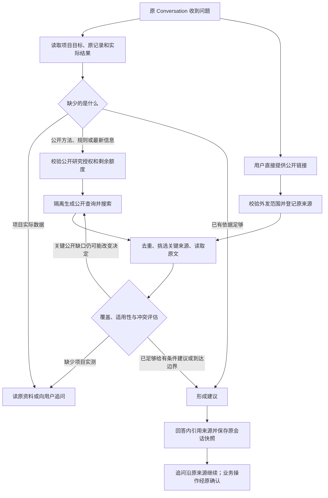

# PR-6 联网搜索接入调研与范围

调研与审查修订日期：2026-10-27（America/Los_Angeles）。源码基线：本地 `bf7ca1a`。状态：PR-6 规划 v2，已纳入用户提供的联网搜索审查；本文为待实施合同，业务代码与可执行 Schema 尚未接入。

建议复用现有 DeepSeek Search / Fetch，把公开资料检索接入“问忆程”的原调查循环。首个交付应能围绕项目问题规划查询，按中间观察修订调查方向，比较来源、解释冲突，在同一 Conversation 中给出有条件的建议，并把经确认的研究总结归入原 Artifact。主动事件仍沿用原 Anchor。

本次 `git ls-remote` 实查远端 `codex/r3-runtime-research` 仍为 `c8c7072d01598de6d7315697bd505d84e33cd8f6`，本地 HEAD 为 `bf7ca1a93c6b1fb5bf38b8e21d8cbf8edc2e3aaa`。审查方无法从远端核验本地新增文件的意见成立。独立代码审查前须提供可解析的固定提交或包含本地提交的审查包，并记录基线；本轮不推送分支。

## 1. 当前代码已经有什么

| 能力 | 当前事实 | PR-6 的工作 |
|---|---|---|
| 搜索与正文读取 | [searchProvider.ts](lib/research/searchProvider.ts) 已调用官方 `/v1/tools/search`、`/v1/tools/fetch`，请求限时 20 秒、响应限长，禁止认证重定向。 | 复用 HTTP 适配器，增加取消、调用元数据、费用与明确错误分类。 |
| 搜索返回值 | [contracts.ts](lib/research/contracts.ts) 目前保留 URL、标题、短摘要、日期、站点；长摘要和排序元数据被解析层舍弃。 | 保留有界 `summary`、`rerank_score`、`authority`；供应商评分只参与候选排序，不代表结论已证实。 |
| 原长期委托 | [researchTools.ts](lib/mission/tools/researchTools.ts) 已有 `web_search`、`web_fetch`，受 `MISSION_WEB_ENABLED`、版本化研究范围和原 Runner 控制。 | 提取可共用的查询/来源处理函数，保留原 Mission 调用与预算，不直接把 Mission 工具挂到聊天。 |
| 查询隔离 | 查询生成只收到批准的公开主题、概念和公开来源；[queryPolicy.ts](lib/research/queryPolicy.ts) 校验主题、排除词和公开 HTTPS URL。 | 保留隔离；私有聊天、附件、内部实验数值不进入搜索请求。关键词校验只是辅助，不能取代隔离输入。 |
| 网页快照 | [sourceRepository.ts](lib/research/sourceRepository.ts) 保存短摘要/托管正文、片段 hash、修订、抓取时间，旧观察保留。 | 复用归一化语义；普通聊天使用自己的原会话快照，不能借用他人或虚构 Mission。 |
| 普通 Focus 调查 | [toolAdapter.ts](lib/conversation/toolAdapter.ts) 仅提供项目检查、记忆检索、原资料读取、行动检查四项内部工具。 | 扩展 [调查合同](lib/types/agentExperience.ts) 和 [原循环](lib/conversation/investigationService.ts)，允许选择有界公开检索与来源读取。 |
| 来源展示 | [fileGuides.ts](lib/conversation/fileGuides.ts) 支持内部记录、附件和成果；[会话 DTO](lib/types/conversation.ts) 尚无网页来源元数据。 | Web/ArkTS 同步支持外部来源，旧文件指引保留。 |

官方现行文档确认已有两个独立 JSON 接口，因此“DeepSeek API 只能聊天、无法独立搜索”的旧经验不适用于当前版本。使用同一个官方密钥可以认证，不意味着普通聊天已经自动联网。[官方接口指南](https://api-docs.deepseek.com/guides/search/)

## 2. 搜索服务取舍

下表是本次核对的公开标价，单位为美元；免费额度、正文/摘要附加项、模型费用另计。接入优先级依据现有代码与运维成本，尚未通过中文/英文检索质量对照决定。

| 方案 | 能力与公开价格 | 对 ProjectMemo 的判断 |
|---|---|---|
| DeepSeek Search / Fetch | 搜索和正文分别 $0.75 / 千次成功且有结果的请求。[指南与计费](https://api-docs.deepseek.com/guides/search/) | 首选。已有代码与凭据路径；搜索与生成模型可以独立配置。 |
| Tavily | Search basic 1 credit、advanced 2；按量 $0.008 / credit，即约 $8 / $16 每千次；Extract 另计。[计费](https://docs.tavily.com/documentation/api-credits)、[接口](https://docs.tavily.com/documentation/api-reference/endpoint/search) | 作为后续对照供应商。固定深度与预算，避免自动参数升级改变成本。 |
| Exa | Lite $4、Auto $7 / 千次，基础含最多 10 条；Contents $1 / 千页/内容类型。[价格](https://exa.ai/pricing)、[搜索接口](https://exa.ai/docs/reference/search) | 公开论文、技术资料的备选对照；是否优于当前方案由同题实测决定。 |
| Brave | Search $5 / 千次，提供 Web Search 和面向模型的 LLM Context。[官方产品与价格](https://brave.com/search/api/) | 需要独立搜索索引作为备选时评估；首版无需增加第二套凭据。 |

按 DeepSeek 标价，4 次成功且有内容的外部请求约 $0.003 / 轮，1000 轮约 $3，仅为外部检索费用。“2 搜索 + 2 正文”只是其中一种分配，不是固定执行链。查询生成、调查和回答的模型调用仍消耗原模型预算，重试也须预留上限；这不是每轮总成本预测。

官方指南还对 Harness / Claude Code / Codex 的服务端工具注明北京时间 2026-11-01 00:00 开始按请求计费。产品预算按公布单价计算，不能把该说明推广成 ProjectMemo 的长期免费承诺。[计费说明](https://api-docs.deepseek.com/guides/search/)

首版直接调用服务端 HTTP 接口；MCP 是一种接入协议，不会增加搜索覆盖或替代产品权限。已有 Next.js 后端可直接复用适配器，暂不引入额外 MCP 服务、Python 服务或浏览器爬虫。

## 3. 开源实现参考

以下信息来自本次 GitHub 仓库元数据和原项目文档；stars 只用于满足活跃项目筛选条件。GitHub 推送时间为 UTC。

| 项目 | 活跃与许可证 | 借鉴点 | 对照后保留的差异 |
|---|---|---|---|
| [DeepSeek Harness](https://github.com/deepseek-ai/deepseek-harness) | 263,691 stars；2026-10-23 推送；MIT。 | [Provider](https://github.com/deepseek-ai/deepseek-harness/blob/master/packages/web/web-deepseek-api/README.md) 与 [模型工具](https://github.com/deepseek-ai/deepseek-harness/blob/master/packages/web/tool-web/README.md) 分层；UI 用短摘、模型用长摘要；持久化来源展示元数据。 | 其可选 `ori_question` 会发送原问题，忆程不照搬；不引入其 Runner。文档披露 Fetch 不报告最终跳转 URL，不能声称独立验证了最终域名。 |
| [GPT Researcher](https://github.com/assafelovic/gpt-researcher) | 30,318 stars；2026-10-10 推送；Apache-2.0。 | [可替换检索器](https://docs.gptr.dev/docs/gpt-researcher/search-engines)、问题拆解、来源追踪；学术任务可组合网页与论文检索。 | 整套 Python 深研流程对首版偏重。[插件合同](https://docs.gptr.dev/docs/gpt-researcher/search-engines/retriever-plugins) 建议部分失败返回空数组；忆程必须区分“查无结果”与“服务失败”。 |
| [Vercel AI SDK](https://github.com/vercel/ai) | 27,548 stars；2026-10-28 UTC 推送；[实际 LICENSE](https://github.com/vercel/ai/blob/main/LICENSE) 为 Apache-2.0。 | [工具调用及结果回传](https://ai-sdk.dev/docs/ai-sdk-core/tools-and-tool-calling)，按来源显示引用。 | 复用设计思路，不迁移现有调查器、预算账本与业务确认。GitHub 的 license 元数据为 NOASSERTION，许可证结论依据实际文件。 |

这次没有复制外部源码、安装依赖或运行上述项目。

## 4. 一轮回答如何工作

模型决定是否搜索、补哪个信息缺口；服务端决定范围、工具参数、预算和来源访问。不会给每条消息固定附加搜索，也不会先给建议再寻找赞同它的网页。

### Research Coverage：是否值得继续调查

在原 turn 的调查状态中保存有界 `ResearchCoverage`，建议首版 schemaVersion=1；执行前转为共享可运行类型和负例测试。它是原调查的观察与决定，不是另一个永久研究计划。

| 字段 | 合同 |
|---|---|
| `questionHash / goalRef / scopeRevision / asOf` | 绑定原问题、目标、公开研究范围版本和用户要判断的时间。 |
| `facets[]` | 最多 8 个会改变决定的方面，如方法、数据/标注条件、指标、适用版本、资源投入、失败原因；每项有稳定 ID 和公开信息/项目事实类型。 |
| `coverage` | 每方面为 UNSEEN / SUMMARY_ONLY / PARTIAL / READ_SUFFICIENT / CONFLICTED / UNAVAILABLE / UNKNOWN；READ_SUFFICIENT 仅表示对当前问题读到足够内容，不把项目目标升格 VERIFIED。 |
| `evidenceRefs / missing / conflicts` | 绑定实际已读 sourceId、修订、片段与适用条件；冲突列出具体不一致的主张及其来源，不能只填“来源不同”。 |
| `nextDecision` | SEARCH_PUBLIC / READ_SOURCE / READ_PROJECT / ASK_USER / HANDOFF_MISSION / ANSWER_CONDITIONALLY / STOP。每次需说明信息需求、预期观察及它可能如何改变推荐。 |
| `stopReason` | SUFFICIENT_FOR_QUESTION / NO_NEW_INFORMATION / NEED_PROJECT_RESULT / CONFLICT_UNRESOLVED / BUDGET_LIMIT / USER_STOPPED / PERMISSION_REVOKED。停止时保留已有结果和关键未知。 |

例如比较分割模型时，方法、数据规模、标注方式、指标与算力条件分别核对；公开论文 A 的 Dice 与项目实验 B 的其他划分结果不能直接排高低。缺少同条件实验时转向项目验证，而非不断换词搜索。

检索出五条结果不自动表示充分。相同网页转载不算独立证据；摘要与正文不符时记录差异，以实际可读原文和适用条件修订结论。服务端验证引用和范围等结构约束，语义充分性与建议质量另做人工/冻结样本验收。

| 用户问题 | 合适的调查 |
|---|---|
| “这个实验下一步怎么做？” | 先读实验条件和已有结果；检索相应方法及局限，再提出适配本项目的比较或验证。 |
| “现在官方提交要求是什么？” | 优先查官方最新规则，读取有日期/版本的原文；不同版本冲突时明确说明。 |
| “我上次到底测了多少显存？” | 回到原记录/附件；外部网页无法回答用户实际测量值。 |
| “有没有更好的方案？” | 同时查适用条件、代价、失败条件与替代路线，结合目标和投入判断。 |

首个纵向切片支持项目对话，以及已定位到项目的 WORKSPACE 对话；完全无项目的公开问答需要独立的 owner/scope 合同，不用任意项目 ID 凑现有字段。

## 5. PR-6 必须冻结的合同

### 公开查询授权

- `llmContextApproved` 授权向生成模型提供上下文；新增的会话公开研究授权单独表达搜索外发范围。复用 `researchScopeSchema` 的主题、公开概念、排除词和域名语义，保存 owner、会话、关联项目及递增版本。
- 首次开启时展示将发送的公开主题；确认后在该范围内按需搜索、保留可关闭入口。后续已授权搜索不逐次弹窗；改主题、扩大范围或撤销时更新版本。
- 原生成模型可以依据已获授权的项目上下文分析；生成搜索词的请求只接收公开范围和允许使用的公开来源。主模型只选信息需求/公开研究方向，不能提交任意含私有正文的查询。
- 不发送原始聊天作为 `ori_question`，不发送 IP 本地化字段，不把密钥、文件名中的私人信息或未公开实验数值拼到查询或 URL。

### 用户提供 URL 的读取

- 用户在原消息明确提交的公开 URL 可独立登记为 USER_PROVIDED 待读来源，保存原 messageId、原字符串 hash、标准化 URL、owner、授权版本与来源 ID；不要求先搜索同一链接。
- URL 必须来自实际用户输入或专用链接输入字段。模型建议的网址只可进入待确认建议，不能冒充用户输入取得读取权限。
- “读这个链接”仅覆盖校验通过的公开链接读取，不顺带授权任意主题搜索、同域爬行或后台监测；已有公开研究范围更窄时先完成范围确认。服务器预算和当前权限仍适用。
- 校验 HTTPS、端口、身份信息和允许域名；带登录、签名、令牌或私有分享信息的 URL 不直接外发。仅删除片段或猜测链接“应该公开”不能替代检查；域名许可也不能证明目标页面公开。
- 登记、Fetch 前与结果发布前均检查范围；登记后仍由 `web_fetch(sourceId, revision, scopeRevision)` 读取，模型没有任意 URL 抓取权。
- arXiv 摘要页、GitHub README、动态网页只按实际所得内容回答。PDF/代码/动态内容读不全时标记范围，建议文件导入或已授权专用连接器；不根据标题推断全文，不绕过登录或站点限制。

### 来源归属与回读

- 原 Mission 的 `ExternalSource.missionId` 当前非空，继续服务原委托。首版聊天观察保存到原 `ConversationTurn.readManifestJson` / 消息来源中，不创建虚构 Mission，也不新建执行状态库。
- 把归一化函数改为可接收明确的来源所属范围；聊天源 ID 绑定实际 owner / conversation / turn / 内容修订。不能把会话 ID 当 Mission 外键。
- 共享来源 DTO 增加外部来源元数据：provider、请求 URL、可用时的最终 URL、标题、发布时间、抓取时间、读取层级、截断范围、内容 hash、研究授权版本。旧 DTO 无新字段仍可读；旧 PROVIDER_EXTRACT 记录兼容映射为正文片段，不升级成文档全文。
- 所有外部材料保持 `EXTERNAL_REFERENCE`，不能沿当前内部 reader 一律标成 `PROJECT_OBSERVATION`。来源可访问、内容适用、支持具体主张分别判断。
- 追问通过原 turn / message 读取保存片段，重新校验当前 owner、项目访问和研究授权；按 hash 回读原快照。源过期/修订时明确提示，重新检索形成新版本，不改写旧依据。
- 外部请求前后以及答案/提案发布前检查 scope 版本、停止状态和原会话身份。撤销后的迟到结果不能发布为可用来源，旧提案也不能绕过当前校验。
- 私有会话不自动并入项目公共历史；外部资料转成项目记忆、行动或委托，仍走原确认与持久化约束。

### 阅读级别与时效

| `readLevel` | 可以表达的已读范围 |
|---|---|
| SEARCH_SNIPPET | 搜索结果的短摘要提及某个结论。 |
| SEARCH_SUMMARY | 检索服务的长摘要描述了某个方法；尚未核对正文。 |
| FETCH_EXCERPT | 已取得网页相关正文片段，保留范围和截断信息，不代表读完整份论文或整个仓库。 |
| DOCUMENT_EXTRACT | 已有文档解析器确实返回指定页/章节及定位。首版不以托管 Fetch 冒充该能力，后续按覆盖实测增加。 |
| UNAVAILABLE | 未取得可核验内容，保留失败原因，不从标题生成确定结论。 |

`readLevel` 与 `retrievalMethod` 分开：若 Search 的 `need_content=true` 确实返回可读正文，标为 FETCH_EXCERPT，transport 记为 SEARCH_INLINE_CONTENT；不能把摘要或空 content 映射成正文。该级别描述阅读深度，不宣称请求经过 Fetch 端点。直接 Fetch 的 transport 为 PROVIDER_FETCH。引用再保存具体使用片段，不能只引用未读标题。[官方字段定义](https://api-docs.deepseek.com/api/search/)

时效快照区分 `publishedAt`、`fetchedAt`、`applicableEdition/version`、`effectiveFrom/effectiveUntil`、`effectiveStatus` 和 `supersededBy`。生效状态为 CURRENT / FUTURE / SUPERSEDED / CONFLICTED / UNKNOWN，并绑定支持该判断的实际片段；缺失适用期不能由发布日期或抓取时间补齐。

“现在的要求”优先核对官网对应届次/版本、实施日期和修订记录；`site:`、`lang:`、`after:`、`before:` 作为服务端校验的查询规划条件，不扩大已批准域名和主题。时间过滤可能遗漏旧发布但仍有效的规则，需回查原规则与后续修订；论文原始方法也不因年代早被一律排除。[官方查询语法](https://api-docs.deepseek.com/guides/search/)

跨轮复用保存的原片段时显示原抓取时间；读取缓存不能更新成“刚刚查证”。缓存可否用于本题取决于 asOf、内容修订、当前授权和问题时效需求，不按单一 TTL 判定现行有效；需要当前规则时重新取得来源，新版本与旧版本并存。

### 工具与预算

- 沿原 `investigationDecisionSchema` 扩展公开搜索与外部来源读取；`web_fetch` 使用已观察 sourceId 与修订，URL 从服务端原来源读取。模型不能自造 URL 或指定任意内网地址。
- 保留当前 QUICK / STANDARD / DEEP 总预算。增加外部请求次数、估计费用与实际结算字段；外部工具同样占用原读取次数和时长，查询生成也占模型次数，不能藏在 Provider 内无限调用。
- 建议 STANDARD 每轮外部请求最多 4 次，预算控制总资源，模型依据覆盖情况选择策略而非固定 2 搜索 + 2 正文。QUICK 现有总读取上限 1，按实际摘要或内联正文的级别回答；DEEP 沿原显式选择。
- 同查询去重、同 URL 去重；正文按需读取，结合剩余 24 条/24,000 字符观察总上限分配片段，给最终回答预留原预算。没有新信息或公开资料无法补足实际数据时停止。
- 为外部请求预留和结算预算，记录 provider / purpose / requestId / scopeRevision / 结果数量 / 耗时 / 费用与失败原因。保留当前用户额度约束，细分模型费与搜索费。
- HTTP 408/429/5xx 仅在剩余预算内有界重试；401/402 明确提示配置或余额问题，403/404 作为来源不可读处理。空结果、服务失败、取消和额度不足分别记录，不能全部返回“未发现资料”。
- 首版仍经固定供应商托管 Fetch。若以后增加本机 HTTP 抓取，必须额外处理 DNS/私网/重定向/端口/响应大小；现有 URL 字符串检查不足以证明直连抓取安全。

在相同资源上限下对照四种策略：一次 `count=10` 检索并选择性 Fetch；一次 `need_content=true`；两个互补方向再选读；按覆盖/冲突迭代修订。更大的 count 不增加当前搜索单次价格，但会增加响应量和模型处理成本；是否选择内联正文以命中、可读率、范围、延迟和费用实测决定。[参数与计费](https://api-docs.deepseek.com/guides/search/)

### 长研究的持久推进与恢复

现有 [POST turns](app/api/conversations/[id]/turns/route.ts) 等待 `submitConversationTurn` 执行；原 [turnService](lib/conversation/turnService.ts) 已保存 turn、幂等键、预占、停止标志与读回，超时中断标记 UNKNOWN/FAILED 并拒绝自动重发。这些机制不等于可在进程重启后从任意研究步骤续跑，PR-6A 必须补齐再扩大调查深度。

- 接收输入与推进原 turn 分开：短请求持久接受并返回原 turnId；原执行器按 checkpoint 推进。调度层只领取/唤醒原 turn，不新建 Research Runner；Next.js 请求内未等待的 Promise 不能作为持久调度。
- 使用数据库 lease / fencing / CAS 保证同 turn 同一推进者；消息发布、预算结算、步骤提交均校验执行代次、scopeRevision 和取消标记。部署时必须提供实际可用的推进服务与重启策略。
- 外部请求以稳定 operationId 记录 PREPARED / DISPATCHING / SUCCEEDED / FAILED / UNKNOWN，绑定输入 hash、来源版本与费用预占。HTTP 前持久记录发送意图；返回后先保存有界原响应/快照，再推进下一模型决定。不能只凭 argsHash 去重复用所有历史搜索。
- 页面关闭或断线后，重开按原 turnId 读取阶段和已保存结果，不重新提交模型或外部请求。工作进程重启后，仅从已确认完成的 checkpoint 接续未开始步骤；重复调度复用原结果。
- 请求已可能发出而结果未落库时记 UNKNOWN，保留预占，不能承诺外部请求 exactly-once。供应商不提供幂等/结果回查时，由用户明确选择追加预算后重查，或依据已有结果停止；新请求有新操作 ID 并引用原 UNKNOWN。
- 显式停止立即阻止后续派发，尽力 Abort 正在进行的请求；迟到结果不能发布为当前可用来源，也不能解除未知费用预占。保存必要审计不等于向用户宣布“未计费”。
- 原阶段事件有单调序号和实际时间：规划、搜索、读取、评估冲突、等待用户、停止/完成。轮询或流式断线可按序号回读；流只是展示通道，不承担任务持久性。研究里程碑没有可计算分母时不显示百分比。

### 有依据的回答

建议正文连接三件事：项目实际情况、外部来源中的适用结论、因此推荐的下一步。引用贴在具体结论附近，例如“该方法适合……[1]”；展开来源能看原 URL、日期和本次实际读取的片段。

网页内容按不可信资料放入数据消息，不进入 system 策略；网页内的“忽略规则”“创建任务”等文字没有工具权限。服务端检查引用 ID、片段 hash 和访问权限；这些检查只能证明引用绑定，不能代替结论是否受到原文支持的语义验收。

同题优先选官方文档、原始论文和维护方资料；需要比较时补充独立或反面来源。`authority`、搜索排名、来源数量都不能直接等同真实性。论文公开指标不能证明本项目达到同样指标，官方部署教程也不能证明用户已经部署成功。

Web 与 ArkTS 使用同一来源 DTO 和可信绑定；正文内轻量编号，回答末尾可展开“参考来源”。与已有项目文件指引可区分、可同时显示，不为简单回答强制增加整页来源卡片。输入区“云端分析”与“联网补充”含义分开，详细外发说明按需展开。

### 研究 UI、总结与原任务接续

`ResearchResult / Investigation View` 是原会话中的服务端可信投影：复用 investigation、evidence、comparison、question、approval、receipt 等语义块，模型选择组合、次序和强调。简单检索允许一段正文与引用，复杂比较再展示覆盖、冲突和条件；不新建独立研究页面或固定六卡模板。

“继续调查”绑定原 coverage/turn/scope 和新的有界预算选择；“为什么推荐”绑定原结论与证据；“进入项目验证”通过原 Mission/Action 预览与确认。外链 OPEN 从服务端原来源绑定读取地址，模型和客户端不上传任意跳转 URL。旧/撤权/已停止状态移除不适用操作，保留可读说明。

研究总结先保存在原私有会话为有界草稿，保留结论、适用条件、冲突/未知、来源 manifest、读取级别和修订。用户预览确认后复用 [Artifact repository](lib/repositories/artifacts.ts) 写入原项目成果并原子保存回执；增加面向 Conversation 的归入适配器，绑定 owner、目标项目、草稿 hash、原读集、授权版本和幂等键。不能调用仅接受 Mission 的归入服务并伪造 outputId。

已有 Mission 研究输出继续使用 [原 Artifact 归入流程](lib/mission/artifactAdoptionService.ts)。两条入口共享原成果与确认语义；私有来源的公开可见范围在预览中明确，失去权限的源不得通过旧总结重新公开。后续修订创建原 Artifact 新版本，不覆盖旧研究依据。

### Prompt V2 的研究职责

| 逻辑职责 | 允许的输入与输出 | 原执行位置 |
|---|---|---|
| SEARCH_DECISION | 根据目标缺口判断是否值得联网，保留选择内部读取/询问用户。 | 原 INVESTIGATE 决定；不是额外固定调用。 |
| QUERY_PLANNING | 只用批准公开概念/公开来源，形成互补查询方向、域名/语言/日期条件。 | 隔离查询 Prompt；不接收私有聊天和实验值。 |
| SOURCE_ASSESSMENT | 分别输出阅读级别、适用条件、时效、支持/反证/未定和具体冲突。 | 原调查评估，可与下一决定合并。 |
| INVESTIGATION | 更新 ResearchCoverage，并在预算内继续、转向、接续原任务或停止。 | 原 INVESTIGATE / GoalGap 循环。 |
| ANSWER_SYNTHESIS | 联合项目事实与外部依据形成有条件的建议，明确关键未知。 | 原 ANSWER；不能把摘要包装成全文核验。 |
| UI_PLANNING | 按实际研究状态选择解释、依据、比较、验证和结果块。 | 原 UI_PLAN，服务端重绑定操作和当前状态。 |

上述是逻辑职责，不能把六个名字直接变成六次模型调用或新计费 purpose。原 PromptSpec 分责、system/data 消息隔离、全消息预算、usage 未知预占和版本审计继续适用；联合调用仍记录包含的职责与各自 schema/policy 版本，公开查询职责保持输入隔离。

## 6. 与原 PR-6 主动能力一起交付

| 切片 | 范围 | 验收产物 |
|---|---|---|
| PR-6A（P0） | 公开范围、用户 URL、读取/时效合同、原会话快照、预算和原 turn 持久推进。 | 兼容/隔离、请求中断/重启/取消/UNKNOWN 不重放；不伪造 Mission。 |
| PR-6B（P0） | 多方向查询 → 选读 → Coverage/冲突评估 → 修订查询/转向项目 → 有条件停止 → 回答引用与追问。 | 三领域纵向流程；中间观察确实改变下一调查决定；简单任务少调用。 |
| PR-6B-UX（P0） | 原会话 Research View、真实进展、来源级别、为什么推荐、继续调查/准备验证。 | Web/ArkTS 同状态与绑定，断线恢复显示原步骤，旧消息/草稿兼容。 |
| PR-6C（P1） | 原授权 GitHub/实验/公开观察进入 Anchor；研究总结确认归入原 Artifact。 | 目标关联、去重与 FOLLOW/LATER/STOP；成果 manifest/版本/可见性与幂等回执。 |
| PR-6D（P0） | 跨语言/来源覆盖、恢复与总费用对照、双端交互、部署配置与回滚准备。 | 模型质量、工程检查、模拟器/目标设备、ECS 各自回执；独立审查使用可核验基线。 |

“用户在会话开启联网”不自动授权后台定时搜索。主动监测需要原连接或 FOLLOW 对应的明确范围、频率、额度和停止方式。首版可以先接入已合法到达的变化，不承诺扫描互联网或自动发现本机实验文件。

## 7. 验收重点

工程验证覆盖：关闭联网零外部请求；公开查询输入隔离；跨 owner / conversation / Mission 不可读；撤权和停止后的迟到结果；同请求幂等与费用；私网 URL / 注入网页；空结果、402、429、超时；来源修订、截断、原快照回读；外部来源不升格项目事实；原行动仍须确认。

质量对照保留原 12 道开发回归题（科研、竞赛、课程各 4），另冻结至少 24 道独立覆盖题；两者分别报告，独立题提前可见或用于修 Prompt 后转开发集，不能混算留出成绩。独立题按六场景各至少 4 道：中文官方规则、英文论文、GitHub 项目、中文技术实践、同名消歧、长尾专业问题。覆盖用户 URL、PDF 不可读、版本生效冲突、摘要与正文不一致、查询修订后命中、互相矛盾及部分服务失败。

同模型配对比较内部资料、联网摘要、覆盖驱动调查；另在冻结子集对照 count=10 / 内联 content / 互补查询 / 迭代查询策略，统一总资源上限。记录原输入、scope、Prompt/schema/provider/model、检索时刻和原响应；网页会变化，线上覆盖与固定响应回放的恢复测试分别报告。样本与期望在运行前锁定，不后验挑题或删掉失败。

指标分别记录：官网/原始来源命中、关键条件覆盖、消歧、实际阅读级别、适用版本/生效状态、冲突识别、引用支持、建议可执行性、研究新增价值、用户操作/中断成本、每目标总调用/费用、端到端与恢复耗时。搜索次数和 JSON 成功率不当质量分数；隐私泄露、越权、未经确认或重复业务写入为零容忍。质量由独立评分验收，不能只由 Prompt 作者自评。

工程故障集另覆盖：DISPATCHING 前后进程中断、响应到达/落库前中断、断线后重复 POST、双推进者竞争、取消与迟到响应、scope 变更、来源 superseded、缓存回读不改抓取时间；明确断言没有无意重发、重复结算、重复消息/成果或错误“已完成”。

本次只核对源码、官方网页和开源文档；没有测试真实搜索命中质量、ECS 网络或付费供应商延迟。上一阶段模型账本仍为 44/48，本次新增调用 0；未来实测继续沿原额度或用户另行批准的预算，不重置账本。

完整质量矩阵需要的调用数将超过当前剩余 4 次。运行前先输出 PREPARED_ONLY 清单，计算模型、Search、Fetch 的独立上限和总费用；未获足够追加额度时继续合同/隔离恢复/双端验证，不缩减样本后宣称完整验收。

下一步实施从 PR-6A 的授权、URL、来源与可恢复 turn 合同开始；PR-6B 证明中途观察会改变调查路线，PR-6B-UX 同步原双端体验，PR-6C/6D 完成原成果沉淀、事件与独立质量验收。第二 Provider、专门学术检索、PDF 深读和仓库代码研究由覆盖实测决定。
