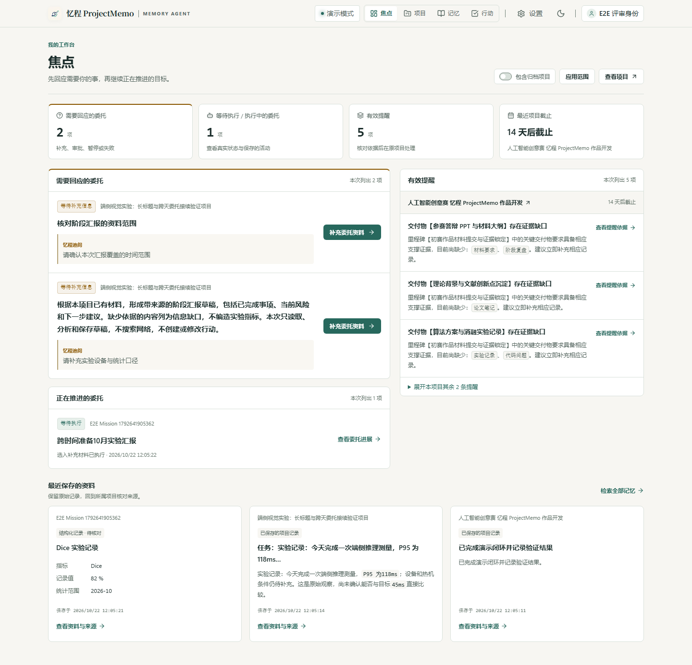

<div align="center">
  
  <h1><a href="https://project.luojiatutor.xyz/">忆程 ProjectMemo</a></h1>
  <p><strong>把一个长期目标交给忆程，带着项目记忆继续下一步。</strong></p>
  <p>记录资料、追踪变化、委托研究；离开之后，进度、草稿和确认记录仍在。</p>
</div>

你准备一份科研阶段汇报，忆程读完资料后发现实验口径不足，停下来追问。第二天补上实验记录，你可以回到同一个委托，核对新材料、修订计划，再继续生成带来源的草稿。

研究结果、用户确认和现实行动的完成分别记录，方便你知道下一步该由谁来做。

## Demo

[打开 Web 工作台](https://project.luojiatutor.xyz/) · 需要账号。线上版本随发布更新，本页描述当前仓库实现。



截图来自本地隔离测试项目，使用 mock 数据；不是线上真实项目或真实模型的运行效果。

## Install

自行运行需要 Node.js 24。下载仓库后安装依赖：

```powershell
git clone https://github.com/Leionel/projectmemo.git
cd projectmemo
npm.cmd install
```

## Quickstart

在全新的本地目录首次初始化：

```powershell
if (!(Test-Path .env)) { Copy-Item .env.example .env }
npm.cmd run db:setup
npm.cmd run dev
```

打开 [本地工作台](http://127.0.0.1:3000)。开发模式默认账号 `contest-demo`，默认口令 `contest-demo-2026`，用于本机体验；生产环境须自行配置账号。登录后创建自己的项目，记录第一条资料。

`db:setup` 会应用迁移并导入演示素材。已有数据库的升级方式、鸿蒙后端地址与部署说明见 [开发与运行说明](DEVELOPMENT.md)。默认 mock 可体验资料整理和页面流程；长期委托的自主执行需要另行配置模型与 Worker。

## 从四个入口开始

| 入口 | 在这里做什么 |
| --- | --- |
| **焦点** | 回应等待补充或审批的委托，查看暂停原因，继续进行中的目标，处理所属项目的行动与提醒。 |
| **项目** | 围绕一个项目，使用概览、委托、资料、行动和成果五个工作区。 |
| **记忆** | 跨项目检索已保存的资料，回到原项目查看来源、当前结论和演进记录。 |
| **行动** | 集中查看未完成行动与有效提醒，进入原项目处理并记录实际结果。 |

Web 适合深度阅读、资料管理和成果审阅；HarmonyOS 适合随手记录、查看状态、补充资料与轻量审批。两端使用同一个后端，设置在个人工具入口。

## 委托一个目标，持续协作

- **按目标推进：** 忆程可选择项目检索、资料读取、公开研究与草稿工具，执行历史保存在同一个委托中。
- **缺信息就等待：** 提问与已有成果保留，补充材料后可核对是否满足缺口，再接续任务。
- **重要写入由你批准：** 行动提案与成果归入在原流程确认；材料接续遵守委托内授权，公开研究范围与云模型上下文分别授权。
- **草稿回到项目：** 审阅后将成果归入现有文档，保留版本和来源，后续工作还能继续引用。

委托入口、网络研究与自动接续由服务端开关和个人授权共同控制。草稿保存、成果采纳和现实行动完成各有自己的状态。

## 让项目记得为什么改变

资料可以保留原始记录与附件修订；结论可查看依据、争议与被取代的关系。项目状态支持与明确“已了解”的基线比较，行动完成可写下结果并形成复盘记忆。

来源存在不代表结论已证实，采纳一份成果也不会自动把其中每句话变成项目事实。

Project Twin、Decision Lab、GitHub Sensing 和 Experience Learning 属于后续 R4 规划，未作为当前可用能力展示。鸿蒙设备上的安装、通知、无障碍和触摸体验仍需设备验收。

## License

仓库目前未提供项目开源许可证；字体等第三方资产遵循各自随附许可。
