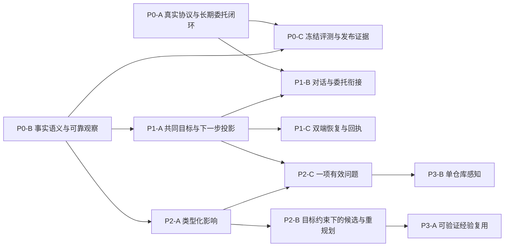

# ProjectMemo Agent 增量演进路线图

审查基线：`c93da467`。日期：2026-10-23。本文是实施建议，没有领取或执行新的业务开发包；不替代现有 R3/R4 的发布放行记录。

## 1. 先做什么

优先顺序：**真实任务可靠性与事实语义 → 现有模块共同选择下一步 → 有依据的变化与重规划 → 有证据的经验复用或外部感知**。

若只能实施三个增量，选 P0-A、P0-B、P1-A。前两项让一个真实委托值得信任，第三项让用户在项目入口自然继续它。P0-C 的评测从第一项开始记录，而不是等全部功能做完才测。

本轮不建议增加 Agent 一级导航、新 Runtime、新 Planner/Executor、第二套持久状态机、通用事件总线、图数据库或向量数据库。`AgentMission` 继续拥有执行状态，Ledger 拥有关系语义，Action/Artifact/Receipt 继续拥有业务结果。

### 1.1 当前事实与不重复开发的范围

| 已有能力 | 当前源码与阶段记录 | 本路线图保留的边界 |
|---|---|---|
| 模型逐步选工具、Worker、步骤/事件/租约、暂停/恢复 | `lib/mission/runner.ts`、`modelAdapter.ts`、`runtimeStore.ts`；R3 WP-10/12 | 不重新建设“长期任务引擎”；真实供应商往返与进程恢复仍须验收 |
| 固定提案、用户批准、幂等 Action 创建 | `lib/mission/approvalService.ts`；R3 WP-11 | 已批准创建待办不等于现实任务完成 |
| 等待问题、补料关联、充分性评估、人审接续 | `continuationService.ts`、`sourceSignals.ts`、`gaps.ts`；R3 WP-30 | 自由文本恢复只触发重评，不能直接代表材料充分 |
| 受限自动接续 | `continuationService.ts:78–109` | 只覆盖预授权、单项结构化项目指标；不是通用后台目标跟进 |
| 来源版本重查 | `repository.ts:22–45`、`readSetValidator.ts` | 卡片哈希已包含来源与关系的 effective 状态，不重提“直接来源完全无版本保护” |
| 私有 Output、逐句核验、固定版本成果归入 | `outputService.ts`、`claimVerifier.ts`、`artifactAdoptionService.ts`；R3 WP-21/31/32 | 有核验 Adapter 不等于真实 Judge 质量合格；保存/归入不升级项目事实 |
| 时态 Ledger 与原始资料/附件修订 | `temporalLedger.ts:16–26,95–175`、`temporalLedgerService.ts:59–88` | UNKNOWN 不是 FALSE；人工来源确认是声明注记，不自动变 TRUE |
| Web/ArkTS 委托、概览摘要、全局焦点、五分组导航、首委托起步 | Pre-R4 P10/11/20/21/22、F1–F4；`R4_UX_INTEGRATION_CONTRACT.md:19–62,171–180` | 不再把“曝光已有 Mission”和“新增全局焦点”列成待开发功能 |
| 行动结果回写 | `actionService.ts` 的完成事务与 `resultCardId`；R3 WP-31 | 复用结果链，禁止由工具返回成功或 CI 通过自动设置 DONE |

### 1.2 本轮重新确认的阻碍

1. **真实服务证据不足**：历史协议修复回执明确 `live_model_tested=false`；旧 ECS 两次 `MODEL_PROTOCOL_ERROR` 缺少细类，不能追认根因为截断。已有严格 Schema、有限纠错与 usage 结算应先复验，不再用宽松 JSON 或无限重试掩盖问题。
2. **可信语义没有贯穿所有消费方**：Copilot 的 `TrustReceipt` 主要是引用准入，`evaluateClaim` 不读取来源文本，UNKNOWN+current 仍可支持 Claim（`trustReceipt.ts:39–83`）。Mission 已有更细的逐句规则/Judge，不能把两个 `SUPPORTED`/`ENTAILS` 当同一个证明。
3. **观察可能不完整或过期**：Mission 的 `inspect_project` 只读前 20 条行动；301 张卡片即拒绝；上下文裁剪丢弃最早观察（`tools.ts:15–31`、`contextBuilder.ts:7–23`）。Snapshot 的缓存身份未覆盖关系时间跨界（`buildSnapshot.ts:67–80`、`projectStateService.ts:294–299`）。这些均不是增加漂亮图表可以解决的问题。
4. **下一步存在多个选择器**：Reentry 的优先级不读取 Mission（`projectReentryService.ts:232–260`），概览另外读取 Mission。可出现“一边等回答、一边建议新行动”。已有入口应共享只读选择结果，而非再加一张巨型 Agent 卡片。
5. **目标联系薄弱**：`Project.goal` 与 `AgentMission.goal/successCriteriaJson` 各自存在，当前没有共同的阶段关注目标或目标绑定修订（`schema.prisma:98,896–897`；`contextBuilder.ts:20`）。Copilot 输入不含对话历史、Mission 或等待问题（`copilotService.ts:180–189`）；每次回答后只能单次行动/成果提案，不能自然继续原委托。

相关可复现证据见 [Memory 与上下文审查](working/MEMORY_EVIDENCE.md)，完整能力及评测边界见本目录其他审查文档。源码行号对应本基线，后续按函数重新定位。

## 2. 阶段与依赖

P0/P1 的小规模联系改造不等待完整 Twin/Lab。P2 在 P0 语义与可重复真实任务达标后扩展；P3 根据实测价值择项，不默认全部纳入比赛范围。现有 R4 的工时是旧范围估计，本文不把拆包后的工时相加承诺截止日期。

### 2.1 价值、成本与比赛风险排序

成本为相对工程量：S=窄适配/专项回归，M=涉及数个模块及双端契约，L=含持久契约、跨模块事务或新求值器。它不包含等待供应商、设备或人工标注的自然时间；领取时按当前 diff 冻结具体估时，不重复计算已完成工作。

| 顺序/包 | 用户价值 | 创新证据价值 | 工程成本 | 依赖与比赛风险 |
|---|---|---|---|---|
| 1 / P0-A | 委托能完成、失败能恢复、确认不重复 | 直接证明动态工具和长期执行 | M–L | 复用 Runtime；真实服务是首要风险，不可用新 UI 遮蔽 |
| 2 / P0-B | 不错用旧记录，知道哪些结论尚未核验 | 项目自己的时态/证据差异最直接 | L，可先拆窄时间/上下文修复 | 与P0-A并行准备；语义变更需防过度拒答 |
| 贯穿 / P0-C | 结果可信且可复现 | 为所有创新提供同条件对照 | M，逐包增量 | 先冻结任务；不应最后才收集失败分母 |
| 3 / P1-A | 进项目就知道等什么、继续哪里 | 把L4机制变为可感知的持续协作 | M | 依赖可靠观察；低于新Twin/Lab的工程风险 |
| 4 / P1-B | 不反复说明同一任务 | 任务型对话与恢复联系 | M | 依赖P0-A/B和P1-A；防重复新建委托 |
| 5 / P1-C | 双端继续、不丢回执 | 已有原生价值的运行证明 | S–M，设备验收另计 | 可以随P1-A/B补证；比赛设备不可用时单列未验收 |
| 6 / P2-A | 新证据能精确定位需复核对象 | 类型化跨层影响的核心差异 | L | 依赖P0-B；先窄纵切片，避免全图闭包 |
| 7 / P2-B | 比较可执行方案、保留原任务 | 从影响走到有条件的决策 | L；排程按需另拆 | 依赖P2-A与P1联系；多候选、事务采用、版本竞态风险较高 |
| 8 / P2-C | 少打扰、问题能推进任务 | 主动选择缺口而非只提醒 | M | 依赖P1-A/P2-A；先用应用内问题验证价值 |
| 9 / P3-A | 同类新任务少走弯路 | 需真实留出结果才成立的研究价值 | L | 真实正负轨迹不足时先只交索引；比赛收益不确定 |
| 10 / P3-B | 软件项目减少手工录入 | 场景整合价值，非原创感知算法 | M–L | 按用户需求可与P3-A换序；凭据/外部语义与噪声风险较高 |

## 3. P0：真实 Agent 可靠性与核心闭环

### P0-A：用现有 Runtime 走通可恢复的真实委托

实施状态（2026-10-24）：本地工程、隔离回归、双 OS 恢复与 HTTP fixture 已完成；ECS 内部合成任务已完成一项历史成功与两项修复后恢复成功，累计23次真实调用；不是新版本从零三次独立成功。原始结果已归档到 `evidence/p0-c/20261023-live-recovery/`。当前代码与证据见 [P0-A/B实施记录](P0_AB_IMPLEMENTATION.md)。以下审查问题保留为基线。

- **真实问题**：已有本地执行机制，缺少当前供应商完整工具往返、缺口追问、补料恢复与固定结果的重复证据。历史协议失败只能证明曾失败，不能说明当前修复已生效。
- **涉及与复用**：`modelAdapter.ts`、`modelProtocol.ts`、`runner.ts`、`runtimeStore.ts`、`contextBuilder.ts`、`continuationService.ts`、`resultVerifier.ts`、原 Worker 与两类 Provider 探针；不新增执行器。
- **最小增量**：扩展现有探针为“模型决策→实际只读工具→观察返回→再次决策”，记录协议模式、schemaVersion、tool schema、finish reason、输入/输出预算、usage、纠错次数与有分类的错误。将固定成功条件与结果中未核验/有争议的声明并列展示；当前工程状态不重新解释为事实已经验收。另关闭遗留 Copilot 确认写入的窄缺口：`withProposalLock` 是进程内 Map，`createAction` 先提交、`executedProposals` 后另写事务（`copilotService.ts:322–345,381–438`）；为固定 sourceRun/proposal 绑定持久唯一意图，短事务内来源版本重验、业务与确认回执原子提交，长模型请求放事务外。复用 Mission 的模式与现有 Action/Artifact 领域服务，不把 Mission 的强保证外推到所有旧写路径。
- **双端影响**：Web/ArkTS 使用同一错误 code、可恢复动作与 Mission ID；显示“执行已完成/草稿待核对/还缺信息”各自事实。保持现有暂停、继续、补料、批准命令及 requestId，不新增顶层状态枚举。
- **风险**：供应商原生工具与 JSON 路径不等价；输出预算不足、工具参数失败和模型拒绝需分开；更多纠错可能消耗预算。最大一次纠错保持有界；权限/来源失败不得模型重试绕过。
- **测试方法**：Mock 覆盖截断、Schema、未知工具、无效参数、usage 缺失、超时、工具失败、重复观察、无效循环和预算。独立库用真实两个 OS Worker 做租约/fence/宕机恢复；Copilot 另测不同进程同时确认、业务提交后响应/回执故障、来源已变、同 requestId 异载荷，不能以同进程 Promise 并发替代。当前 Copilot 风险由源码确认，本轮未做新双进程复现。获明确额度授权后，按评测协议跑内部整理、缺私有指标、带批准行动三类固定任务，每类至少三次，全部保留失败。
- **可验收结果**：至少一条真实模型驱动“目标→读取→发现缺口→追问→补料→同 ID 接续→带出处草稿→用户审阅/归入”的完整轨迹可重复；可选行动经过确认，现实完成另由用户填回执。协议成功率与任务成功率分别报告，不预填数值。
- **回退**：失败后暂停原 Mission，保留步骤/Output/usage；用户可补料或人工查看。关闭有问题协议模式或外部工具，不把 mock-fallback 命名为真实成功。
- **旧包映射**：R3 WP-00B/10/11/12/20/21/30/31/32/50；R4 W0/W6。属于已有承诺的验收与窄修复，不是新一轮 Runtime 建设。

### P0-B：统一引用准入、语义支持与时态观察

实施状态（2026-10-24）：只读评估轴、双端文案、Snapshot 有效期、Reentry 新鲜度、分页与上下文裁剪已实现并完成本地回归；真实 Judge 质量评估未执行，开关默认关闭。见 [实施记录](P0_AB_IMPLEMENTATION.md)。

- **真实问题**：Copilot 的 `SUPPORTED` 不代表语义蕴含；给模型的卡片没有时态元数据；Snapshot 可能跨有效期复用旧状态；Mission 观察可能因条数和裁剪遗漏关键事实。
- **涉及与复用**：`temporalLedger.ts`、`trustReceipt.ts`、`claimVerifier.ts`、`claimJudgeAdapter.ts`、`buildSnapshot.ts`、`projectStateService.ts`、`hybridSearch.ts`、`mission/tools.ts`、`repository.ts`、`contextBuilder.ts`。Ledger 仍是时态规则来源。
- **最小增量**：先加版本化只读 `EvidenceAssessment` 适配，分列 `citationAdmissibility`、`temporalState`、`semanticVerdict`、`knowledgeClass`、来源版本/时间/文本范围。旧字段继续兼容但不在 UI 宣称“已核验事实”；语义 UNKNOWN/NOT_CHECKED 不等于反证。让 Copilot 复用已有受预算规则/Judge，不另建通用 NLI 平台。Snapshot 比较已构建的 contentHash 或完整时间分区，并给出 `nextInvalidationAt`。工具增加 coverage/游标/未覆盖对象与必要依赖定向读取；上下文保留当前目标、约束、未决问题、否决、关键来源，尤其不能在 `data.slice(0,1600)` 中截掉来源的时态标记（M4已纯函数复现）。裁剪清单可读；复用现有 AgentRun.trace 持久轻量 manifest：hash、goal/context/plan revision、source hashes、included/excluded stepIds、schema/promptVersion，不存敏感全文或新建状态表。
- **双端影响**：两端引用展示相同评估轴与明确的未知/历史/争议文案；旧客户端缺新字段时按未核验处理。附件原文、修订和人工来源声明仍分别呈现。
- **风险**：把所有 UNKNOWN 一律拒答会使孤立真实记录不可用；直接开启 semantic 检索可能外传/回填缓存并超预算；用最新 Top-N 代替 300 卡上限会丢旧依赖；修改 Snapshot 解释需升级 schema/policy 并保留旧版本。
- **测试方法**：纯函数与独立库覆盖无关引用、相反数字/否定、同项目错误来源、UNKNOWN、CONTESTED、SUPERSEDED、来源确认不变 TRUE、有效期跨界、孤立/归档记录、301+ 卡、关键旧来源、裁剪后否决保留、来源变动与跨用户隔离。Judge 另做双人标签/留出任务，规则/模型/人工裁决分别计数。
- **可验收结果**：来源仅存在不能获得语义“已支持”；同一来源/关系在 Mission、Copilot、State、Reentry 的评估语义一致；有效期跨界不再回旧快照；截断不会静默冒充完整上下文。信息足够时正常回答，不靠全部拒答过关。
- **回退**：新语义核验关闭时明确未核验并保留来源，不能回退到“已证实”；新投影关闭保留原记录/快照，关键写入来源保护继续启用。
- **旧包映射**：R3 WP-21/30/32 的适配补充；R4 W0 前置、W1 中 C05/C06/C07/C08。现有 W1 的正确性子包前移，不要求先建完整 Twin 图。

### P0-C：把测试结果转成可复现的任务证据

实施状态（2026-10-24）：最小收口已归档真实模型原始结果、累计账本与内容审阅摘要，冻结十类任务入口；人工语义、完整留出集及设备验收仍未完成。

- **真实问题**：工程通过、真实模型质量、用户理解、设备行为和生产启用经常来自不同版本，不能相互代验。
- **涉及与复用**：已有任务 fixture、`scripts/eval-claim-checks.ts`、Provider/Search 探针、Runner、现有 AgentRun/Step/Event/Output/Receipt、R3 WP-50 规格和本目录评测协议。`scripts/eval-missions.ts` 已在 P0-A 实现并完成 ECS 接续验证；P0-C 复用该入口，补齐冻结清单与版本证据。
- **最小增量**：新增薄 `eval-missions` 入口串联上述实际模块；一份冻结 task manifest 与机器可读 trial/result schema，记录 commit+dirty hash、数据/来源快照 hash、模型与协议、授权预算、实际工具、错误、预标成功条件、人工标签；公开结果只保留脱敏必要轨迹。不建立第二套 Runner 或相互独立的评分系统。
- **双端影响**：对同 Mission/Action/Output/Receipt ID 和版本做交叉读回；原生场景加冷启动、弱网、切身份与会话失效，不用静态截图替代操作证据。
- **风险**：难任务从分母消失、开发/留出混用、同一重试当独立样本、模型自评当人工真值。正确等待与过度拒答分开记分。
- **测试与验收**：先完成正常/缺料/冲突/取代/协议失败/工具失败/中断/重试/拒绝/新证据失效十类用例；至少一个完整主故事留下可复现原始轨迹。各项分母、成本、失败和置信区间按实际样本报告；没有实测就保持空值/未验收。当前主线程测试只证明当前工程回归。
- **回退**：未通过缩小可交付范围，保留失败；不删除任务、不用录屏补真实模型/设备 Gate。
- **旧包映射**：R3 WP-50/51、R4 W0/W6；贯穿 P0–P3，避免三个独立评测入口。

## 4. P1：让 Agent 成为现有页面的协作主线

### P1-A：同一个项目目标和下一步选择结果

实施状态（2026-10-24）：统一只读投影、个人关注委托与两端入口已实现；本地隔离回归、Web端到端、双端契约、鸿蒙单测与构建通过。真实设备与生产部署未执行，验证记录见 `P0_C_P1_A_IMPLEMENTATION.md`。

- **真实问题**：Reentry、概览焦点与 Mission 摘要分别选下一步；项目目标与委托目标没有显式联系。入口已足够，继续新增入口不能修复冲突建议。
- **涉及与复用**：`projectReentryService.ts`、`mission/workspaceSummary.ts`、项目 Attention/Focus 投影、`projectHealthService.ts`、现有概览/委托/接续组件；不复制状态。
- **最小增量**：建立有界只读 `ProjectAgentContext`/`nextStep` 选择函数，输入现有服务事实，返回 goalRef、attentionKind、entityRef、reason/evidenceRefs、observedAt、freshness、fallbackReason。优先处理需用户回答/批准/失效来源，再继续原任务，最后提出新行动。第一版只允许用户选择当前关注 Mission；goalRef 绑定 `Project.goal` 内容指纹与 Mission ID/planRevision。确有多阶段目标需求时才加带 revision 的关注目标配置，不先造目标 DAG。
- **双端影响**：概览、Reentry 与焦点展示相同实体和理由；一处主操作，其余按现有分组定位。先修 Web 焦点 `MissionGroup` 没有渲染 READY/RUNNING 分支的具体缺陷：上层传了 running，当前43、98–107行只展示 pending/stopped，导致正在做的任务从此处消失（本轮产品 SSR 探针已复现，见 `evidence/agent-review/c93da467/product/focus-mission-ssr-result.json`）。这不是重新做一次泛曝光。原生摘要错误明确“暂不可用/上次同步”，不以 null 当作没有任务；不把所有模块塞入巨型 Agent 卡。
- **风险**：读取聚合放大首页延迟/泄漏私有 Mission；时间戳自身不应导致来源不断变化。OWNER 筛选先于计数，最多保留现有有界摘要；不在 GET 运行模型或自动新建任务。
- **测试方法**：等待输入+旧安排、待批准+风险、来源失效+运行中、READY/RUNNING确实有行且深链到原任务、空项目、无权限、超时/部分失败、切用户及迟到响应；共享选择器一致断言和 Web/ArkTS DTO 契约；小测用户能否复述“当前目标、Agent 在等什么、下一步”。
- **可验收结果**：同一观察版本两端和三个入口只给同一首要下一步；点击回同问题/提案/Mission；用户不必理解模块名即可继续。没有证据证明“60 秒”前，只将其当用户测试目标。
- **回退**：关新投影回到现有分区，但保留不可用提示与权限；不写第二套 Mission 状态。goalRef 可空兼容历史任务。
- **旧包映射**：Pre-R4 P10/11/20/22 的剩余联系，R4 W4/W5 的前置。前移到 Twin/Lab 前，避免重做已完成五导航和曝光。

### P1-B：Copilot 回答、提案与长期委托的最小衔接

实施状态（2026-10-24）：本地实现及隔离验证完成，见 P1_BC_IMPLEMENTATION.md；真实模型任务识别误转/漏转率未评估。

- **真实问题**：Copilot 是一次提问和两种提案，未读当前 Mission/等待问题，也无转委托路径；同项目上下文可能被反复说明。
- **涉及与复用**：`copilotService.ts`、`MemoryCopilot.tsx`、ArkTS Copilot 服务、`missionService.ts`、原创建/命令/批准/接续接口、P1-A 投影与 P0-B 评估。
- **最小增量**：对回答增加可选、严格枚举的 `continuationSuggestion`：回答、打开现有任务、预填新委托。建议绑定 projectId、来源 runId、目标文本/条件和选定 Mission 引用；用户预览/修改后调用原服务创建或继续，稳定 requestId 去重。只带有界、同用户授权的近几轮显式消息及未决约束，不全量迁移聊天库，不从聊天推断长期人格。原行动提案可编辑后应生成新预览与新 hash，不能批准时任意改载荷。
- **双端影响**：两端提供“继续此委托/交给长期委托”动作、预览与返回来源对话的链接；复杂研究留在 Mission 详情，聊天不承担整个工作台。只显示可观察工具预览与回执，不显示隐藏推理链。
- **风险**：每句问话都变委托、重复任务、旧对话放宽权限、编辑提案绕过冻结。纯问答不创建 Mission，已存在任务优先关联，授权独立确认。
- **测试方法**：纯查询零业务写、同提问重试、已有等待任务、用户拒绝/编辑、新旧来源变化、跨用户历史、长度裁剪与否决保留；两端对同 requestId/来源 run 读回；真实模型意图分类另评估误转委托与漏转率。
- **可验收结果**：用户可由一次任务型提问进入原 Mission 的可恢复执行；既有问答/登录/工作台契约保留，模型没有批准权限。
- **回退**：隐藏新建议类型回现有两种提案与问答；历史建议可读，未确认不写入。
- **旧包映射**：R3 WP-21 的上下文补齐、Pre-R4 P22、R4 W4；不是另建 Planner，也不是把聊天框放大。

### P1-C：两端完整读回和失败恢复

实施状态（2026-10-24）：本地实现及实际 ArkTS 服务/Next 路由往返验证完成；设备、非开发网络与平台 Gate 保持开放，见 P1_BC_IMPLEMENTATION.md。

- **真实问题**：摘要失败或本地缓存可能被呈现为“没有委托/当前状态”；跨端事实一致不等于设备操作已验收。
- **涉及与复用**：现有 Mission/Focus/Reentry services、ArkTS session/cache/lifecycle、原 Action 完成与成果固定版本链接。
- **最小增量**：只增加读取状态适配（fresh/lastKnown/unavailable）及观察时间，不新增业务状态；失败保留明确的上次结果，401/撤权清空私有内容；精确定位 question/approval/output revision/receipt，原命令不变。
- **双端影响**：Web 发起、鸿蒙补料/批准/继续、Web 查看同一成果及现实回执；已受理、运行中、完成、归入和现实结果分开。
- **风险**：迟到响应复活旧身份缓存、弱网重试新建重复写、把工程成功当设备成功。
- **测试与验收**：共享 DTO、401/403/409、网络重试、切用户与冷启动故障；授权设备上操作同 ID、相同版本与回执，非开发网络验证；签名/设备/平台各自记录状态。
- **回退**：保留原精确链接和历史读取，隐藏无法可靠使用的新动作；不清理用户历史或撤销已提交业务。
- **旧包映射**：R3 WP-40/41/42、Pre-R4 P21/P31/F4、R4 W4/W6。已有原生功能不重复开发，重点关闭开放 Gate。

## 5. P2：新证据能改变建议，而不是只增加提醒

### P2-A：窄范围类型化影响及失效保护

实施状态（2026-10-24）：本地实现与隔离验证已完成，最终回归/发布状态见 `P2_IMPLEMENTATION.md` 和 `evidence/p2/validation.json`；真实模型、设备和生产验收未执行。

- **真实问题**：ChangeImpact 当前是一跳关系/标题启发式，并无条件将最近三份成果列入复核；已持久化而非仅 Map。Mission 能重查直接来源，但间接依赖和及时定位不完整。
- **涉及与复用**：Ledger、ActionRequirement、DeliverableEvidence、成果块来源、`changeImpactService.ts`、`meetingStateDiffService.ts`、`readSetValidator.ts`、`continuationService.ts`、原 Worker。
- **最小增量**：执行旧 W1/W2 的首条纵切片：同一事务采样的只读 typed projection/ImpactAssessment，区分支持变化、需复核、硬前提不满足、计划陈旧；一个源变化→两层依赖→一个成果块→一个 Mission。必要 `ProjectImpactJob` 只是持久补偿意图，源变更事务写入，由原 Worker 消费；没有第二 Runner。关系/来源和执行硬依赖不同，支持关系不做无条件传递闭包。
- **双端影响**：概览摘要给根因和受影响对象，详情按需展开；Mission 显示哪些未执行步骤需重评，成果只标相关块。旧成功步骤、Output 和 DONE 回执不回写为“未执行”。
- **风险**：SUPERSEDED 当假、来源追溯当硬前提、证据环自证、Job 重试反复 bump planRevision。未覆盖或不支持语义返回 UNKNOWN/INCOMPLETE；提交端 read-set/fence 独立保护，不等待 Job 才防陈旧。
- **测试与验收**：取代/冲突/替代支持、AND/OR、hard/soft、同根因重复、环、过期、部分邻域；源变更和采用并发、Job 后宕机、重启补偿与旧 Worker 提交。精确解释一条完整根因路径，受影响对象与标注一致，不把无关最近成果统统判无效。
- **回退**：关闭新影响呈现/新采用，保留历史与提交保护；不得在新关键写入路径降级为不完整一跳检查。
- **旧包映射**：R4 W1/W2、研究裁决 C01/C03/C04/C09；保留原架构所有权，P0-B 已完成的正确性部分不重复估算。

### P2-B：让候选方案、成功条件和原 Mission 相连

实施状态（2026-10-24）：本地实现与隔离验证已完成，最终回归/发布状态见 `P2_IMPLEMENTATION.md` 和 `evidence/p2/validation.json`；真实模型、设备和生产验收未执行。

- **真实问题**：旧 R4 Lab 计划充分，但若独立展示方案卡，没有目标/成功条件/执行上下文仍会成为另一个工具页。现有排程只接受当前可开始的依赖，不能直接代表未来联合计划。
- **涉及与复用**：原 Mission goal/successCriteria/constraints/planRevision、只读 Context、ChangeImpact 确认、approval/Receipt、`actionFeasibilityService.ts`、`scheduleService.ts`；拟 `DecisionScenarioProposal` 与纯计算器沿旧设计。
- **最小增量**：候选绑定同一 goalRef、不可变 baseManifest、预算与源版本；原计划参照+两个实质取舍方案，模型定性权衡与规则/计算指标分开；最多有限修订，缺私有数据问用户。采用短事务原子执行冻结白名单 delta、回执及影响意图，推进原 Mission 的新 planRevision，而非新任务。仅当演示任务需要未来排程时做 W3 的同窗 A→B 最小范围，不把完整优化器作为所有 Agent 改进前置。
- **双端影响**：概览/行动/Mission 就近进入对比；Web 并排、手机纵向；采用后回到同委托并可读回同回执，无新一级导航。
- **风险**：复制两份相似文本冒充候选；贪心失败称证明无解；预览调用会持久化的旧 scheduleService；模型自评代替成功条件；新材料使旧方案陈旧。
- **测试与验收**：两个实质候选、原计划参照、未知输入、硬约束检查、有界重规划、用户拒绝、源变化/过期/撤权/并发不同选择、响应丢失重试、两 OS Worker；采用一次、结果一次，历史保留。真实新证据确实改变后续建议，且可追溯至条件与来源。
- **回退**：关新采用保留未采用方案/历史回执；已提交业务不自动撤销；不能纳入原子事务的操作不进白名单。排程失败退回未排安排，不伪造可行性。
- **旧包映射**：R4 W2/W3/W4；W3 从整包前置改为需求驱动的相关纵切片。Twin 的价值由决策正确性证明，不以图节点数验收。

### P2-C：围绕当前目标只问一项有效问题

实施状态（2026-10-24）：本地实现与隔离验证已完成，最终回归/发布状态见 `P2_IMPLEMENTATION.md` 和 `evidence/p2/validation.json`；真实模型、设备和生产验收未执行。

- **真实问题**：现有主动提醒以截止/卡片类型/停滞等规则为主；“没有记录”不代表现实未完成，增加规则数量不会自然变成持续目标协作。
- **涉及与复用**：`agentContextService.ts`、`interventionPolicyService.ts`、个人 `USER:<id>` 预算/静默/反馈/送达，Mission gap/等待问题，P1-A 与 P2-A。
- **最小增量**：旧规则只提供候选信号，结合 goalRef/影响选择询问、等待、准备或静默。返回一项问题、影响对象、为何现在、用户可答性及未答后果；补料回同问题/委托。先采用可解释优先级，不称“期望信息价值概率”。后台准备需要另有授权和成本预算，通知配额不授权模型调用。
- **双端影响**：焦点显示一项可推进的问题；保留不知道/稍后/停止主题，明确生成、曝光、设备送达不同事实。
- **风险**：重复催促、对被取代风险继续提醒、把 CANCELLED 当现实风险消除、公开研究被误当内部指标、无变化也调用模型。
- **测试与验收**：变化/反转/取消/无变化、未知与现实完成缺证、延后/静默/预算/撤权、同根因去重；记录有效介入与无用打扰，实际触达另测；用户补一条材料能继续当前任务而不是再建无关提醒。
- **回退**：关新排序候选保留原策略门禁和历史反馈；不自动启动周期研究。
- **旧包映射**：R4 W5 前置关联 P1-A；Target TP/R3 WP-X2 的周期订阅仍延后。Proactive 2.0 的验收是推进了什么，不是发了多少条。

## 6. P3：有条件才做的外部感知和经验复用

### P3-A：一类成功方法、一类失败护栏的项目内复用

实施状态（2026-10-24）：轨迹索引、规则提炼（Workflow/Guardrail）、CANDIDATE/SHADOW 状态机、用户激活与建议注入、双端就近展示已实现并完成本地隔离回归；真实模型与真实任务效果对照未执行，保持未验收。见 [P3-A实施记录](P3_IMPLEMENTATION.md)。以下审查边界保留为基线。

- **真实问题**：有轨迹/结果不代表学到了有效经验；没有真实任务与反馈，自动“学习”只会重复不可靠做法。
- **涉及与复用**：原 Step/Event/Output/Approval/Action resultCardId/MissionArtifactReceipt，ContextBuilder；旧 R4 TB 的 ExperienceUnit/Use 可作为必要新模型，不另造知识平台。
- **最小增量**：先建带结果标签的可观察轨迹索引；数据足够后提炼一类 Workflow 和一类 Guardrail，记录适用前提、工具/协议版本、反例、来源及撤销；CANDIDATE→SHADOW→项目内激活。注入的只是建议，不授权写入，也不变更事实。
- **双端影响**：建议旁“此经验适用的条件/来源/停用”，管理放二级历史，不加学习仪表盘或人格画像。
- **风险**：用户采用误当现实成功、同一重试算多个样本、负迁移、过时协议、私有轨迹跨项目泄漏。
- **测试与验收**：冻结新任务对照无经验/结构化经验，报告 Task Success、总成本、过度拒答和负迁移；撤销/修订/版本不兼容/冲突时不再新注入。若只证明工程可提炼与检索，就只声明这些，不说“越用越好”。
- **回退**：停注入、保留历史与 Use；已执行结果不回滚。
- **旧包映射**：R4 MFR 轨迹索引、TB；R3 WP-X1 只保留明确用户偏好，不从聊天自动建立跨任务人格。高级 DecisionPattern 与跨项目迁移延后。

### P3-B：单仓库只读感知；周期准备后置

- **真实问题**：外部读取可降低录入负担，但未经项目关联/采纳的 commit、PR 或 CI 不是项目事实或现实完成证明。
- **涉及与复用**：Research Source/Scope、SourcePointer、原 Worker、用户确认、P2-A 影响与 P2-C 介入；旧 R4 TE 的 SourceConnection/ExternalSignal。
- **最小增量**：先一类公开仓库/一个明确项目，ETag/分资源游标/重叠扫描/修订/撤权；信号候选→用户关联/采纳→影响分析分层。只有用户小测证实录入负担是主障碍才优先于 P3-A。周期研究订阅另限定目的/范围/频率/时区/期限/成本，不顺手开启。
- **双端影响**：资料页候选及明确来源，焦点按价值展示；CI pass 不直接设 Action DONE，用户仍填现实回执。
- **风险**：网页/PR 指令污染、错项目关联、相同 SHA 不同 check attempt、私有仓库外传、轮询成本与消息噪声。
- **测试与验收**：304/分页中断/429/403/重启/撤权、恶意标题、重复和修订、错 actionId/跨项目；至少一条真实授权仓库变化到候选、采纳、影响，未采纳零事实写入。无凭据只完成 fixture，不算真实接入。
- **回退**：撤销连接立即停止新请求，游标/历史保留；迟到响应不自动应用；不删除已采纳事实。
- **旧包映射**：R4 TE，周期另 TP/R3 WP-X2；多连接器、私有凭据平台与通用后台研究继续延后。

## 7. 对旧 R4 的具体调整

| 原规划 | 本轮裁决 | 为什么及执行方式 |
|---|---|---|
| W0 真实协议/高风险探针 | **优先** | 当前仍缺可靠完整真实任务证据；P0-A/C 先做，不能由旧绿灯代验 |
| W1 Snapshot 语义/时间/观察覆盖 | **拆出前移** | P0-B 先修正确性和最小 observation；完整 typed projection 留 P2-A，不等画图才修 |
| W1 Project Twin | **保留但以决策为验收** | 只读一致投影，服务工具选择、可行性、来源核验；不引入平行事实库，不以可视化图规模算创新 |
| W2 Decision Lab/ImpactJob | **保留窄纵切片** | goalRef/成功条件/原 Mission 绑定是必需；Job 负责补偿不是第二 Runtime；ChangeImpact 已持久化，不重复修“内存丢失” |
| W3 资源排程 | **按任务依赖拆入** | 同窗硬依赖是实际缺口；完整排程求解不应阻塞 P0/P1 的目标接续主线 |
| W4 双端旅程 | **现有读取联系前移 P1** | 原生 Mission/五入口/摘要已建；先统一下一步和错误读回，新增 Lab/影响界面等 P2 数据就绪再接 |
| W5 Proactive 2.0 | **强调问题和闭环，不扩大提醒规则** | 复用 USER 预算/反馈；一次有效问题、无变化静默、补料回同任务；先不启周期付费研究 |
| W6 真实任务/设备/发布 | **贯穿而不是末期补证** | P0-C 冻结任务，从每包采集；真机/平台/生产启用各自放行 |
| TB Experience | **先轨迹索引，后真实留出验证** | 没有真实正负反馈不宣称有效学习；跨项目泛化/DecisionPattern 后置 |
| TE Sensing | **条件化选择** | 用户证实录入是主要成本时可优先单仓库；外部候选不直接变项目事实 |
| TP 周期后台准备 / WP-X2 | **延后** | 当前等待资料扫描不是通用订阅；需明确频率/成本/送达/撤销，不借“自主性”跳过授权 |
| 新通用 Runtime/多 Agent/图数据库 | **不做** | 当前问题在语义、真实验证与现有模块关系；没有证据证明重建基础设施有收益 |

## 8. 每个包统一收尾要求

1. 按具体风险选受影响测试；主线程统一运行共享 Prisma 测试，独立测试库、文件不并行。迁移先空库与旧库副本，不初始化真实库。
2. 代码、mock/fixture、真实模型、Web/ArkTS、模拟器、真机、平台、生产启用分别填状态。当前测试数量不能充当任务完成率。
3. 新接口字段可选兼容，两端 models/services 同步；写入继续归属、版本、提案绑定、幂等和事务保护。长请求在事务外。
4. 每包使用新证据目录，记录代码/任务/来源/模型/Worker/协议版本、命令/退出码、失败和限制。不得写入密钥、个人数据库或签名文件。
5. 功能开关只关闭新增入口/执行，保留历史回执与底层保护；失败降级必须可见。没有对应证据不提高放行层级。

完整实施的判断标准是：用户给出的项目目标在可信上下文中被持续读取；新资料改变可解释的判断；原任务能经确认继续；真实结果由回执写回。新增模块数不作为成绩。
