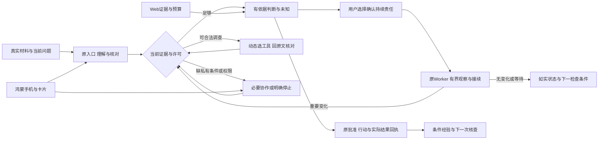

# 全国总决赛交付清单：表达真实产品，不另造演示系统

日期：2026-11-01。[审查](COMPETITION_AGENT_PRODUCT_AUDIT.md)、[冲刺时点](COMPETITION_SPRINT_ROADMAP.md)、[真实旅程](COMPETITION_REAL_USER_JOURNEY.md)、[鸿蒙策略](COMPETITION_HARMONYOS_STRATEGY.md)。本文件提供待制作文案、结构和核对要求；没有声称视频、PPT、海报或提交包已经产出。

## 1. 通知依据与状态

赛程与材料要求来自用户本轮附件，尚未拿到原始赛方通知的可长期引用链接。材料负责人须保存原通知/问卷字段/补充说明，核对作品格式、命名、签章、参赛者信息和现场要求；不自行推断评分、权重或允许刷新源码。

| 项目 | 用户提供的要求 | 建议内部完成 | 当前状态/Owner |
|---|---|---|---|
| 信息问卷 | 11/03 23:59截止 | 11/02核对，11/03白天提交留回执 | 待材料负责人认领，未提交 |
| 报到抽签 | 11/12 09:00～18:00 | 11/11确认人/交通/证件/设备 | 待核对原通知 |
| 作品U盘压缩包 | 11/12 22:00现场截止 | 11/11 20:00完整首包，11/12 18:00复核 | 尚未封包 |
| 实训营/说明会 | 11/13 | 保留参会与规则变更记录 | 待参加 |
| PPT刷新 | 11/13 23:00截止 | 11/13白天完成最终一致性审查 | 尚未制作；只在赛方允许范围刷新 |
| 答辩/创意集市 | 11/14 | 11/12前备好正常产品设备和静态材料 | 待准备 |
| 颁奖 | 11/15 | 依通知安排 | 无需产品功能支持 |

完整Agent可运行源码工程或符合通知要求的小艺测试态Agent是赛道要求中的交付路径。**当前推荐完整源码工程为主**，因为小艺平台链未签收；HAP与Web是额外完整产品体验，不替代源码，也不把已有受限HTTP适配等同于小艺平台测试态资格。

## 2. 一句话定位：比较后选择

| 文案 | 适用位置 | 裁决 |
|---|---|---|
| “忆程：记得项目来龙去脉，查清问题，随时接着推进。” | 海报标题、开场 | 推荐；普通用户能理解，解释时再说责任与鸿蒙 |
| “把项目交代清楚，让Agent在期限和预算内持续跟进。” | Agent机制页 | 突出Always On；必须有真实Worker和连续记录支撑 |
| “手机接住材料与变化，Web核对证据，Agent接着同一项工作。” | 跨端页 | 表达角色分工；分享/系统入口未验收时不能配假操作镜头 |

技术层辅助说明可用“有来源、可纠正、能接续的项目协作Agent”。不把Memory、Dream、Always On、HarmonyOS连成一串当创新论证，不写“完全自主”“永不遗忘”“全设备审批”或“已证明全面提升”。

## 3. 作品介绍草稿（小于800字）

以下正文按当前可确认工程能力写，正式提交前绑定实际冻结版本；若后续完成真实模型/真机/多日验收，应据具体证据改相应句子，不添加无依据的效果数字。

<!-- INTRO_START -->
忆程ProjectMemo面向同时推进课程、科研与竞赛项目的大学生。材料散落、背景反复解释、任务中断后难以接续，是项目协作中的常见负担。忆程把项目记录、证据核对与持续委托连接起来，让用户知道现在先处理什么、发生了哪些重要变化、哪些工作仍在跟进。

Agent沿原始材料与版本建立当前理解，将事实、用户报告、待验证假设和未知分开；在权限与预算内自主选择工具、回读原文，并根据新证据调整调查。用户可以纠正目标、暂停或撤回，相关判断和待处理操作按当前版本重新核对。长期委托由服务端Worker承接，保留观察、等待、恢复及累计用量，而不依赖手机持续打开。

Web适合阅读详细证据、核对授权与结果；鸿蒙原生客户端适合记录、补充条件和快速纠正，桌面服务卡片提供返回原任务的入口。两端共用Next.js后端及原任务身份，行动经用户批准后沿原服务形成完成回执，工具成功和用户自述不直接等同于现实目标达成。

当前已实现动态调查、有效记忆与条件假设、持续责任、条件经验及多类工具，并有工程回归和部分隔离模拟器证据。个人记忆在独立分支持续整合，真实模型质量、目标真机与自然日使用按独立Gate验收。项目将继续验证跨项目理解、低负担采集和失败经验的实际收益。
<!-- INTRO_END -->

这不是最终功效声明。当前PM失败、版本断层和安全Gate在技术材料中如实列出，不把“后续验证”剪裁成已通过。若问卷只允许纯文本，移除Markdown/注释，单独重新计字。

## 4. 创意效果图/交互流程图

推荐交付一张以正常用户任务为中心的流程图，图下注明“交互路径示意，非固定Agent执行流程；平台渠道按实际验收范围”。以下Mermaid可作为制作底稿，不是已导出的正式图片：

没有持续委托、不联网或没有新假设都是合法分支；图中的可达入口不得作为“所有平台渠道已完成”的证明。正式视觉使用现有品牌、真实截图与清楚连线，不生成不存在的产品界面冒充截图。

## 5. 五分钟以内视频计划（建议4分40秒）

| 时间 | 内容与正常产品操作 | 必须有的证据/限制 |
|---|---|---|
| 0:00～0:25 | 一个学生的真实项目痛点与当前问题 | 实际需求/材料且有展示同意，不编参与人数与节省时间 |
| 0:25～1:15 | 材料进入、理解核对、原问题调查 | 使用当时真正完成的入口。项目前预览未交付就展示原明确建项，不补假镜头；不能强制拍所有工具 |
| 1:15～2:00 | 原文、条件假设与新证据，用户纠正后判断变化 | 真实source/版本/实际run；没有产生Dream就不插入一条，旧记录可注明日期 |
| 2:00～2:55 | 已确认责任、真实跨日检查与必要协作 | 实际Worker/观察时刻/预算。跨日剪辑标“真实历史记录节选”，不伪装现场连续运行 |
| 2:55～3:40 | 鸿蒙卡片/App原问题→短回应→Web读回 | 同一原Mission/question/版本；系统分享/小艺只有验收后才实拍并宣称 |
| 3:40～4:15 | 原行动与结果、证据支持范围/费用未知 | Action/resultCardId与独立设备/结果分别呈现；失败/UNKNOWN可保留，不加虚构ROI |
| 4:15～4:40 | 第二类真实项目的通用性片段、当前边界和前景 | 不是改名相同fixture；一周/月研究未做就说计划 |

剩余20秒留片头片尾或现场格式差异，成片实际时长必须≤5分钟。正常剪辑、加字幕、遮挡私密信息可以；不得预排模型结果、改日志时间、假通知或剪出不存在的因果。录屏保留当前模型/版本与实际操作出处，旁白功效主张能逐项回证。

录制只在业务冻结与相关Gate通过后进行；变更影响哪些交互就重录那些段，不为了重拍重置真实项目。原失败/等待可用旁白解释，不需要开发一个“演示恢复键”。

## 6. PPT信息结构

建议8～10页，具体口头答辩时长和页数待原通知核对，不能把视频5分钟直接推成答辩时长。

1. 用户真实问题与一句话价值；不先讲架构缩写。
2. 一个真实项目怎样开始、交代、接续与核对结果。
3. 真实决策：原证据→缺口/假设→动态工具/必要问题→修订；同页区分模型选择与确定性守卫。
4. 长期责任：范围/期限/预算、Worker、无变化/失败/等待与恢复；展示一次真实记录。
5. 鸿蒙日常入口与Web分工：卡片/手机短回应→原问题，平台状态真实。
6. 两类真实项目与独立质量/条件对照；样本和限制如实标注。
7. 结果支持、用户控制与安全可靠性；不把测试数作为创新分。
8. 当前边界、长期价值与下一步；需要时将证据索引/架构展开作附录，不另造评委页面。

Memory/Dream可与第3页整合，Personal与第2/5页整合，不必每模块一页。工程图表达的是一个原Runner/记忆/审批/结果权威，不能画出并不存在的新“智能中枢”。答辩中每项“已完成”有版本/证据；每项“计划”不配伪运行截图。

## 7. 创意集市与87×57cm模块

通知给出的自由创意区尺寸为87×57cm，方向、固定方式、出血与打印规范需负责人核对。可先按横向布局设计，不能把建议当赛方强制值。

版面建议：上方一句话定位；中部一条正常用户旅程和两张可读真实截图（手机原问题、Web证据）；下方三条能回证的能力、实际支持设备与体验入口。避免整面架构框图、测试数字墙或把手机界面等比堆成全设备展示。可加一张“已做/待验”小索引，图下注明截图对应版本与数据性质。

陌生人互动：用自己愿意提供的非敏感文本，经正常入口完成一次理解/核对；可以拒绝长期委托，也不要求现场连真实外部系统。工作人员说明已有真实历史责任记录，用户自行查看依据与未知。无网络时使用已核实的本地视频/打印图并说明联网功能不可用，不启动假的离线Agent。

二维码只到正常产品/公开说明，登录权限与真实隐私不靠公开通用账号绕过。不把旧contest-demo/合成验收账号当作可公开共享的真实用户库；若需现场体验身份，必须是正常注册/隔离身份与原权限，不为比赛新增数据生成器。

## 8. 完整源工程与HAP封包

| 项目 | 验收动作与禁区 |
|---|---|
| 唯一源码身份 | 选通过适用Gate的实际Commit，记录必要dirty范围并消除未交接业务改动；包/视频/PPT/后端/HAP一致性表，不能把PM分支代码零散复制进去 |
| 完整性 | Next app/components/lib、schema/全部迁移、脚本、测试、Harmony工程、package/lock、依赖许可及README/DEVELOPMENT；Agent源码是原正式实现，不是简化问答替身 |
| 安装/生成 | 明确Node24/npm、原生SQLite依赖、Prisma生成目录`lib/generated/prisma`及锁文件；Windows npm.cmd、其他目标OS分别验证，不能复制跨OS原生模块代替安装 |
| 数据初始化 | 为新用户提供显式独立空库步骤、全部迁移和账号初始化。旧库走备份/增量/完整性检查；db:setup含seed，不作为默认真实库修复或“生成展示数据”步骤 |
| 正常执行 | Web启动、真实模型配置/账号资格、原mission:worker独立进程、来源授权与工具依赖、停止/日志位置；没有模型时只能明确规则/开发模式，不能算自主运行 |
| Worker部署 | 文档包含Web/Worker实际所需unit/同库/presence/权限与重启，配置模板不带密钥；文档样例与当前服务分开，不能只给Web unit称长期委托可运行 |
| 附件与解析 | PDF/图片/OCR支持范围及Poppler路径/版本、Browser运行时、工具许可明确；缺依赖/处理许可的路径有真实错误/恢复，不假装完全支持 |
| HAP | 正常产品包、bundle/版本/hash/目标系统/签名状态/HTTPS地址及安装读回；签名私钥不交包，unsigned只作为开发构建证据，不承诺现场直接安装 |
| 环境模板 | `.env.example`等只留占位配置，实际密钥/用户token/账户quota配置不进包；默认关闭未经签收的Browser/外写/平台渠道，不用比赛专用开关替代原feature flags |
| 数据与证据 | 源码包不含真实个人库、storage原件、认证态、trace正文、开发备份或本机绝对私钥配置；证据按同意脱敏另放，合成测试fixture标开发用途 |
| 跨系统 | 实际选定Windows/目标Linux环境验证依赖与启动；离线依赖包若准备，应平台匹配、许可明确且无npm凭据，不默认为工程可完全离线推理 |
| U盘 | 从明确allowlist封包，manifest含路径/hash/版本，解压到干净目录启动；校验zip/U盘副本/文件可读、HAP与视频时长。没有实际接收回执不写提交成功 |

**特别检查脏配置。** 主目录Harmony build-profile含本地签名相关配置的可能性已知，不能直接把整个工作目录压缩。保留原文件不动，封包采用经核验的模板/排除规则；禁止提交私钥或在报告打印敏感字段。文件级清单扫描、压缩包内容扫描和干净机器解压验证分别执行，不只搜索一个关键词。

## 9. 素材主张与证据绑定

| 主张 | 合格材料 | 当前缺口 |
|---|---|---|
| “自主调查” | 实际provider、工具选择、原文与观察引发改道的原run/step | 当前独立语义质量待验，不把脚本选择当模型决策 |
| “持续跟进” | 真实服务器、原责任许可、多个真实日期的观察/等待/恢复与累计额度 | `/health`200或可控时钟不够 |
| “越用越懂项目” | 旧条件正确召回、纠正生效、条件对照/用户任务成本与负迁移 | PM5长期结论不预支 |
| “鸿蒙自然协作” | 指定包/设备/后端的卡片或手机原问题接续及Web读回 | 小艺/分享未验不配成功镜头；旧模拟器图标明范围 |
| “项目真正推进” | 原Action/resultCardId＋目标条件内独立检查与反例 | 用户自述/工具成功不替代现实效果 |

素材负责人在每次刷新PPT/视频后核对字幕、旁白、截图、版本和证据。保留失败材料与备用播放设备、线缆、网络/电源检查，但这些只属于现场保障清单，不进入产品架构。
