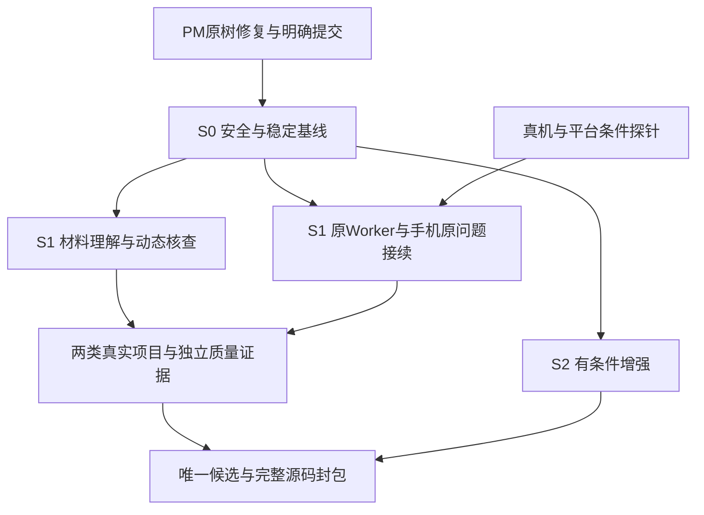

# Final Competition Sprint：既有 Roadmap 的时间视图

日期：2026-11-01。北京时间 UTC+8。[审查基线](COMPETITION_AGENT_PRODUCT_AUDIT.md)；[真实旅程](COMPETITION_REAL_USER_JOURNEY.md)；[开发交接](COMPETITION_IMPLEMENTATION_HANDOFF.md)。本表只调度原 G/FVT/UX/CT/PM 工作，不创建比赛业务模式或另一套长期路线。本轮所有实施、实验、安装和部署均未启动。

## 2026-11-02 实施更新

S0 已获用户启动实施授权。历史表中的 `PMcf1bbb0/PM4 未提交`、旧主分支及线上版本描述保留为 11/01 截点，不能作为当前状态。PM1～4 与入口已合并到基线 `aea257c`；S0 在独立树 `D:/Projects/hongmen-s0`、`codex/s0-trust-fixes` 实施，修复与各类 Gate 见 [S0 实施记录](S0_IMPLEMENTATION_2026-11-02.md)。主目录未提交签名/生成配置继续保留。

依赖提交 `5d3ad3f`，核心修复提交 `784d99a`，后续会话/Worker/原生及存储收尾到 `8da4f05`。完整回归 1486 项通过，后续存储定向 36 项通过；Web E2E 为 33 业务＋1 setup 通过、2 原有跳过、0 失败/flaky；鸿蒙 92 项及 unsigned HAP 构建通过。工程、真实模型、设备、Linux、自然日和独立复核分别签收。生产 audit 为 0 不等于所有开发依赖告警已关闭，S0-B 的剩余 minimatch 风险在实施记录中单列。S0 尚未并入 master、推送或部署。

## 2026-11-02 S1 实施更新

S1 从 S0 候选 `4b2cbd3` 开独立树 `D:/Projects/hongmen-s1`、分支 `codex/s1-verified-project-journey`，分三个内部阶段提交：`42d934e`（A：材料→可纠正理解→确认建项→原 Capture 接回）、`05ea5c3`（B：历史条件/来源资格探针 + 原 Worker 持续责任真实进程证据）、`5f736c2`（C：手机接回原问题 + Web 同版本结果核查）。细节、Gate、失败与回滚见 [S1 实施记录](S1_IMPLEMENTATION_2026-11-02.md) 与 `evidence/s1-project-journey/20261102/ACCEPTANCE.json`。

本节对第 4 节三块的进度更新：

- **S1-A**：项目前材料走受控临时草稿（新增 `ProjectIntakeDraft`/`ProjectIntakeMaterial` 迁移），预览把原文/建议/未知/成功标准候选/下一问题分开；整体纠正沿原 `admitDirective`；确认复用 `createOwnedProjectInTx` 的 Project + OWNER + AgentRun 事务；材料随后经原 Capture/Attachment 同步。Web `/projects/new` 与鸿蒙新“先放材料”入口都可用；材料中的指令不会被当作用户命令。**未签收**：真实模型理解质量、真机交互。
- **S1-B**：探针确认到期跨越、派生来源、来源链未知、局部/账户范围分离已由原 `effectiveContinuity`/`sourceUse`/`contextBuilder` 覆盖，因此没有重写 Composer，只补证据；原 Worker 真实进程探针验证“未到期不领取、缺云批准显式暂停、用户暂停不复活、无成功模型回执、清理幂等”。**未签收**：Linux/systemd、自然日、真实模型判断。
- **S1-C**：卡片与入口携带 project/mission/question/approval/source/版本/期限意图，过期意图回到当前委托；Web 与手机用同一 `readback` 读同一问题与结果版本；进展区新增“已执行/已观察/已独立支持/用户报告/反例/未知”只读投影。**未签收**：真机冷/热启动、卡片系统刷新、离线 TTL。

工程检查：全量单元/集成 197 文件 1504 项通过；`tsc`/`lint`/`build` 退出 0（lint 仍为 S0 的 9 条既有 warning，build 6 条路径追踪 warning）；Web E2E 35 业务＋1 setup 通过、2 原有跳过、0 失败/flaky；鸿蒙 100 项通过、unsigned HAP 构建通过（未签名、未安装）。真实模型、设备、自然日、第二类真实项目与独立复核保持 NOT_RUN，且不因工程通过而签收。

## 1. 外部期限与内部冻结

外部时间来自用户通知，未取得原始赛方文件的逐项核验；材料负责人需保存通知原文和收件回执，不据此编造评分权重。

| 时间 | 性质 | 具体动作 |
|---|---|---|
| 11/03 23:59 | 通知：信息问卷截止 | 建议11/02完成填写核对、11/03白天提交并留回执；介绍绑定当时实证，不等功能开发完 |
| 11/12 09:00～18:00 | 通知：报到抽签 | 人员/交通/设备/证件依原通知核对；与工程操作分开 |
| 11/12 22:00 | 通知：U盘压缩包作品提交截止 | 完整代码、说明、视频等按最终清单交；提交成功另留接收记录 |
| 11/13 | 通知：实训营/说明会 | 核对赛方临时信息，不能自动把澄清变成开发新功能 |
| 11/13 23:00 | 通知：PPT刷新截止 | 只按允许范围更新PPT；不假设允许改11/12已封包代码 |
| 11/14、11/15 | 通知：答辩/集市、颁奖 | 展示正常产品和实际记录，故障用已核实备用材料说明 |
| 11/05 20:00 | 建议：高不确定平台探针闸门 | 分享/Intents 未得到设备/注册证明则不作为决赛前交付依赖 |
| 11/09 20:00 | 建议：新增能力冻结 | 停新provider、schema扩展、外写渠道和大重绘；仅补已承诺闭环与已复现问题 |
| 11/10 20:00 | 建议：候选源码冻结 | 唯一候选提交、契约/迁移/设备/模型/自然日证据清单；未关闭Gate继续修，不能先叫放行 |
| 11/11 20:00 | 建议：首个完整封包/干净环境复跑 | 保留重新构建/重装/文件损坏的缓冲，不在临提交才首次启动 |
| 11/12 18:00 | 建议：提交包完整性复核 | 校验zip/manifest/hash/可读性及U盘副本；距官方22:00仍留缓冲 |

这些内部时点是工作建议，不是新赛方规则。晚到的安全修复必须进入候选并补影响验证；若无法完成则禁止开放受影响能力、撤回相关承诺，不能用临时关UI绕过服务端缺陷。回到已知易受攻击版本不是安全回滚。

## 2. 执行依赖与资源

默认按一个可持续整合主线安排，不假定额外人力、真机、云额度或平台资格已经到位。Owner 为职责槽位，未认领不算已排产；同一人可承担多项，但独立语义评分不可由自己的生成模型单独签收。

不要求S0所有任务结束才写文案、准备留出题或做合成隔离测试。使用真实私人材料、启用新增网络/后台路径前，相关Security Gate必须通过。自然日观察计划11/06～08；如延期可11/08～10，记录实际起止及覆盖小时，不把跨过三个日期说成完整72小时。更晚仍保留未验收，不能加速时钟冒充。

## 3. S0：可信基础与交付阻断（11/01～04优先）

| 任务 / 原Issue | 为什么现在 / 真实缺口 | 复用、代码与双端影响 | Owner / 工作树 | Gate、验收与回滚 |
|---|---|---|---|---|
| S0-A 原入口安全 G10/G12/G13/G15 | 草稿串号、membership-only删除、文件清除、Markdown隐式联网均可破坏真实用户信任 | CaptureBox/UserNav；项目DELETE/guard；storage与原SourcePolicy/Worker生命周期；MarkdownRenderer。Web/鸿蒙读回停用/清除状态一致 | 客户端/鉴权/生命周期负责人待认领；从核对后的已提交基线建独立修复树 | Security：隔离owner/member、上传/删除/撤权竞争、preload网络、清除恢复；不需付费模型。回滚保留原件和同步拒用守卫，不恢复不安全渲染/权限。11/04前要有明确修复或限制开放裁决 |
| S0-B G21 依赖补丁 | 当前Next16.2.11等仍在原公告范围，原扫描未被修复提交关闭 | package/lock、Next/Prisma/原生SQLite/构建脚本；两端后端契约与HAP链接回归 | 依赖负责人待认领；独立补丁树 | Security+Functional：实际可达性、兼容升级、受影响构建/全量；不用audit fix --force。回滚到经核验兼容安全版本；不可完成则不批准公网发布 |
| S0-C G02/G03/G04 | 建项两写非事务、整理模式与可用性可能误导 | 原createProject/OWNER/回执；Capture模式DTO、capabilities与账号配额；Web/Harmony服务同步 | 业务API/双端负责人待认领；独立修复树 | Functional，部分Security交叉：故障注入唯一项目、无孤儿；mock/规则/失败明确，查询不发付费探活。回滚保留手工建项/原文保存，绝不谎报实模成功 |
| S0-D PM集成/PM-REGRESSION/PM-R01 | cf1bbb0之后PM4/入口未提交，PDF全量仍失败；入口后续26项脚本检查已通过 | PM原树的personalInvalidation、policy、原Compose、MemoryScopeNav及页面；已存在实现不重做 | PM原实施者＋独立复核者；继续hongmen-personal-memory | Functional+Security：固定Poppler路径/版本，绑定最新26项检查的源码/配置并复核返回/账号/CAS、超窗无Step守卫；先形成提交再合并候选。脚本不需实模；HAP编译＋安装另验。禁用个人注入可止功能，隐私删除阻断继续有效 |
| S0-E G05/G06 Worker与版本 | 线上71499b6、本地1ee、PMcf不一致；health不能证明后台跟进 | 原mission-worker/workerCycle/Presence；现有部署说明、Web/Worker实际unit、同库配置、Constants | 运行负责人待认领；实际部署操作另授权，先隔离同拓扑验证 | Functional+Evidence：同release/数据库/开关、扫描/claim/失败分离、App关闭/Worker重启后原身份预算继续；无私钥/凭据进回执。可停新触发，保留原任务和UNKNOWN；不得新建Runner或默启生产 |
| S0-F 双端与工程封包底线 | 当前安装包身份/后端兼容、完整工程复跑尚缺最新签收 | 原Node24/npm脚本、Prisma迁移、DEVELOPMENT、harmony-build、ApiClient/Constants | 构建/设备/材料负责人待认领；唯一候选树及独立空库环境 | Functional：空库/旧库副本、干净安装、Web核心/HAP安装登录HTTPS；不复制真实库和签名私钥。未签名包仅开发证据，不能当最终可安装产物。构建产物按manifest恢复，不覆盖真实用户数据库 |

S0不是六项全部“没有实现”，而是已有入口的差距关闭与最新组合签收。G17独立质量在Evidence Gate中继续P0，不能因安全修好了就写Agent通过。

## 4. S1：三个完整产品能力（11/03～08主线）

### S1-A：真实材料形成可纠正理解，并自主查清一个问题

- 对应FVT01/06、UX1/2、CT1～6及PR6。用户不用先整理完整目标；材料→带出处的目标/约束/未知→整体核对→确认建项→原调查与真实结果链。
- 复用NewProjectForm、原Conversation/Turn、Capture/Attachment、Admission/GoalGap、原批准/Action/resultCardId；最小增量是项目前预览、原件/内容版本绑定、原建项回执与部分同步恢复。
- 具体代码：`app/api/projects/route.ts`、原项目/采集服务、`lib/conversation/investigationService.ts`、两端现有建项/对话入口。Capture/Attachment要求projectId，不能先建假项目；原账户Conversation/AgentRun可承载预览操作轨迹。临时原件不自动成为有效业务事实。
- Web核对较完整理解和原文；手机单列预览、短纠正、原问题接续。不规定搜索→论文→浏览器固定链；资料足够时可不联网。
- Owner：首次旅程负责人待认领；执行树在S0基线确认后指定。需要真实模型证明决策质量，目标设备证明交互；脚本只能验证准入和状态。
- 验收：V25/26/35/36、一个真实用户从正常入口完成；源证据、目标版本、问/查/停理由及原结果读回。先冻结留出材料与允许决策集合，再运行对照。
- 风险：预览变授权、模型猜你目标、重复建项、额外调用未计量。回滚到手工明确建项＋原调查，保留草稿和原件，不把未交付预览称已完成。
- 11/05 20:00完成项目前处理探针。失败则停止扩泛化解析器，优先完成现有文本/受支持材料的完整确认；不会把模型目标准入保护削掉。新增扩展最晚11/09 20:00停止。

### S1-B：Memory/Dream影响判断，原责任在后台持续成立

- 对应UX2/3、CT1/3/7/8、PM1～4及FVT03/07/08。用户能交代一段工作，在权限/期限/预算内观察；新证据能改变调查、必要时协作，离开后还可恢复。
- 原composeHypotheses、effectiveMemory、Experience、Worker/InvestigationDelegation/Attention/Continuation与读集是唯一执行路径。优先补当前旧条件遗漏、反例后回原文、无变化低调用和失败/未检/等待的真实区分。
- 具体代码：原hypothesis/digest服务、contextBuilder/investigationService、mission-worker/workerCycle、responsibility/attentionReceipt、PM原树personalContext/Invalidation。只按已复现缺口补，不重写全部Composer。
- Web查看证据和责任预算；手机只呈现当前重要变化、短问题及暂停/恢复。用户不需逐项配置技术概念，原责任预览仍明确边界。
- Owner：Agent/运行负责人待认领，PM内容由原负责人交接。必须有真实模型与服务器观察、真实日期记录；App退出由设备轨验证，不能只看保存状态。
- 验收：两类项目中真实发生的观察/无变化/失败如实记录；工程负例独立注入，原generation/lease/UNKNOWN预算正确；条件对照证明原文核对/错误条件至少没有退化，严重越权为硬失败。
- 回滚：关闭新增整理或观察触发，保留用户停止、来源阻断、历史记录与原任务，不迁往新服务。11/06前启动获准自然日轨，11/09后不加新触发/provider；证据不足如实保留，不造变化补故事。

### S1-C：卡片/手机接回原问题，Web核对真实结果

- 对应FVT04、FVT02基础、UX1/3及原鸿蒙入口。卡片不是项目缩略列表，重点是一项当前关注/一项待协作及最后同步；手机回答后Web读回同一question/Mission。
- 复用FormExtension/WidgetDataService、EntryAbility Want、原Handoff/readback/entry和MissionDetail/FocusConversation；原导航信封补question/source/proposal/version/expiry意图，不复制任务状态或批准令牌。
- Web原状态/结果区域展示已执行、报告、独立支持、反例和未知；手机摘要与恢复条件同源。原GoalState是有界视图，不新增完成真值。
- Owner：鸿蒙/原Handoff负责人待认领；主目录Index/ProjectHome的未提交UI由原作者先交接，避免与PM入口改动相互覆盖。
- 验收：真机冷/热启动、登录/换账号、旧问题已答/旧审批失效、断网TTL、重复卡片点击；Web原Action/resultCardId与独立设备结果分开。必须有目标手机，只有模拟器就只签模拟器。
- 回滚：保留原任务/项目入口，关闭不可靠的系统渠道；不能把禁止过期执行的守卫一起回滚。11/05前确认真机/签名/后端条件，11/08前完成核心原生旅程，11/09停设备范围扩展。

## 5. S2：按增量价值决定，不按功能数量（11/04～09）

| 增强 / 原ID | 进入条件、价值与代码 | 模型/设备与风险 | 验收、Owner、回滚与停止线 |
|---|---|---|---|
| 系统分享 FVT04/G11 | 普通学生确有从文档/聊天接收材料的任务；先验证ShareExtensionAbility/URI，复用原Capture/Attachment与S1-A预览 | 真机必需；不能把任意URL自动Fetch或将图片当已OCR；离线/换账号原件保护 | 原生负责人待认领；文本/URL/单受支持文件→确认归属→幂等同步，取消/URI过期/空间不足；11/05探针，11/09冻结；停注册保留可导出草稿 |
| 小艺/Intents G19 | 平台登记、设备、签名都实际可用时，做查询/原任务打开/已授权只读接续 | 平台不确定，审批必须回App，个人摘要最小化 | 平台负责人待认领；原授权用户真机投递和失败路径；11/05无条件就不列已交付；可回到App渠道，不伪注册 |
| Personal跨项目/Adaptive FVT03 | 原PM4与入口Gate关闭后，在两个实际项目使用同一明确偏好/不同局部要求 | 实模证明不只改语气；隐私/时间/负迁移风险 | PM原负责人；明确保存/局部覆盖/手机纠正/到期/关闭；不新增自动画像；11/09后只修已承诺流程 |
| 结果与成本 FVT02/05、G07～09 | 原结果投影及真实用量覆盖先展示，不要求先实现全计费平台 | 不必加模型；费率/usage未知就未知；不得虚构ROI/节省小时 | 结果/预算负责人待认领；原call去重、失败费用、估算/账单/未知；11/08定最小覆盖，11/09停费率/提供方扩展，退回资源明细不填0 |
| 失败改进 FVT07、PM5 | 先有真实失败/纠正和样本同意，用原trace/Experience与评测脚本 | 人工脱敏/独立标注与有限实模费用；开发样本不再留出 | Agent质量负责人待认领；配对Experience开/关/条件拒用，保留负结果；无证据就报告未证，禁止自动改线上Prompt；实验数据截点11/09冻结 |

S2不是对既有PM能力降级，而是把尚需新增/外部开通的范围与S1联合证据分开；已存在且通过Gate的能力正常保留。任何S2将使S0/S1整合与三日证据中断时，停止该扩展而不是减少原安全和自主调查能力。

## 6. S3：11/15以后继续原路线

保留原PM5一周/月/三月研究，完整Personal/Digest/Dream八条件与Experience对照；更广语义长期召回/旧有效承诺、复杂工具兼容与恢复；更完整数据主权、费率/账单与运营；真实跨设备迁移、穿戴轻交互。重新投入条件是目标用户任务、权限/设备/平台/成本与独立质量证据，而非“技术上可做”。不新建平行记忆库、目标状态库、调度或Agent框架。

## 7. 三类Gate与追踪

| Gate | 此冲刺的硬要求 | 当前状态 |
|---|---|---|
| Security | G10/G12/G13/G15/G21、准入/处理许可、抑制、预算/lease/UNKNOWN、外写幂等 | OPEN；没有本轮修复Commit或生产放行。任何泄漏/越权/重复效果即阻断该路径 |
| Functional | G02/G03/G04、PM当前全量/入口、空/旧库、原结果链、Web/手机核心 | CT7干净候选历史PASS；PM新失败未闭合；dirty UI另外签收 |
| Evidence | 首次用户、真实模型、模拟器、目标真机、自然日、独立结果与用户价值 | 历史部分存在，当前联合验收NOT_RUN/部分；不相互换算 |

沿原Roadmap第11节逐Issue追踪：G02/03/04/10/12/13/15/21不得降级；G05/06运行、G07/08/09结果、G11/19/20原生、G14导出、G16能力、G17质量、G18召回继续原Owner槽位。新增的 COMP-PM-NAV（先失败、现26项脚本通过，待提交/整合验收）、COMP-RELEASE（版本断层）、COMP-WORKER（实际持续运行）只追踪本轮发现，不另造实现。

每条记录字段：Issue ID、Owner认领、worktree、基线/dirty指纹、修复Commit、适用Gate、原测试/模型/设备证据、独立签收、剩余风险、回滚方式。当前未认领/未修复的Commit填“未提供”，不能把1ee或cf写成修复全部问题。

## 8. 时间不足的保护顺序

优先保护：安全与真实数据、原目标/授权/预算和结果身份、已有动态调查/原文核对、停止纠正和接续、手机原问题与Web证据、完整可运行源工程。保留真实失败和UNKNOWN，不为了完整叙事加一轮假Dream或强制联网。

暂停顺序：新穿戴/系统迁移 → 未开通Intents → 多文件/音频分享 → 新工具/provider → 非必要视觉重绘/独立仪表盘。核心分享如已稳定可保留，不因为列表顺序机械删除。S0无法关闭时只发布可被证明安全的范围；若核心也不安全，应报告交付风险而非伪造通过。

## 9. 2026-11-02 S1 独立复核增量

原候选 `24e58e9` 不能直接作为 S2 的审查通过基线：独立库实际复现五项失败，修复沿原服务完成。`63e19bb` 全量 198 文件 / 1520 项通过；`fd4f754` 再补指引跨期限、引文与日期校验，受影响 5 文件 / 43 项通过，最终 Web 构建/E2E 和证据身份以 `S1_INDEPENDENT_REVIEW_2026-11-02.md` 与 `evidence/s1-independent-review/20261102/ACCEPTANCE.json` 为准。

当前是独立树的本地工程进展，尚未合并、推送或部署；原第 7 节历史 Gate 快照不被这些测试自动改成生产放行。真实模型、首次用户、模拟器、真机与自然日仍分别验收。用户负责的 Reflexion 阅读项目按 `S1_FINALS_ACCEPTANCE_GUIDE_2026-11-02.md` 留证据；S2 使用 `S2_IMPLEMENTATION_HANDOFF_2026-11-02.md`，保留第 5 节原五包及全部原 Agent 能力。

S2 已于 11/02 从修复证据提交 `24004cf` 建独立树开始。首批 `6a90423` 在原回执补累计用量/未知费用，并修复鸿蒙进展字段错配；4 文件 / 28 项、类型/lint、定向任务 E2E 与 103 项鸿蒙单测及 unsigned HAP 通过。该批不等于完整计价、平台分享/Intents 或整个 S2 已完成；详见 `S2_IMPLEMENTATION_2026-11-02.md`。

11/02 独立审查收尾：`2a976227` 关闭原报告 2 项 P1、5 项 P2；205 文件 / 1551 项、类型/lint、109 项鸿蒙合同与 unsigned HAP 通过，集成完整 E2E 36 业务＋1 setup 通过（2 旧跳过）。主干与 S2 已包含集成 `c4f8cc0`；本地签名/配置保留。费用、平台入口、真实模型/设备/自然日和用户价值仍按原路线分别推进；16 个既有开发依赖告警与构建受限并发条件保留，未因此宣称生产放行。

S2 后续批次（同一分支 `codex/s2-product-enhancements`）：`601f486` 项目前材料实际送入范围（预览 DTO + Web/鸿蒙覆盖提示 + 按页原文核对；8 项新测试、intake E2E、105 项鸿蒙）；`cc958be` 可核对的调用覆盖（原 AgentRun/Step 只读投影，UNPRICED 与 unknown 保留；4 项新测试、missions E2E）；`88383e1` 偏好边界回归（3 项）与平台能力只读探针。偏好边界由既有 PM/Continuity/Attention 覆盖，未新增偏好系统；系统分享/Intents 因本树无签名配置、模拟器 unsigned 安装返回 `9568332` 而保持 NOT_RUN；失败改进因缺样本同意保持 NOT_RUN。全量与 E2E 结果见该批实施记录与 `evidence/`，不得据此签收设备、实模或自然日。
