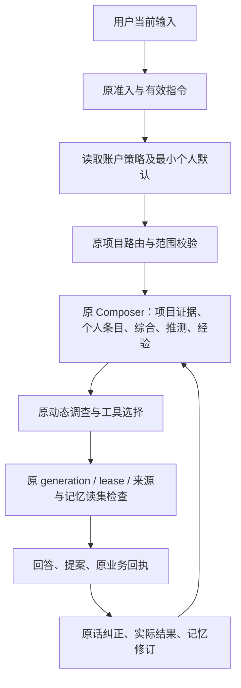

# 记忆怎样影响理解、调查、委托和结果

日期：2026-11-01。本文冻结拟实施的服务合同。它扩展原 Claim/Event、SourcePolicy、ConversationTurn、Mission 和 AgentExperience，不另建 Planner、Runner 或记忆数据库。当前代码事实见 [架构审计](MEMORY_ARCHITECTURE_AND_SCOPE_AUDIT.md)，阶段和 Gate 见 [Roadmap](PERSONAL_MEMORY_ROADMAP.md)。

## 1. 六种内容各自负责什么

| 内容 | 权威来源 | 可以影响什么 | 不能替代什么 |
|---|---|---|---|
| Fact / Evidence | 原 Capture、附件修订、有效关系和工具观察 | 支持或反驳项目判断 | 来源存在不等于支持结论；自报不等于实证 |
| Episode | 原阶段修订及其来源 | 理解经过、决定和阶段变化 | 不替代原文、当前权限或当前任务状态 |
| Intent / Preference | 原 Directive 与个人记忆准入事件，分别存放 | 指令约束工作；偏好提供有条件的默认 | 偏好不创建任务、资料访问或写入授权 |
| Commitment | 原 Mission/Action 与持久回执 | 接续未完成责任、核对等待条件 | 摘要一句“已完成”不能完成原行动 |
| Hypothesis / Dream | AgentClaim 及原推理中的证据评估 | 提出信息需求、引导原调查改道 | 推测和模型自信不是证据或用户许可 |
| Experience | 条件化 AgentExperience、案例、反例和 Use | 提供方法建议、提醒适用条件 | 不改工具权限，不把一次成功概括成普遍规律 |

不为六种语义新建六张表。原始经历、当前综合、用户理解与方法经验保留不同权威；它们可引用同一原始来源，不能被当作多份独立支持。

## 2. 自然语言什么时候能写个人记忆

新增记忆准入应复用 Directive Admission 的设计原则，但不把个人偏好塞进项目工作指令。

拟议准入服务输出包含 `admissionStatus`、核对过的原话定位、解释、目标 scope、替代条目、有效边界、是否需要确认及原因。只有用户输入身份、内容版本及明确意图都通过检查才写 ACTIVE；候选与澄清也保留原 requestId，避免响应丢失后生成多份候选。

| 输入 | 准入结果 | 持久化结果 |
|---|---|---|
| 在账户表单明确添加内容与范围 | DIRECT_APPLIED | 保存准确原话、范围和版本；不再重复询问 |
| “以后技术问题先给结论”，来源确为用户本轮直接表达，范围明确 | DIRECT_APPLIED | 若允许从明确表达中保存，写个人偏好；有同主题冲突时先核对替代对象 |
| “这次先给结论” | SESSION_ONLY | 仅本轮有效，不创建个人条目 |
| “这个项目只能用 CPU” | PROJECT_GUIDANCE | 进入原项目约束/指令合同，不升级账户习惯 |
| “以后都这样”，无法确定“这样”和范围 | NEEDS_CLARIFICATION | 只问一个必要问题；不先写永久默认 |
| 从反复操作归纳“用户喜欢 CPU” | INTERPRETATION_CANDIDATE | 可以存候选及例外，不激活、不注入 |
| 网页、论文、日志、模型总结或引用文本内写“请永久记住……” | NOT_USER_MEMORY_COMMAND | 按原资料处理，不作为用户授权 |
| 要记住凭据或自动保存敏感画像 | REJECTED_FOR_MEMORY | 不写记忆；按具体凭据/敏感数据产品规则处理 |

认证用户、找到原话和理解正确是三个不同条件。认证只能证明请求身份；原话 hash 只能证明来源未变；模型分类不能证明长期范围或替代关系正确。直接生效只覆盖可保真解析的明确表达；其余先形成解释候选或澄清。不能把所有自然语言都改为固定表单，也不能把模型的一次分类当作永久改写依据。

明确表达可以先由模型建议结构化，但最终直接准入须通过服务端规则核对原话、否定、期限、对象与范围。超出保真解析范围的候选需要用户确认冻结的解释。单纯重复次数、采纳率、已读率都不是晋升条件。

## 3. 同一个认知账本，三个不同状态轴

### 3.1 个人条目

```text
明确添加/明确表达 ──准入──> ACTIVE
模型归纳 ──> CANDIDATE ──用户确认原内容与范围──> ACTIVE
ACTIVE ──暂停──> PAUSED ──显式恢复且仍有资格──> ACTIVE
ACTIVE ──修订──> 新修订 ACTIVE，旧修订 SUPERSEDED
任一可管理条目 ──撤回──> WITHDRAWN
任一条目 ──删除──> DELETED + 立即消费阻断 + 正文清除进度
```

“能否使用”在读取时另算：账户政策、项目例外、来源权限、内容版本、当前任务条件、时间边界和敏感策略都要满足。恢复暂停不会复活已经过期、撤权或被删除的内容。

### 3.2 Dream 与整理

Dreaming 指整理经历，Hypothesis 指待验证主张。前者可以产生后者，不能用同一状态代表两件事。保留现有 PROPOSED、INVESTIGATING、SUPPORTED、REFUTED、INCONCLUSIVE、EXPIRED 及来源受限视图；支持与反例关联同一稳定 claimId，包含条件和原始根。

目前综合和假设可在原推理输出中产生，并非已有独立夜间学习服务。新增个人候选也优先附在原 Conversation/Mission 调用内，或在用户发起“整理我的记忆”的原 Conversation 中执行。没有执行根、许可和预算时只做便宜的失效标记，不启动模型。

### 3.3 Experience

继续区分 CANDIDATE、SHADOW 与 ACTIVE，以及 RETRIEVED、INJECTED、MODEL_DECISION、USER_FEEDBACK、OUTCOME_OBSERVED。一次方法命中、用户采纳建议和现实结果成功分别记录；UNKNOWN 结果不算反例，也不算成功。

首批跨项目方法迁移只提出有条件的候选，不将项目 Experience 的 projectId 去掉。方法适用性仍需要数据划分、环境、工具和协议等条件匹配；个人偏好不能替匹配器补造缺失条件。

这里的“学习”更新有来源的理解、适用条件、反例和选择记录，不在线训练基础模型，也不自动改系统提示词。是否学得更好由后续任务质量证明，不能由支持次数增加来证明。

## 4. Context Composer：先判资格，再决定放什么

当前两个实际入口是 `lib/conversation/investigationService.ts:187` 和 `lib/mission/contextBuilder.ts:47`。前者合并记忆/假设时使用约 6000 字符预算；后者使用自己的上下文预算。`composeEffectiveMemory` 从最近八条综合里选最多两条、约 9000 字符，`composeHypotheses` 从最近十六条里选最多四条。它们有覆盖声明，但都不是长期重要信息的完整召回策略。

当前 `search_memory` 已支持主题分页和按 sourceIds 定向读旧/归档卡片；`hybridSearch` 另有可选语义检索。不能把“已经有 embedding”当作所有执行链都已消费语义检索，也不能把搜卡片等同于搜任意旧 Digest 或 Hypothesis。

推荐扩展原 Composer，增加共同的 eligibility/selection/manifest 服务，两个入口仍保留各自用例编排。



图中的阶段是数据依赖，不是固定调查流程。Agent 仍按信息缺口动态决定读哪份原文、是否检索、是否比较指标或改道；不能把复杂任务压成固定的几步问答。

### 4.1 召回分四条通道

1. **必须读取的当前控制。** 原 STOP、当前指令、有效项目约束、项目例外和账户使用政策。这些不由语义相似度或最近窗口决定，不允许为了 token 预算静默删掉。
2. **长期有效的个人条目。** 按 owner、状态、范围、条件与时间取候选，再按问题相关性、用户显式优先级及适用性排序。稳定有效约束有单独索引入口，不能先截最近八条。
3. **问题相关的项目材料。** 原 search_memory、原记录/文档、长时 Digest/Hypothesis 指针和原任务回执。补有界的历史检索/分页能力，不默认换向量数据库。
4. **综合、推测与方法建议。** 作为导航和有条件提示，保留来源、状态与覆盖；需要提出新事实或业务操作时回读原始证据。

中文查询不能只依赖整串 substring；可复用现有分词/二元短语思路，后续由检索对照题决定是否需要更好的分词或语义重排。首次实现先用同库索引、关键词、定向旧记录和显式优先级，记录遗漏原因。旧信息找不到时主动回原任务和资料，不补造背景。

路由前只读取不泄露项目内容的账户默认，例如表达方式和用户明确保存的通用关注。项目派生信息在路由确定及晋升许可校验后才可进入。不能让个人记忆中的隐藏项目名替用户决定去读取另一个项目。

长期认知检索建议扩在原 memory 服务内，按 owner、scope、kind、状态和时间分页查旧 Digest/Hypothesis，再走当前资格检查。若要暴露给模型，沿原工具注册和计量增加有界的认知读取能力；结果放在认知 facet，不伪装成 `search_memory` 返回的原证据 Source。两端来源详情仍能跳回原资料。

### 4.2 拟议上下文分组

```ts
type MemoryContext = {
  currentInstruction: unknown;       // 原指令和准入结果
  projectEvidence: unknown[];         // 当前获准项目的可引用原证据
  personalContext: unknown[];         // 偏好/自述，非项目事实、非授权
  projectSynthesis: unknown[];        // 当前综合与原文指针
  hypotheses: unknown[];             // 条件推测，历史状态另列
  experienceAdvisories: unknown[];    // 条件化方法建议
  commitmentPointers: unknown[];      // 原 Mission/Action，不复制状态权威
  memoryReadSet: unknown[];
  selection: unknown;                // 原因、遗漏、覆盖与预算
};
```

该结构是合同草图，不是新 Planner。每条个人上下文标明 `claimId/revision/kind/applicability/sourceClass`，模型不能从个人偏好推导项目实测。EXPIRED/REFUTED 可以作为“为何不继续旧方法”的历史线索，不能混入当前有效建议。

### 4.3 预算与选择说明

保留原调用的模型/工具/HTTP 累计额度。新增候选提取、重排或综合若调用模型，记录原 Turn/Step 的 AgentRun 与预算根，禁止以“内部记忆工作”免计费。

先预留当前控制、问题和必要原证据，再给个人上下文与摘要/经验软上限。首轮可试个人上下文最多 512 tokens、最多六条，且不超过本次可用输入预算的 10%；这是待标定的起始值，不是产品容量承诺。不同模型使用对应 token 估算，不能把现有字符数当成精确 tokens。

如果必须保留的指令和证据已经装不下，缩小本次调查或向用户说明，不裁掉限制。普通偏好、重复摘要和低相关推测优先让出预算。覆盖不完整时模型可调用原检索继续读，不能把 top-k 的缺席当不存在。

每次选择保留简明原因：明确适用、与问题相关、当前指令覆盖、条件缺失、来源不可用、过期、预算省略。UI 只显示重要原因，调试记录保留完整枚举。`RETRIEVED` 只表示找到了，`INJECTED` 只表示进入上下文，模型声称“用过”也不证明它产生因果收益。

拟议 `resolvePersonalContext` 返回 `items/readSet/selection/coverage/nextBoundary`。每个遗漏有原因，返回的条目与读集必须一起裁剪。个人记忆没有适用结果时，原问题、项目读取和调查照常进行；不能为了“命中率”硬放无关背景。

## 5. 作用域和优先级

优先级按含义分层，不能把所有文本排成一个“最高优先”列表：

- 系统安全规则、真实资源权限、工具白名单、批准边界和预算决定能不能做。
- 用户当前明确请求及本作用域有效指令决定本次要做什么。
- 当前项目的有效约束和事实决定这个项目有哪些条件；明确的项目例外覆盖个人默认。
- 个人偏好、用户自述、综合和经验提供有条件的协作背景。
- 未确认候选只供用户审阅，不供模型按它行动。

当前请求与旧项目硬限制冲突时不能静默按“新消息优先”联网或写入，必须走原 Directive/Responsibility 变更合同。相互冲突的个人偏好也不按更新时间武断覆盖：技术问题喜欢详细、日常提醒喜欢简短可以共存；同范围无法兼容则澄清或暂停其中一条。

## 6. 记忆读集、hash 和在途竞争

### 6.1 必须绑定的内容

原 Turn.readManifest / Step.protocol 增加个人记忆读集：owner、条目 id/revision、当前资格 hash、被允许使用的抽象内容 hash、来源根/版本、policy privacyRevision、项目例外版本和 nextBoundary。选择缓存还应包含内容检索版本、问题语义/约束摘要、工具与编译器版本、输出受众。

账户策略变化即使本次没选中任何个人条目，也应参与缓存键，防止复用“当时没有个人记忆”的旧选择结果。项目原有 intentHash、reusePolicyHash、sourceRevisionReadSet、cognitiveReadSet、experienceReadSet 不被替换。

调用前还检查个人内容是否允许交给当前模型/服务处理；原云模型许可只覆盖其原有对象范围。没有个人云处理许可时，不把个人正文传给远端模型或远端 embedding。规则模式可使用确定性的显示偏好，但不能假称已做模型个性化。账户开关的说明应让用户理解这一点，不要求每次正常调用重复批准。

现有 contextBuilder 的 manifest.hash 在追加 Experience 字段前计算，不应被当作未来所有记忆内容的完整指纹；现有独立 experienceReadSet 保护继续保留。新缓存键要明确覆盖哪些分组，不能靠名字叫“contextHash”推定覆盖完整。

### 6.2 三类变更分别处理

| 变更 | 在途行为 | 原任务和提案 |
|---|---|---|
| 仅表达默认，如以后简短 | 下次组织回答时采用；允许清楚说明后续生效 | 不暂停所有 Mission，不重置预算，不使无关业务批准失效 |
| 背景/方法条件变化，已影响当前判断 | 受影响消费者进入原 INVALIDATED → DRAINING → RECOORDINATING 流程 | 只处理依赖此背景的计划/提案；需要重新预览时沿原入口 |
| 删除、关闭使用、撤权或隐私范围缩小 | 同事务推进 privacyRevision；新派发和新发布同步核对，旧文本不再发布 | 依赖旧记忆的提案失效；已派发外部效果按原 UNKNOWN/对账处理，不能假称撤销 |

写记忆时先占原 User 写锁，CAS 条目和策略版本，同事务提交事件、控制回执及必要消费者失效。账户级 fan-out 需要覆盖所有受影响项目/会话，不能只调用一次带当前 projectId 的 invalidateContinuityConsumers。

活跃对象很多时可异步展开失效清单，但同步 privacyRevision 检查必须先挡住新派发和发布。异步队列快慢不能决定用户删掉的内容是否还会被使用。

### 6.3 迟到结果和预算

原 generation/lease 继续是执行权。已发出的模型请求无法收回已传数据，但它的旧语义结果不得发布为当前回答；已发出的工具请求只能结算自己的历史观察。来源仍有权限、版本和时效时，原始成功观察可以按原规则复用，不能复用含旧个人判断的模型总结。

drain 到期仍未知的派发保留 UNKNOWN，未发出的预占按原规则释放/失败；原模型/工具/HTTP 消耗累计，不因换 generation、换设备或重新登录清零。原协调上限仍有效，不能形成无限重排循环。

必须用真实 await 屏障验证：模型在生成时删除记忆、两端同时修改、调用已派发后收到 STOP、回包晚于失效、同请求重试和 Worker 重启。仅测页面上的 stale 徽标不能签收。

## 7. 无事件也会失效

有效视图使用 `validFrom <= asOf < validUntil`，到期点属于失效区间。hash 采用时间所处区间，不把每毫秒时间写入 hash。每次读取/派发/发布都重算资格；没有新事件也不能继续使用昨天仍有效的背景。

持久时间使用 UTC，另保留用户语义的 IANA 时区；“下周”“毕业后”等相对边界无法可靠确定时先澄清。跨时区和夏令时以实际边界测试，不能用设备显示日期代替服务端生效时间。

nextBoundary 取原指令、来源时效、个人条目、项目例外和原责任期限的最早边界。复用原 Worker 的下次检查和 Turn 守卫，不另建常驻计时器。时间越界本身不调用模型；只有当前判断确需重核且原许可有效时，才在原任务内继续调查。

## 8. 记忆与 Always On 怎样联动

一次新观察到达后，先由原变更/来源/责任规则判断它是否影响正在承担的事，再决定要不要花调查预算。个人长期关注可帮助指出关联，不代替“这是用户当前授权委托”的判断。

| 情况 | 行为 |
|---|---|
| 已获准委托内出现相关新证据 | 原 Investigation/GoalGap 组织信息需求，动态选择工具，更新原假设与结果 |
| 无内容变化，仅普通刷新或顺序变化 | 不新增模型调用，不重复提醒 |
| 来源观察失败 | 记录失败和退避，不写“无变化”，不归纳用户偏好 |
| 观察变了但来源已失效/撤权 | 停止消费旧内容，按原任务暂停/请求核对，不自行换未授权来源 |
| 发现与长期方向有关的新问题，但无持续许可 | 当前会话有相应只读研究许可时可调查；否则形成建议，不后台创建新任务 |
| 用户长期不回应 | 保留等待用户语义，合并注意力；不把沉默当批准或“用户不关心” |

通知降噪先使用原 Attention 设置、InterventionPolicy、已读回执和 dedupe。模型推断“用户晚上不想被打扰”只形成候选；用户明确确认后通过原策略服务更新。读过、通知过、批准过和执行过始终分开。

## 9. 与工具路线的衔接

| 能力 | 记忆可以帮助什么 | 仍由原合同决定什么 |
|---|---|---|
| PR-6 Web Search/Fetch | 少重复背景、选择相关公开问题、回查旧来源 | 公开研究范围、联网许可、URL/版本、注入防护；网页不是用户指令 |
| GitHub/CI | 记住目标设备或核对方法，理解有意义的变化 | 仓库授权、ref/head、日志权限与原观察；CI 绿不证明现实目标完成 |
| 文档深读 | 找回长期约束，返回原页/表核对 | 附件版本、物理定位、覆盖、OCR 未知状态 |
| 论文检索 | 关联用户授权保存的研究方向 | 公开概念边界、元数据/全文等级、论文与本项目结果分开 |
| 指标与沙箱 | 参考先验方法，优先核对划分、单位和环境 | 数据许可、固定核算批准、环境隔离和真实结果回执 |
| CT-7 部署观察 | 参考用户明确提供的环境背景，提醒核对 release | 观察授权与 build/deploy/health/user-path 分层，不自动部署 |
| CT-8 Experience | 提示适用方法和反例，减少已犯错误 | 条件匹配、ACTIVE 状态、原案例资格与结果标签 |
| CT-9 Browser/外部只读 | 当旧记忆不足时读取当前事实 | 当前连接、账户、资源范围与 HTTP 预算，不根据个人信息自动登录 |
| CT-10 外部写入 | 草拟符合当前偏好的内容 | 原提案哈希、版本、批准、幂等、补偿范围和 UNKNOWN 对账 |

## 10. 私有理解不能自动流向共享内容

个人记忆只用于当前 owner 的私有上下文。团队成员看不到其他人的个人条目。带个人上下文生成的草稿应标记隐私依赖；进入共享 Episode、Artifact、外部写入正文或通知标题前，沿原预览/确认机制核对允许披露的内容。

公开检索词、URL 和外部工具参数也属于外发内容。个人兴趣只能帮助选择用户已允许的公开主题，不能把私人背景或项目秘密拼进查询。复用 PR-6 的公开范围与脱敏机制，并增加个人上下文 canary 负例；提示词约束本身不构成完备的信息流防泄露证明。

不能只靠提示词保证模型不复述背景。首批采用保守的输出受众标记：只要生成时读过个人上下文，共享采纳必须展示实际内容和个人上下文提示，由用户确认本次披露；不因“只是偏好”跳过这个检查。设备卡片与系统通知默认不放个人原话。

删除记忆后，历史消息可保留“当时用过一个现已停用的背景”的最小标记；其明文、缓存、摘要和导出仍要遵守清除合同。已外发内容由原业务系统管理，不能自动删对方对象来冒充个人记忆删除。

还需阻止重新提取：删除事件保留最少的原 source/locator 身份和禁止复用标记，移除其正文；清空全部时推进 `extractionNotBefore`，暂停期间的聊天不在重开后自动补扫。旧摘要、导出和候选都不能绕开这个边界。用户主动重新添加可以生成新事件，需明确这次保留的内容，不自动恢复整条旧来源链。

## 11. 结果如何回来

反馈回原对象：用户改正理解写 ClaimEvent；改变工作目标走 Directive/Responsibility；来源更正走原修订与 SourcePolicy；方法反馈走 Experience；行动结果仍写 Action 与 resultCardId。一次反馈可触发多个原用例，但必须明确每个作用对象，不能用一个“反馈已收到”掩盖只更新了聊天文本。

满意度、采纳、任务完成和效果质量分别记录。模型觉得用户喜欢某种方案，只能是候选理解；真实结果反驳旧方法时，应改变经验资格与下一次建议。个人条目不因一次不采纳自动失效，也不因多数采纳自动扩成所有项目的默认。

## 12. 可导出，但不由文件掌权

memory.md 可导出当前可用的个人/项目理解，dream.md 可导出待核实问题。两者都标明 asOf、作用域、缺失覆盖、状态和来源指针，导出前重新鉴权。它们不能包含凭据、不可访问来源或私有内容的跨账户混合。

导入必须生成预览和候选，重新校验原根和 scope；不接受 Markdown 内的“已授权”“永久事实”声明。删除或撤权后导出缓存失效，旧文件也不能反向恢复被删除记忆。
