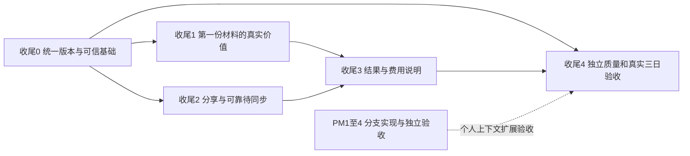

# ProjectMemo 最终阶段：优先级与实施路线

日期：2026-11-01。依据[研究报告](PROJECTMEMO_FINAL_VALUE_TRUST_RESEARCH_2026-11-01.md)及[代码矩阵](CODE_GAP_MATRIX_2026-11-01.md)。下面是既有 R4 的收尾安排，不另起 CT 路线。用户只额外授权了当前 CT-7 合并，其余实施仍待下一轮任务启动。

**本轮增量修订：产品与 Agent 价值深化。** 第 8～12 节新增八项行为合同、三类 Gate、E2E 统计与追踪矩阵；原收尾 0～4、G 系列优先级与既有验收目标保留。以下“立即实施”是推荐的下一轮顺序，本轮只修订规划。

## 1. 投入裁决

| 方向 | 主要用户与可感知价值 | 最小完整交付 | 复杂度、运行费用与风险 | 优先级 |
|---|---|---|---|---|
| 首次可靠价值 | 刚收到课程/竞赛材料、还不会整理目标的学生 | 一份材料 → 可靠建项 → 原文可回看 → 首次有依据判断 → 一项下一步 | 中；复用原解析和推理调用，不另加营销式总结；项目目标误准入、重复创建需先挡住 | P0 合同，P1 体验；值得优先投入 |
| 低负担采集 | 经常接收老师建议、截图和实验文件的学生 | 分享 → 本地留存 → 归属确认 → 同请求同步 → Web 读回 | 中；文件空间、OCR/ASR、重试成本单列；URI、账号和权限边界较多 | P0 草稿隐私，P1 文本/文件分享；完整音频 P2 |
| 结果判断 | 需要知道项目究竟推进了什么的人 | 原任务/行动回执 → 目标条件 → 结果支持与反例 → 原依据 | 中；优先只读规则投影，必要解释复用原推理；误把报告升级为实测是主要风险 | P1 高价值；当前收尾应有基础版本 |
| 人机交替 | 需要 Agent 主动调查、又会随时改变重点的用户 | 原调查 → 最小问题 → 手机接管/纠正 → 原任务合法继续 | 以验收为主，小量交互补全；无新常驻费用；主要成本是反例与并发验证 | P1；复用 CT-1/UX-3，不重写执行器 |
| 能力如实表达 | 所有用户，尤其没有云额度或后台不可用的人 | 保存/模型/规则/部分/UNKNOWN 一致；能读回实际后台观察 | 小至中；配置/元数据查询不新增模型调用；高频探活本身需节流 | P0 模式和资格，P1 就绪投影 |
| 改进闭环 | 开发团队与遇到错误的用户 | 绑定反馈 → 最小脱敏样本 → 独立标签 → 对照 → 回归 | 中；人工标注和受预算约束的实模实验；错误样本外传和题目泄漏需管控 | P0 独立质量 Gate，P1 样本工具链 |
| 能力与成本演化 | 运行长期委托的用户及运营者 | 原用量 → 冻结费率/版本 → 未知预占 → 任务费用说明 | 中；不引入新模型调用，计量覆盖和账单对账有维护成本；未知费率不能硬封顶 | P1；严格货币上界需单独签收 |
| 数据自主 | 长期积累项目资料、参与团队项目的用户 | 有范围的完整导出 → 停止使用 → 可核查清除 | 中至高；存储/下载/清理费用；角色、私有资料、备份及派生链不能漏 | P0 权限与清除边界，P1 导出体验 |
| 鸿蒙全场景 | 手机捕获、快速处理，Web 深入调查的学生 | 原生分享/卡片 → 原任务 → App 鉴权处理 → Web 接续 | 中；设备、分发和平台开通是主要成本；后台寿命与 HMS 能力不能假定 | P1 手机/卡片，Intents 先探针；穿戴 P2 |
| 长期价值 | 同时进行课程、科研、竞赛的持续用户 | 三自然日闭环，再延伸一周/月/三个月 | 研究和运维成本为主；需要同意、退出和删除机制；选择偏差与负迁移需披露 | P0 启动真实验证，P1 长期队列 |

## 2. 当前收尾的顺序

实线表示最终验收依赖，不要求串行等待全部工作。用户研究协议、设备准备和留出题在收尾 0 就开始准备；PM-1～4 在原工作树推进，最新实现及未决 Gate 见第 8 节，不阻塞当前项目的首次价值、结果与费用补全。账户功能验收后再加入个人上下文旅程，当前项目继续使用已有 Continuity。

### 收尾 0：统一版本与可信基础

先完成已授权的 CT-7 整合，再以独立修复 PR 处理 G02/G10/G12/G13/G15 等旧入口问题。G21 的依赖核查与补丁是生产发布前的 P0 Gate，不混入 CT-7 冲突解决，也不因本地回归通过而跳过。

CT-7 已整合为 `master@1ee89f3`，本轮工程 Gate 通过；后续从实际核对过的提交继续。其他收尾项仍是规划，不因本文顺序自动获得实施或生产操作授权。

- CT-7 整合必须保留 CT-8～10 的浏览器、日历和外写合同，覆盖 SourceConnection 迁移、来源类型、工具清单、预算、生成式 UI 和双端来源读回。不能选一侧文件使另一侧能力消失。
- 建项原子建立 Project/OWNER，并绑定原请求身份；原文保存成功与模型整理结果分开回执。
- 草稿按账户隔离；成果预览禁止未批准远程图片、预加载等隐式联网。
- 按锁文件与实际服务器条件核对 Next/Zod 等公告，单独完成兼容升级与回归。Windows 本地后端的暴露范围同样检查；不使用批量 `npm audit fix --force` 代替评审。
- 项目销毁在原服务内重验 OWNER/相关版本，不能只沿用 membership 检查。删除前明确数据范围；原确认绑定操作载荷。
- 删除先停止读取、生成和发布，再清理文件与派生物。原 Project 级联会删除项目内回执，不能先删 Project 再指望其子任务完成清理。探针应比较保留 DELETING 阶段与最小清除请求记录，选择能跨项目正文删除保留恢复身份的方案；不保存被删正文，不重建结果账本。
- 日志与截图采用新目录；真实数据库、生产开关和旧证据不参与合并。

验收：独立库空库/旧库迁移；OWNER/MEMBER 竞争；建项写入/回包故障；跨账户草稿；浏览器渲染无自动外发；上传与删除竞争；清理失败恢复。对现有代码问题保留首次失败，修复后再签收。

回滚：关闭新增观察入口；保持旧数据可读和原执行链。角色、隐私和删除阻断不能随功能回滚一并撤掉。当前用户 UI 修改单独保护，不成为整合 PR 的顺带提交。

### 收尾 1：第一份材料的真实价值

这是 CT-7 整合之后最推荐的第一个产品切片。

用户选一份实际材料，修订项目建议后确认，原资料保存，Agent 在原 Conversation 中给出能回原文核对的判断。随后从手机纠正或补充，回 Web 读回同一判断和原行动结果。

- 复用：项目服务、Capture/Attachment、原对话、GoalGap、SourcePolicy、原确认/Action/resultCardId/Handoff。
- 新增：本地建项草稿与来源绑定、可靠创建回执、整理模式 DTO、当前账号能力资格、首次价值计时与必要交互。
- Web：材料起步、目标提议编辑、来源回看、模式和关键未知的按需说明；保留原手工建项。
- 鸿蒙：应用内选材/粘贴、就地纠正与原任务读回；系统分享在收尾 2 补齐。
- Agent：动态选工具、根据观察改道，必要时回旧材料；不规定必须依次搜索、读网页、读论文。
- 费用：沿原 Turn/Mission 预占；手工 Capture/OCR 有自己的原 Run 和账户配额。由任务触发的处理必须传原计费上下文；尚未汇总的独立调用明确列为覆盖缺口，不用一个虚假的总价合并。
- 验收：首次用户无教程完成一次有依据的判断，能说明其来源与未决条件，能纠正，且原结果链可核对。模型不可用时仍能保存并理解降级状态。

本切片可以分成入口可靠性、认知消费、双端与原结果三个内部检查段，最终必须形成完整旅程。建好表、改好入口或显示一段个性化开场都不是完成。

### 收尾 2：分享与可靠待同步

复用收尾 1 的采集草稿，增加 HarmonyOS 分享目标。首批处理文本/URL 和一个受支持文件，明确归属后走原 API。离线只保证已落盘的草稿和可用原件，联网后重新鉴权，前台有界同步。

Web 保持同一原件与修订读回，不另建云收件箱。默认只给项目归属建议，不自动将材料写入其他项目。无项目时回到收尾 1 的建项确认。

验收必须经过外部应用真实分享、冷/热启动、取消、权限失效、空间不足、断网、重启、同请求回包未知和账户切换。识别语音先做独立设备探针；保存音频和后台长传不混进首个分享交付。

回滚时保留可导出的未同步内容，停用新分享注册不清空用户草稿。

### 收尾 3：结果与费用说明

以原数据生成一份任务或项目推进说明，直接回答：做过什么、哪些条件已有证据、哪些仍待核实、下一步由谁处理，以及费用覆盖到哪里。

复用 MissionCompletion、GoalState、TrajectoryIndex、原 Action/resultCardId、固定核算和 AgentRun，不新增第二份目标完成状态。结果变化通过原 Impact/GoalGap 链更新，不为每次查看多调用一个总结模型。

费用首先完成只读估算与 UNKNOWN 覆盖；需要严格金额上界时，再让全部相关调用在原预占中绑定冻结费率。单独的手工操作、其他任务或外部账单不能暗中混入一项委托总包。

两端在原任务详情呈现主要结果，条件和费用细节按需展开；首页只提示重要变化。一个失败或负结果也能形成有价值回执。不得为了“推进率”把失败隐藏成未使用样本。

验收：草稿完成、用户报告、固定核算、指定设备观察、反例、来源撤回分别输入，投影给出不同结果；相同请求读回一致，旧目标/旧来源不支撑新结论；重启、跨天和重新协调不清零费用。

### 收尾 4：独立质量与三自然日验收

沿原评测规范准备新留出题和独立评分，执行[完整旅程](FINAL_VERTICAL_ACCEPTANCE_JOURNEY_2026-11-01.md)。先工程故障回放，再真实模型，再目标设备与三个自然日。任一层未完成就保留对应未验收状态，不用另一层替代。

反馈只绑定原消息/Run/Step 和原来源版本。样本进入回归前经过同意、脱敏与人工标签。首批可用现有评测文件和对应原事件，只有查询与协作确有困难时才增加轻量标注投影。

回滚以原版本和冻结 manifest 为单位；模型或工具升级未过对照时继续使用已验收版本或明确降级，不自动换供应商并扩大费用。

## 3. 和原有路线如何衔接

| 既有工作 | 本轮复用与补齐 | 不重复安排 |
|---|---|---|
| UX-1 | 首次材料、WorkState、Reentry 与原项目入口 | 新增一个全局 Agent 控制台 |
| UX-2 | 原综合、假设、Claim 纠正和来源回看 | 第二套 Dream/记忆数据库 |
| UX-3 / CT-3 | 原 Worker、持续责任、观察、注意力、原任务控制 | 手机第二后台执行器或定时任务替代 Always On |
| CT-1 | Admission、有效时间、generation/lease、抑制与原批准失效 | 仅 UI 标 stale 的新协调机制 |
| CT-2 / PR-6 | CI/Web 范围、来源、计量、覆盖和 UNKNOWN | 为演示强制每题调用外部工具 |
| CT-4～6 | 文档定位、指标/固定核算、论文元数据 | 通用训练平台或未经验证的自动全文结论 |
| CT-7 | 正确整合现有适配器；补独立部署/制品证据接口 | 重新实现环境观察或自动部署系统 |
| CT-8 | 原条件经验、反馈阶段、版本与真实结果资格 | 支持数自动等于学习收益 |
| CT-9～10 | 已有隔离读、连接、批准、外写与效果回读 | 新的通用外写审批引擎 |
| PM-1～5 | 原完整个人记忆切片、跨层使用、删除与长期评测 | 把账户记忆缩成设置 UI，或另起用户画像专项 |

## 4. 必要的增量合同与实现探针

| 合同 | 最少绑定内容 | 必验探针 |
|---|---|---|
| 可靠建项 | actor、requestId、payload hash、项目与 OWNER、同事务原回执 | membership 插入失败、回包丢失、并发重复、同编号异载荷 |
| 采集信封 | owner 本地命名空间、clientDraftId、原内容 hash、候选归属、原 requestId、同步状态 | 退出、撤权、URI 到期、断网重启、原回包未知 |
| 能力投影 | 配置/资格/预算/运行观察/覆盖/模式、理由、观察与到期时间 | key 缺失、账号零额度、Worker 无共享路径、来源超时、过期缓存 |
| 结果投影 | 原目标版本、验收条件、原回执/来源、独立性、适用条件、反例和未知 | 自述与独立观察分层、固定核算输入不匹配、旧结果不支撑新目标 |
| 能力 manifest | 工具/version/schema/effects、模型/协议/prompt 身份、可用性与许可指纹 | 同名工具改 schema 未升版、旧批准、经验版本不匹配、模型升级回归 |
| 费用投影 | 原调用身份/父任务、费率版本、计量类别、币种、已知/估算/未知/上界 | 缓存 token 包含关系、无 usage、修复/Judge/OCR/embedding、跨天、迟到结果 |
| 数据操作 | owner/范围、稳定请求、源/权限版本、导出 manifest、停用与清除状态 | MEMBER 删除、导出中撤权、删除与上传竞争、清理失败、备份和设备迟到同步 |
| 反馈样本 | 原对象与版本、同意范围、脱敏记录、失败分类、人工金标、数据集角色 | 凭据 canary、跨项目内容、未来答案污染、撤回反馈、公开样本禁止重识别 |

这些合同都不产生新的工具授权。新增列和索引先基于实际查询与迁移探针；原表无法保存删除后的恢复身份时，才增加最小控制记录，而不是把用户正文复制到另一份长期存储。

## 5. 独立验收与失败规则

| Gate | 通过要求 | 失败或未完成时 |
|---|---|---|
| 工程 | 相关负例、全量回归、类型/lint、Web 构建/E2E、Harmony 检查与页面 HAP 编译 | 修复后重跑受影响检查；无故障解释不合并 |
| 模型 | 新留出任务、同预算对照、独立评分；必要澄清、证据和动态调查均评价 | 不能以开发题或同 provider 的一次评分签收 |
| 原生设备 | 指定系统/设备、分享/卡片/原任务/草稿恢复和权限拒绝 | HAP/hash/SDK 类型或模拟器只证明相应部分 |
| 连续使用 | 三个真实自然日，有变化、无变化和恢复均覆盖 | 时间推进只算工程状态验证 |
| 用户价值 | 首次可靠价值、重复解释、结果支持、通知价值与控制完成率分母清楚 | 不以存储数、工具数、点赞数代替 |
| 外部与生产 | 真实连接及效果回读、备份/迁移/回滚、生产用户路径分别签收 | 不因本地合并自动开启开关、部署或外写 |

权限越界、未批准外写、内容泄露、重复业务效果和预算越界出现一次即阻断该路径放行。正确停止、诚实保留 UNKNOWN 或承认资料不足，不按普通任务失败掩盖成低能力。

首批质量沿原 30 任务×3 次的评测规模设计，保留开发题和留出题角色；已用于修复的题目转入回归，不继续当新留出。对照按用户/项目隔离，模型评分经人工校准。独立评审至少两人，分歧由第三人处理；预算必须包括 Judge、修复和工具子请求。

6～8 人先导与后续探索性队列共用原 PM-5 研究。每个阶段报告总开始人数、可用性失败、已启动任务的全部结果和自然日流失；不能只挑完成者。统计比较在先导后冻结，不用样本小的平均分宣称普遍收益。

## 6. 现在只预留，或明确延期

| 项目 | 当前处理 | 重新投入的条件 |
|---|---|---|
| 独立部署流水线/制品证明 | 在现有 CT-7 来源合同保留适配点，继续显示自报/部分层级 | 有实际部署环境、只读许可和可核查回执 |
| 多节点 Worker Presence | 单机可见性先验证，投影接口可更换来源 | 实际部署跨节点，文件观测不再适用 |
| Intents/小艺系统分发 | 做小范围签名、注册、导航与平台投递探针 | 目标真机、账户开通、系统版本与分发流程齐备 |
| 系统跨设备迁移 | 传原对象身份的导航协议先稳定 | 两台目标设备、明确需求、真实平台验证 |
| 穿戴审批/后台 Agent | 不实现；最多保留脱敏摘要与回手机的方向 | 真实目标用户收益与安全交互均有证据 |
| 完整音频、离线识别模型 | 文本校对先完成，音频类型不假装支持 | 实际语言资源、录音权限、存储/删除和成本明确 |
| 新向量库、通用工具市场、多 Agent | 不引入 | 原库检索/注册表存在可测瓶颈且替代方案有明确净收益 |
| 自动训练/改系统提示词 | 不实现 | 独立数据、质量、版本和回滚先成立；不能由在线反馈直接触发 |

## 7. 开发收尾的交接要求

实施者先读当前 HEAD、worktree 与用户修改，再按对应切片工作。优先从核对后的已提交基线开 `codex/` 独立 worktree；不要复制真实数据库、凭据或签名材料。新证据写新目录，保留失败，明确模型/规则/fixture。

检查通过以后才整合；合并保存的是代码，不等于生产、设备和实模通过。主目录存在同时修改时，先备份与核对实际重叠文件，恢复后比较用户改动，不能批量 stash、覆盖或顺手提交。任何原约束无法承载新增能力的地方，交付明确探针与可审查修正，不删保护条件来换取绿色测试。

## 8. 增量核对：当前实现与放行状态

本轮读取时主目录仍为 `master@1ee89f3`，CT-7 与 CT-8～10 基线已包含。主目录 19 个 tracked dirty 路径涉及 UI、配置、文档、历史图片和一项删除，不能将其等同于已测整合提交。

Personal Memory 工作树为 `D:/Projects/hongmen-personal-memory`，HEAD `cf1bbb0`：PM-1 `092fc4f`、PM-2 `e0407ee`、PM-3 `cf1bbb0` 已提交，并已合入 CT-7 基线。用户报告 PM-4 完成；本轮实际读到其分级失效、责任依赖、最早边界、模型调用上下文与 `tests/pm4EvolutionResponsibility.test.ts`，同时还存在未提交修改。因此记录为“PM-4 有实现，提交与独立验收待签收”，不再写作只有六份规划，也不宣布主目录已有全部 PM 能力。

Web `/settings/memory`、PersonalMemoryManager 和鸿蒙 PersonalMemoryPage 已存在；UserNav、GlobalWorkspacePage、Index.ets 等入口正在另一会话修改。此处只合并其用户价值与验收要求，不安排另一份入口实现。

PM 最近全量日志 `evidence/personal-memory-pm1/20261101/full-regression-pm4.log` 为 **187 文件中 1 失败、186 通过；1447 项通过、2 失败，退出 1**。失败位于 documentReader/Poppler。旧 validation.json 的分段排查说明不能替代最新全量；环境解释需绑定解析器路径/版本、定向复验及稳定源码后的受影响检查。该记录不证明 PM 本身出错，但 Functional Gate 尚不能签为全绿。新生成文件与仍在运行的验收须另记，不能追写本快照为已通过。

PM-4 源码的在途依赖回查还含项目最近 12 个 CHAT Run 的有界窗口。它可能遗漏尚无 Step 的旧依赖；需证明同步读集守卫仍覆盖派发、发布和费用结算，或补完整原对象指针。此为 **PM-R01 待验证风险**，本轮未运行并发探针，不据此直接宣称可利用缺陷。

## 9. 八项增量如何改变用户行为

产品仍围绕三个认知组织：**眼下最该做的一件事、值得注意的重要变化、正在持续跟进的委托**。下面 FVT ID 是原收尾项的追踪编号，不是新模块或另一套 Roadmap。来源路径未标工作树时指主目录；PM 路径指第 8 节独立工作树。

| ID | 用户可感知差异 | 既有能力及真实缺口 | 归入原阶段 / 裁决 |
|---|---|---|---|
| FVT-01 建项理解 | 给材料后能核对一份项目理解，不必先替 Agent 写好完整项目简介 | Capture/Attachment、原 Conversation/Turn、Admission 已有；项目前材料解析与整体确认尚未串成闭环 | **立即实施**，原收尾 1；先过 G02/G03/G04/G10 与适用 Security Gate |
| FVT-02 进展叙事 | 隔几天回来知道改变了什么、证据到哪、现在先做什么 | GoalState、MissionCompletion、Action/resultCardId、Impact/Reentry 已有；跨对象证据分层与可读叙事需补 | **与现有阶段合并**，收尾 3 + UX-1，不新建进度状态库 |
| FVT-03 自适应协作 | 一句“这周只提醒关键阻塞”能按范围生效并可撤回 | PM1～4、Continuity、Attention 已有；自然语言到不同策略的准入和端侧反馈须核查 | **与现有阶段合并**，PM/UX-3；当前入口修复沿原 Agent 工作树 |
| FVT-04 准确交接 | 手机卡片或 Web 接回同一问题，旧入口不会重建任务 | 原 Handoff、EntryAbility/Widget、源查看与小艺受限 resume 已有；精确位置、版本及失效返回需补 | **立即实施已有 App/Web 路径**，收尾 1/2；系统分享随收尾 2，分布式迁移/穿戴**仅预留接口** |
| FVT-05 任务成果与花费 | 看懂花费对应哪些检查、结果和未完成条件，能决定是否继续 | 原预算/Run/Step 已有，monetaryCost 仍为 null；可读费用与成果关联不足 | **与现有阶段合并**，收尾 3/G07，不新建计费账本 |
| FVT-06 提问质量 | 能自行查的不反复问；真正缺少的一项才找用户 | GoalGap/questions、ask、动态候选和合法 resume 已有；提问时机与接管质量未独立证明 | **立即启动评测准备**，收尾 1/4；按失败结果局部修正原推理 |
| FVT-07 失败改进 | 纠正一次能成为可复验反例，后续少犯同类错误 | CT-8 Experience、Run/Step/Event、原评测已在；独立脱敏样本与条件对照待补 | **与现有阶段合并**，收尾 4/PM-5；在线自动改 Prompt **不实施** |
| FVT-08 能力变化恢复 | 工具失效后知道 Agent 换了什么路径、覆盖损失及怎样继续 | 原动态工具清单、版本匹配、UNKNOWN/恢复已在；等价替代与用户解释需纵向验证 | **与现有阶段合并**，G16/Capability Truth + 收尾 1/4；工具市场**不实施** |

### 9.1 FVT-01：材料先形成理解，再建立项目

**真实增量。** `components/NewProjectForm.tsx`、`app/api/projects/route.ts`、`lib/services/captureService.ts`、`attachmentService.ts` 继续负责原建项和采集。当前 Capture/Attachment 都要求 projectId，不能先造一个空项目，再把它称为“确认前没有业务对象”。schema 中 Conversation.homeProjectId、AgentRun.projectId 可空，允许沿原账户会话与 Turn 做无项目预览，但当前调查服务并未因此自动支持建项理解。

先做一个必要探针：从账户隔离草稿/临时原件，复用原解析器与原 Turn 调用、账户配额及许可，返回带出处的预览。若必须暂存文件，只保存 owner、内容 hash、临时原件指针、期限和清除状态；不建立 Capture/Claim/Project/Mission/Action，不伪造项目 ID，不另建预览 Runner。账户会话/调用日志是操作轨迹，不能变成有效业务目标。

预览包含：材料直接陈述、建议目标、已知约束、关键未知、可选验收条件、建议下一调查方向；每项带根来源定位与“原文/推断/待核对”身份。用户可以整体接受，也可就地纠正一项后重新核对整体差异。截止时间含时区，冲突或模糊指代只问必要问题。文字“整体接受”不批准互联网研究、持续委托或外写。

确认冻结 owner、draftId/revision、原件 hash、预览内容 hash、用户修订、目标/约束及请求身份。服务端复验后，沿 G02 原子建 Project/OWNER/请求回执；文件落盘不塞入数据库事务，确认回执绑定后续原采集请求。附件同步失败时明确“项目已建、资料待同步”，从原请求恢复，不能重复建项或宣称所有对象原子完成。取消、到期及账号切换清理临时内容，断网不静默上传。

**交互与成本。** Web 在现有建项/对话内给一份可编辑理解；鸿蒙用单列预览与就地纠正，首屏只突出一个关键未知。原文按需展开。材料初步分析通常复用一次原调用，重新解析/重试、OCR、embedding 均计原用量；无模型时保留手工核对路径并明确规则模式。验收比较真实材料起步与原手工表单的正确建项、纠正成本、首个有依据判断和退出率，不只比较点击数。对应旅程 V25/V26。

### 9.2 FVT-02：叙事是有依据的读法，不是第二份真相

复用 `lib/decision/goalState.ts`、`lib/mission/completionSummary.ts`、`lib/services/actionService.ts`、`lib/experience/trajectoryIndex.ts`、原 Impact/Reentry。当前 GoalState 明示最近 8 个行动/4 个输出及 incomplete，不能凭这一窗口写“项目全部进展”。先按本次目标回读相关原行动、未完成承诺与证据，保留覆盖边界，沿原 PM-3 补长期召回。

进展说明默认回答三句：上次以来发生了什么；这些结果支持什么/还不支持什么；当前优先处理什么。展开后逐条区分 **已执行、已观察、条件内得到独立支持、用户报告、反例、未知**。用户确认保存一段话不使现实效果变为证实，CI 绿与服务自报只能支持各自范围。

拟议 narrative 投影绑定原 goal/intent 版本、asOf、来源/原回执、条件、覆盖及反例，不持有独立的 done/progress 真值。规则生成可直接展示；需要自然语言解释时复用原总结调用或已有合法缓存，不在每次打开页面重新调用模型。来源撤权/抑制、目标替代和时间边界变化先挡住旧投影，再重算；历史叙事可标历史，不继续支持当前结论。

Web 沿项目状态/原委托展开依据，手机先给变化与下一步；通知只提示有价值变化，不复制整篇周报。用户纠正会进入原 Claim/Continuity 服务，编辑叙事文字本身不能篡改原证据。成本以读投影为主、必要解释沿原预算。验收要求用户离开几天后正确复述当前目标、证据不足与下一步；V27/V28 覆盖错误总结。

### 9.3 FVT-03：一句协作要求，分别进入正确范围

复用 PM 的 `personalAdmission.ts`、`userMemoryPolicy.ts`、`personalContext.ts`，项目 `lib/continuity/admission.ts` 以及 `lib/services/interventionPolicyService.ts`、Attention。自然语言统一入口，服务端按影响对象分派，不能把全部要求存成个人偏好：

| 用户表达 | 应用范围与反馈 |
|---|---|
| “这次简短一点” | 当前回答；不写永久记忆、不暂停无关委托 |
| “以后技术讨论先给结论” | 明确账户偏好，按原准入核对；用户可查、编辑、停用 |
| “这个项目周五前先处理演示” | 原项目指导/期限/目标版本；不自动改长期默认 |
| “这周只提醒阻塞，周一恢复” | 原 Attention 策略，核对项目或账户范围、绝对时间与时区；到期恢复先前策略或明确后继值，hash/nextBoundary 同步变化 |
| “少问我，自动提交” | 沟通偏好可处理；提交授权须独立原批准。不能整体当作永久外写许可 |

范围不清或互相冲突时只澄清缺少的决定；高置信模型分类不能替代准入证据。推断出的风格或关注习惯只作候选。原 readSet 决定在途影响：表达默认不无差别暂停全部任务；隐私缩小/撤权须同步阻断依赖消费者。最早边界跨越无需新事件。

Web/手机在原对话回应“本次/本项目至某日/以后”的简短生效说明与撤回入口，详情复用正在修的个人记忆页和原提醒设置，不新增偏好控制台。规则准入和策略读写不额外调用模型；若原推理解释候选则计原预算。验收看减少重复解释与不合时宜打扰，同时不增加遗漏澄清、关键漏报或越权；V29/V30。自然语言提醒编译尚须核查服务接口，不能由 PM 表存在推定已完成。

### 9.4 FVT-04：交接传位置，执行权仍在服务端

复用 `lib/continuity/handoff.ts`、`lib/conversation/entry.ts`、原 Mission readback、ArkTS EntryAbility/WidgetDataService 和 `lib/xiaoyi/resumeMissionService.ts`。已有 Want 解析 projectId/missionId、通知/卡片跳转及共享后端，不等于已经有精确到问题/证据/审批的统一交接。

扩展原导航信封：projectId、原 missionId/conversationId/turnId、questionId/sourceId 或 proposalId、期望版本、定位意图和过期时间；只带必要身份，不带个人原话、密钥、批准令牌或任意跳转 URL。接收端重新鉴权、核对归属/当前版本/来源政策，再定位原对象。链接只是请求打开，不授予读取、恢复或批准权。

未登录先登录并保留最小 owner 绑定意图；换账号、撤权、对象删除时拒绝且清理意图。旧问题已回答则显示原答案/后继状态；旧审批失效则解释并回当前提案，不能自动批准或重新创建。重复点击、冷/热启动和两端同时进入都指向同一原任务。恢复仍走原请求身份、版本与预算守卫。

Web 展示深查、来源与实际批准；手机快速补一项输入、纠正、暂停或接回；系统分享是“新增材料”意图，不偷换成“新建委托”。卡片显示有时效的脱敏状态，点开重新读取。小艺目前只支持已授权 LOW_RISK_READ_ANALYZE 的受限恢复，其他批准回 App。

平台范围：本机 SDK 有 ShareExtensionAbility、FormProvider、InsightIntent/continueManager 声明；EntryAbility 当前仅 onCreate/onNewWant 导航，没有因此完成系统分享、Intents 注册或分布式 onContinue。SDK 存在不是平台投递与设备证明。现有 App/Web 导航立即做；真实分享随收尾 2 的目标设备验证；系统 Intents、跨设备迁移与穿戴保持原延期条件，只预留原对象身份协议。路由不新增模型成本，恢复后的执行仍计原预算。V31/V32。

### 9.5 FVT-05：说清成果和花费，让用户决定是否继续

复用原 responsibility、Run/Turn/Step 与 G07 费率/用量合同。默认先显示“已核对三项条件，一项仍缺证据；进行了哪些检查，额度用了多少”，不显示没有依据的节省小时数、ROI 或全项目完成率。

费用投影按原 request/call 身份去重，区分实际账单、计量估算、尚未知用量、第三方费用及未覆盖调用，绑定币种/费率版本/任务边界。即使 token 已知，费率未知也不能给金额总计；只有各部分上界可证明时才显示总上界。未知请求保留预占，缓存 token 不重复相加。跨项目共用一次调用不得向每个任务各算整笔费用，无法准确分摊时标共享且不强加虚假分配。

把费用关联到原核查动作和可核对产物，不对“成功”的工具调用假定有用。失败与无结论也显示已消耗资源。下一步展示允许的动作与已有剩余额度；无法确定费用时说明原因，不能由模型猜价。Web 展开明细，手机展示摘要及未知部分。投影不额外调用模型；费率/账单仍沿原路线实现，不新增计费系统。V33/V34 验证费用解释正确率与是否能作出继续/停止选择。

### 9.6 FVT-06：评价提问时机，而不是追求少问

原 `lib/decision/questions.ts`、`dynamicCandidates.ts`、`boundedReview.ts` 和 Mission runner 已支持按缺口 ASK_USER、读取与等待。新增的是冻结可接受决策集合与独立评分，不是把调查改成四步流程。

每个评测机会给原材料、范围、当前权限与预算，标注可接受的 **自行调查 / 一个关键问题 / 请求具体权限 / 停止并给恢复条件**，允许多条合理调查路线。私人信息不可查、材料存在可查、目标冲突、无效许可、用户拒答、成本不足、用户中途接管、结果 UNKNOWN 分层采样。

重要指标：有必要澄清却跳过的比例；可合法调查却反问用户的比例；同一已回答问题重复出现；一次问题包含多少独立决策；未经批准继续；接管后重复执行或丢目标；恢复的原对象/费用正确性。分母是金标决策机会，不只是已经提问的轮次；同时报最终证据质量、任务结果、延迟和成本，不能靠少问掩盖猜测。

“只问一个关键问题”指当前最能解除阻塞的一项，不禁止复杂任务在新证据出现后再问必要问题。手机短答能回同一 questionId，Web 可展开原因；用户说“我已经处理”先记录报告，必要时核查效果。规则测试仅证状态正确；真实模型按原留出任务至少两名独立评分者，分歧第三人复核。开发题修过即转回归。样本准备立即做，实模实验受原授权和总预算约束。V35/V36。

### 9.7 FVT-07：失败要改变下一次判断，而非只多一条经验

复用 CT-8 的 `lib/experience/extract.ts`、`conditions.ts`、`injection.ts`、原 trajectoryIndex/评测脚本。真实失败先绑定原 Run/Step/目标及版本，再区分意图、证据、提问、工具、权限、恢复、成本和界面错误；用户纠正是标签线索，不自动成为唯一金标。

用户选择反馈后预览最小脱敏样本，正文不默认外传。敏感值、身份、私有 URL、跨项目关联及附件元数据都检查；匿名化不等于允许公开。保留 consent/撤回和删除传播，人工标注预期行为、允许替代与反例。冻结数据截点和版本，未来结果不能注入过去输入；用户/项目实体留出，同源改名样本不跨集合。

验证 Experience 的净收益时用配对任务、相同模型/工具/许可/总预算比较启用与停用 Experience，Personal/Digest/Dream 条件固定，再按原 PM-5 做完整消融。方法采纳、工具成功、结果正确和现实效果分别计；报告错误迁移、拒用不适用经验、严重失败、费用和置信区间。质量变好应表现为后续正确选择，而不是只会引用“上次教训”。

Web 原结果处提供简短反馈与可审阅样本，手机能指出哪里不对；详细标注留给研究工具，不加给普通用户。新增费用是脱敏/人工标签和明确预算的实验，规则整理先行。通过独立回归后由发布者显式发布版本；禁止自动改生产 Prompt、自动训练或因用户点赞扩大 Experience 权限。V37/V38。

### 9.8 FVT-08：在原边界内找替代，不能假装等价

原动态工具清单、`lib/mission/runner.ts`、`contextBuilder.ts`、PR-6 覆盖与 Tool/version、Experience 条件匹配继续承担决策与执行。复用 G16 manifest 和 Capability Truth，不再建立发现框架。

能力失效先区分：短暂失败、权限撤回、版本/协议变化、额度不足、能力确实不支持。原观察和历史快照可以在当前许可/时效内复用，但不是新鲜检查。若同一任务仍有合法来源，Agent 在原循环重评缺口、旧经验和替代工具，比较支持范围、隐私、费用与条件；替代工具不必走固定优先级链。

替代只在原已授权工具/范围、允许的数据处理位置和剩余额度内选择。Browser 不能绕过被撤销的 Web grant；公开检索不能携带个人背景；规则 fallback 不能伪装成等价模型推理。切换模型/provider 如涉及未批准处理或费用，需原机制授权。工具 schema/effects 改变时旧经验/提案重验；既有外写 UNKNOWN 优先原身份对账，不另找写工具重复执行。

无法继续时说明“缺哪项能力、已做什么、结果还支持到哪里、由谁满足什么条件后可恢复”。Web 展示替代依据，手机只提示实际覆盖损失及可行动恢复；静默重试只限原有界政策，不无限唤醒。成本与失败均计原任务，原 generation/lease 不变成新任务预算。V39/V40。

## 10. 三类 Gate 与分轨签收

替换第 5 节单一“工程通过”的管理读法；保留其中所有原测试与研究要求。状态使用 OPEN、BLOCKED、PASS、FAIL、NOT_RUN；每个 PASS 必须绑定源码/dirty 指纹、环境、命令退出或实测记录与独立签收。分类交叉时一项 Issue 可关联多类 Gate，不能互相抵消。

| 类别 | 冻结要求 | 当前结论与处置 |
|---|---|---|
| Security Gate | G10/G12/G13/G15/G21；准入、scope/处理许可、抑制、版本/lease、预算、幂等及外写批准不放宽 | 已测 CT-7 原执行链只是部分依据；旧缺口未修即 OPEN，相应路径不发布或不开放，不能凭单元总数豁免 |
| Functional Gate | G02/G03/G04；空/旧库、正常及故障旅程、双端调用方、原回执；G13 清理恢复亦属此类 | CT-7 干净候选通过；主目录 dirty UI 与 PM 分支另外签收，PM 最新全量失败待核对，未合并不算主目录具备 |
| Evidence Gate | 首次用户、真实模型、模拟器、目标真机、自然日、独立结果/用户价值各自证明 | 当前不得因脚本 provider、HAP 或时间推进填为真实验证；未知状态诚实保留仍可通过可靠性检查，不可计现实效果成功 |

G02/G03/G04/G10/G12/G13/G15/G21 继续保留 P0，不因 FVT 产品叙事延期。安全修复与产品设计可并行准备；扩大真实数据、网络或后台用途前须过适用 Security Gate。平台未开通只阻塞对应轨，不削减完整产品目标，也不阻塞其他隔离验证。

### 10.1 Web E2E 口径修正

复核 `playwright.config.ts`、`scripts/run-e2e.ts` 与整合树完整 JSON 报告：CT-7 最终报告总 35 个用例实例，**33 expected = setup 1 + Chromium 业务 32；另 2 skipped，0 unexpected，0 flaky**。既往“33 通过”是报告总数，不能写成“33 条业务旅程全部验收”。业务执行率为 32/34，不把 setup 纳入产品覆盖，不跨版本相加。

两项跳过为 `e2e/focus-agent.spec.ts` 的 D1/D2 directed read（review 开关关闭）与 F3 原问题持续关注（follow 能力在 legacy regression 关闭）。它们正与 FVT-04/06 接续相关；在后续独立隔离 profile 中显式开启所需能力、记录配置/许可并执行，不删除旧跳过记录，也不为过测开启生产开关。

后续报告至少保存原始统计、按 projectName 的 setup/业务分类、唯一 caseId、attempt/retry、expectedStatus、实际结果、skip 原因、功能开关、数据/模型、源码指纹和退出码。expectedStatus=failed 的已知失败用例不能算功能通过；当前计数按本轮实际结果核对。flaky、重试后成功、超时及无报告分别列出；包装脚本退出 0 不是唯一依据。本轮没有重跑 E2E，也没有修改脚本。

### 10.2 证据账目的粒度

每次验收是一行“轨道 + case + 源码/dirty/配置指纹 + 数据范围 + 模型/设备 + 起止时刻 + 结果 + 原证据”。工程回放、首次用户、真实模型、模拟器、目标真机、三自然日、独立项目结果分别记；同一证据可引用多行但不重复计算样本。持续日期按研究时区记录，提前冻结任务/参与者分母、缺失和退出。

## 11. Issue、Owner 与工作树追踪矩阵

本表是规划追踪，不是已经创建外部 Issue 或已经分配人员。Owner 用职责槽位，未认领即“待认领”；PM 原实施 Agent 只是已知工作归属，不虚构其姓名/承诺。Commit 栏必须填写实际修复提交，不能用基线冒充修复。证据中旧 PASS 不关闭新失败。

| Issue ID / 优先级 | Owner / Worktree | 修复 Commit | 验收证据与状态 | 剩余风险/关闭条件 |
|---|---|---|---|---|
| G01 / 已解决 | CT-7 整合原负责人；hongmen-ct7-main-integration | 1ee89f3 | 原 INTEGRATION_VALIDATION.json；Functional 部分 PASS | 生产、真机与独立 TLS/部署证据仍未签收 |
| G02 / P0 | 建项服务负责人待认领；独立树待指定 | — | 旧源码与 V01；OPEN | 事务归属、稳定请求与 FVT-01 整体确认 |
| G03、G04 / P0 | Capture/API/双端负责人待认领；树待指定 | — | 原 fallback/capabilities 代码；OPEN | 模式与资格真实读回，不以配置代替可执行 |
| G10 / P0 | 采集客户端负责人待认领；树待指定 | — | CaptureBox/UserNav 原来源；OPEN | 跨账号草稿、离线和迟到响应隔离 |
| G12 / P0 | 鉴权负责人待认领；树待指定 | — | 项目删除 handler 与 guard；OPEN | MEMBER/OWNER、撤权及销毁确认竞争 |
| G13 / P0 | 数据生命周期负责人待认领；树待指定 | — | 原存储/删除链；OPEN | 同步停用、文件/派生清除和恢复，不丢恢复身份 |
| G15 / P0 | Web 渲染负责人待认领；树待指定 | — | MARKDOWN_RESOURCE_PROBE_2026-11-01.json；OPEN | 含 preload 的真实浏览器无隐式网络探针 |
| G21 / P0 | 依赖与发布负责人待认领；独立补丁树待指定 | — | 原 npm-production-audit.json 与公告；OPEN | 实际可达性、兼容补丁及回归，不做自动强制升级 |
| G05、G06 / P1 | 运行诊断负责人待认领；树待指定 | — | 原 health/WorkerPresence；OPEN | 原 Capability Truth 的就绪与拓扑核对，不能仅凭心跳宣布推进 |
| G07、G08、G09 / P1 | 原结果/预算负责人待认领；树待指定 | — | responsibility/GoalState/Action；OPEN | 按 FVT02/05 接结果、覆盖与费用，不新记账 |
| G11、G19、G20 / P1/P2 | 原生/设备负责人待认领；树待指定 | — | 原 Share/Widget/小艺差距；NOT_RUN | 已有导航先验；分享、系统平台与穿戴按各自设备 Gate |
| G14 / P1 | 数据可携带性负责人待认领；树待指定 | — | 现有成果导出与权限范围；OPEN | 账户/项目完整导出、途中撤权和删除传播，继续原合同 |
| G16 / P1 | 工具版本负责人待认领；树待指定 | — | 原 Tool/Experience version；OPEN | manifest/schema/effects 及旧批准/经验重验，沿原路线 |
| G17 / P0 Evidence | 独立质量与用户研究负责人待认领；原研究环境 | — | 开发回放/历史验收；NOT_RUN | 新留出、独立评分、首次用户/真机/自然日分别签收 |
| G18 / P1 | PM/原 GoalGap 负责人待认领；PM 原树优先 | cf1bbb0 仅部分召回增量 | PM3 主题/指纹与原有界 GoalState；部分实现 | 语义相关旧约束、长期原承诺与提问质量未独立证明 |
| PM-INTEGRATION / P1 | PM 原实施 Agent；hongmen-personal-memory | 092fc4f/e0407ee/cf1bbb0 为已交付阶段；PM4 — | 现有 PM 源码/实施记录；部分实现 | PM4 提交、记录、双端入口及合并候选，不复制 dirty 文件 |
| PM-REGRESSION / P0 Functional | PM 原实施 Agent/环境复核者；原树 | — | full-regression-pm4.log：1447 通过/2 失败；FAIL | 固定 Poppler 环境、复验及更新源码绑定记录；旧 validation 不覆盖 |
| PM-R01 / 待探针 | PM 原实施 Agent/独立审查者；原树 | — | 最近 12 Run 依赖窗口与同步守卫；OPEN | 超窗/在途/无 Step 屏障；证明无旧派发/发布及预算丢失 |
| FVT-01、06 / P1 | 首次旅程负责人/独立质量评审待认领；树待指定 | — | 原收尾 1/4 + V25/26/35/36；NOT_RUN | 真材料首次价值、问题决策与最终结果不退化 |
| FVT-02、05 / P1 | 原状态/结果与费用负责人待认领；树待指定 | — | G07～09 + V27/28/33/34；NOT_RUN | 当前目标、覆盖、反例、费用未知可解释 |
| FVT-03 / P1 | PM 原负责人 + Attention 负责人待认领；PM 原树优先 | — | PM/原策略与 V29/30；NOT_RUN | 自然语言作用域/时间、撤回与不扩权 |
| FVT-04 / P1 | 跨端负责人待认领；树待指定 | — | 原 Handoff/Want、小艺 + V31/32；NOT_RUN | 原问题/证据/审批准确返回、目标设备限制 |
| FVT-07、08 / P1 | Experience/工具负责人、独立评审待认领；树待指定 | — | CT8/G16 + V37～40；NOT_RUN | 失败样本无污染、经验净收益、合法替代 |
| MGT-E2E / P1 Evidence | 回归维护者待认领；隔离 profile 待指定 | 本轮仅文档口径修正 | 35=1 setup+32 业务通过+2 跳过；统计 VERIFIED | 两条跳过目标在功能 profile 真正执行，PM 不继承此结果 |

新增修复、风险或 Gate 使用同一 Issue ID 追加状态记录，不为每次运行建新需求。关闭须补 Owner、实际修复 Commit、测试源码指纹、原证据、独立复核、剩余范围；未知 Owner 不默认已经有执行人。

工作树约束：主目录现有 UI、配置、删除和历史图片保留；不 blanket stash/reset，不顺手提交。PM 入口与 PM4 共用文件正被修改，只在其原负责人形成可审查提交后接续集成。规划本轮只写本目录五份现有文档/快照，不触碰两树业务文件，不启动测试、设备安装、后台执行或新付费实验。

## 12. 独立价值裁决与执行顺序

推荐先把 FVT-01 与 FVT-06 接成原收尾 1 的完整切片：真实材料 → 可纠正理解 → 原建项确认 → 一次有依据调查 → 必要问题/手机接回 → 原 Action/resultCardId。安全修复保留为入口条件，FVT-04 的现有 App/Web 导航同时接入。它最直接改变“首次必须自己整理好一切”的门槛，也最容易用真实任务证伪。

随后在收尾 3 合并 FVT-02/05，让多日回来的人读懂变化与花费；FVT-03 接当前 PM/Attention；FVT-07/08 的反例与指标从首切片开始积累，在收尾 4 完成独立对照。系统分享、Intents 与真实平台按原设备 Gate推进；延期的是未具条件的渠道，不是自主调查、长期理解或跨端目标。

**是否会形成差异：有条件会，但现在尚不能宣布已形成。** 首次使用的差异来自用户能纠正并采用材料理解；长期理解来自正确找回旧条件并停止错误迁移；自主协作来自少问无用问题、仍问必要问题并能合法改道；跨端差异来自回到同一问题而非打开首页；信任来自原结果/反例/未知与可停止使用。每一项都要在本文对应旅程和独立评分中体现，而不是由命名推导收益。

以下调整单独做没有可感知价值：把报告改名 Narrative、把设置改名 Adaptive、把错误重试改名 Recovery、增加 Experience 条数/向量量、堆更多活动日志和 token 图、增加能力徽章或再建全局面板。只修改 schema、标签或统计口径是必要工程时就如实称工程修复；只有它改变可核对判断、用户操作负担、合法继续或真实失败率时，才记作产品收益。
