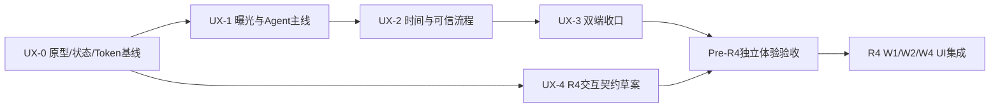

# ProjectMemo 双端功能曝光与 UI 优化方案

初稿：2026-10-21；增量定稿：2026-10-22。状态：Pre-R4 设计规格已交付，UI 实施尚未开始。

本版沿用原审查的 V1–V8、四层曝光结构及有效边界，补充长期 Agent 交互和 R4 承载契约。交付三件套：本文负责总体实施计划；[双端关键页面原型](PRE_R4_UX_PROTOTYPES.md)负责布局与状态；[R4 UX Integration Contract](R4_UX_INTEGRATION_CONTRACT.md)负责未来数据及行为边界。配套 [R4 最终架构](../R4_FINAL_ARCHITECTURE.md)、[最终路线图](../R4_FINAL_ROADMAP.md)、[研究裁决](../R4_RESEARCH_REVIEW_AND_DECISIONS.md)。

原稿保留于 `D:/Projects/hongmen-r3-release-merge/docs/FINAL/实施规划/`，SHA256 为 `336EB5C34C3024ABDC35A0032F94D89AC151E1E66551C9EA6278645ACEE16851`。本修订放入当前 R4 工作区，不覆盖原稿。本轮仅修改设计文档；R4 三份正式文档、业务代码和既有验收证据保持原样。

## 1. 本轮要解决什么

**为现有功能安排更合适的可见位置、展示时机和视觉权重。** 不按“要不要保留功能”重新裁剪产品，也不扩展 R3 的阶段、工时和基础设施。

用户是需要跨天继续科研、竞赛或课程项目的学生。打开一个项目，首先要知道：现在做到哪里、哪些事情发生了变化、有没有事情需要自己处理、接下来如何继续。当前功能分布容易迫使用户先理解模块名称，再猜测任务入口。

成功信号：用户不需要逐个点功能页或一直向下滚动，就能找到当前委托、待补充问题、关键变化和下一步；需要查资料或审阅成果时，有稳定入口。

本轮操作对象是界面结构、入口、呈现顺序和文案层级。项目事实、Mission 状态、审批权限、来源有效性及写入契约继续沿用已有实现。

## 2. 证据与边界

| 证据 | 本轮确认范围 |
|---|---|
| Windows Computer Use 的鸿蒙模拟器画面 | 实际查看项目列表和项目工作台首屏；观察到全局与项目内底栏变化、统计区和阶段重点卡片 |
| [网页桌面截图](/D:/Projects/hongmen-r3-release-merge/evidence/r3/20261021-project-workspace/home-desktop.png)、[网页窄屏截图](/D:/Projects/hongmen-r3-release-merge/evidence/r3/20261021-project-workspace/home-mobile.png) | 2026-10-21 本地隔离库、mock 截图；并非本次 ECS 在线截图 |
| Web 源码 `4b8f706` | 核对首页、功能路由、统计、建议规则、Mission 摘要及全局样式 |
| 鸿蒙当前源码 | 核对 ProjectHome、MissionPanel、MissionDetail、DesignTokens 和颜色资源；主工作区已有未提交修改，未改动这些文件 |
| 在线浏览器 | 本轮多次尝试侧边浏览器及 Edge 扩展；标签元数据可发现，读取画面/DOM 超时，在线操作审查未完成 |
| 安装版本 | HDC 查询未返回目标；未确认模拟器运行包与源码提交一致。AppScope 的版本号仍为 1.0.0，不能据此识别最近构建 |

本方案中的曝光、配色、字号和时长建议属于 **H4：项目建议**，不宣称为华为官方规定。目标 ArkUI/API 版本按本地 DesignTokens 记载为 SDK 6.1.1 / API 24，实际运行设备版本尚未核实。

## 3. 已确认的问题

| ID / 优先级 | 证据 | 用户影响 | 最小调整 | 规则与置信度 |
|---|---|---|---|---|
| V1 / MAJOR | 网页窄屏截图；`components/ProjectWorkspace.module.css:35` 附近的窄屏导航；`components/ProjectPulse.tsx:12` | 项目标题、编辑按钮、两行八个入口及四项统计先占据页面，建议下一步已接近或超过截图首屏下沿 | 压缩标题和编辑入口；将关键事项提前；导航保持可达，完整目录按需展开；统计移到次级位置 | `rule/one-primary-action`、`rule/structure-before-containers`；high（保存截图） |
| V2 / MAJOR | 科研项目截图的“记录参赛要求”；`lib/projectDashboard.ts:93`、`:137` | 通用竞赛缺口可能压过项目当前真实目标，突出显示了不合场景的建议 | 首页焦点先取需要用户回应的委托/风险/行动；准备度仅在匹配场景和目标时参与优先级 | `rule/one-primary-action`；high |
| V3 / MAJOR | `app/projects/[id]/page.tsx:30` 使用完整 `m.goal` 和通用状态 | 当前委托卡展示长段任务指令，用户仍不知道现在要回应什么 | 显示短目标、最近有效进展、待用户处理事项和一个明确的继续入口；完整目标进详情 | `rule/name-object-scope-consequence`、`rule/cover-reachable-states`；high |
| V4 / MAJOR | Web 一级“长期委托”；鸿蒙 `ProjectHome.ets:4514` 的 MissionPanel 放在 CopilotView 中 | 同一功能在两个客户端中的位置和概念关系不同；用户容易把长期委托理解为问答附属能力 | 项目首页露出当前委托；保留稳定委托入口，快捷问答保持直接可达 | `rule/preserve-mental-model`；high（源码，安装包待核） |
| V5 / MAJOR | 桌面截图多个相同容器、两个零数据面板；`page.tsx:28` 至 `:34` | 提醒、待办、委托和最近记录占据近似视觉权重；项目变化详情很靠后 | 按当前任务排序；空模块合并为一行提示；变化摘要前置，完整再入场报告仍按需展开 | `rule/structure-before-containers`、`rule/inline-before-modal`；high |
| V6 / MAJOR | `app/globals.css:1`、`:89`；鸿蒙 `common/DesignTokens.ets` 和 `resources/base/element/color.json:92` | Web 绿/暖白/衬线/透明材质与鸿蒙蓝/冷白/实心表面形成两套语言 | 统一语义色、正文及标题角色、按钮等级和容器用途；保留平台控件与不同布局 | H4 品牌一致性建议，`rule/preserve-mental-model`；high |
| V7 / MINOR | `app/globals.css:119`、`:163`、`:176` | transition: all 和普遍悬浮位移扩大动效范围；缺少统一按压表达。未测得实际长帧 | 明确动画属性；hover 位移仅用于精确指针；触摸提供即时按压反馈 | ui-animation：GPU-only、Frequency-appropriate；high（静态），性能影响待测 |
| V8 / MINOR | `app/layout.tsx:37` 的全局模型运行模式标记 | 常驻技术信息与项目导航、账户入口竞争空间，且不直接回答项目当前任务 | 模型配置及回退详情进入设置；任务实际执行失败/降级在对应委托显示 | `rule/smallest-intervention`；high |

以上发现只描述已观察或已核对的部分。在线导航速度、表单错误、键盘焦点、深色对比度和真实触摸表现未判定为通过或失败。

## 4. 核心决定：四种曝光层级

### A. 首屏动态出现：当前最值得关注的内容

首页只选一个主焦点，依据服务端真实状态和当前用户权限决定：

1. **需要我处理的委托**：待补充信息、待批准、异常暂停；展示具体问题或提案，主操作是“补充实验结果”“审阅行动提案”“查看暂停原因”等。
2. **临近截止或高影响阻塞**：展示具体行动/风险及其影响，不只展示红色计数。
3. **改变当前计划的项目变化**：新证据使结论失效、来源发生修订、已有计划需要重审。
4. **正在推进的目标**：没有更紧急事项时，显示当前 Mission 最近进展和继续查看入口。
5. **尚无活动的项目**：显示一个适合该项目场景的起步动作，如记录第一条实验进展或委托阶段汇报。

该顺序是待原型验证的默认规则。用户明确的截止、禁止方案和自动执行边界优先；不能为突出某个模块而忽略已有约束。`rule/one-primary-action`、`rule/cover-reachable-states`。

“待处理”不能与“Agent 正在运行”混为一谈；Agent 正在执行通常无需用户立即介入。“新资料到达”也不能直接显示为“已满足缺口”或“目标已完成”。

### B. 固定可达：用户主动寻找时有稳定位置

推荐两端共享五个项目任务分组，先做导航原型再决定最终布局：

| 项目分组 | 直接承载的能力 | 曝光方式 |
|---|---|---|
| 概览 | 当前结论、项目变化、重要事项、下一步 | 默认进入；轻统计为辅 |
| 委托 | 长期目标、执行进度、补充、审批、草稿 | 固定入口；首页显示当前委托和待响应事项 |
| 资料与记忆 | 原始记录、附件、来源、知识检索、历史有效性 | 固定入口；内部区分“原始资料”和“项目记忆” |
| 行动 | 待办、提醒、依赖、时间安排、结果复盘 | 固定入口；首页只摘要高优先事项 |
| 成果 | 已归入成果、版本、草稿审阅、生成 | 固定入口；新草稿或需要审阅时在首页出现 |

**问忆程保留常驻轻入口**，并在资料、行动和成果旁提供带上下文提问；不要求用户先进入委托才能快速问一个问题。长期委托是一个持久目标，快速问答是即时理解，两者共享项目上下文但保持任务含义明确。

桌面可以使用侧栏；鸿蒙和窄屏 Web 可以使用底部导航或精简主导航。统一分组、命名和当前位置，允许平台布局不同。全局入口明确写“全部项目／全部记忆／我的待办”，进入单项目后始终显示项目范围。`rule/preserve-mental-model`、`rule/navigation-vs-action`。

### C. 场景出现：在能发挥作用的时候主动露出

| 当前场景 | 该露出的已有能力 | 呈现要求 |
|---|---|---|
| 新上传/补充实验材料 | 处理状态、关联等待中的 Mission、候选接续 | 上传回执附近出现“可能用于继续某委托”，充分性仍按既有检查确认 |
| 会议后整理 | 会议更新、变化预览、受影响行动 | 放在“记录”入口的来源选择及资料页快捷操作；预览确认后才应用 |
| 等待用户信息 | 具体缺口、相关材料选择、补充并继续 | 在首页焦点和同一 Mission 内出现，保留问题与原任务绑定 |
| 等待批准 | 提案内容、影响范围、来源/上下文版本 | 审阅按钮醒目，批准前展示实际后果；不能从首页摘要直接绕过预览 |
| 发现来源失效/冲突 | 受影响结论和成果内容、原始依据 | 在相关内容旁露出核验入口，不要求先去体检页找报告 |
| 行动需要安排时间 | 可用时间、冲突说明、排程预览 | 在行动详情出现，创建待办、排程和实际完成各自保留状态 |
| 行动报告完成 | 结果记录、证据、复盘回执 | 在完成操作附近收集结果，不另造一套“完成”流程 |
| 已有可审阅草稿 | 来源核验、版本差异、确认归入成果 | 优先“继续审阅这份草稿”，避免只突出“再生成一份” |

这部分改变的是现有功能的出现时机，不代表新增自动审批、自动发布或事实确认。`rule/name-object-scope-consequence`、`rule/inline-before-modal`、`rule/smallest-intervention`。

### D. 二级查看：需要时能找到，不占据默认首屏

- 全量工具事件、调用预算与错误诊断：委托详情的“执行详情”。当前错误和恢复动作仍立即显示。
- 总卡片数、总成果数、完整准备度：项目概览的“更多状态”；竞赛准备度在竞赛情境中提升曝光。
- 全量健康检查、阶段检查点、归并与归档管理：从概览或资料页进入；高影响发现要在对应任务处出现。
- 模型 Provider、运行模式、开关、连接诊断：设置或诊断页。
- 个人约束、研究范围、自动接续权限：委托创建/修改时就近查看和编辑；不是要求用户每次先读完全部说明。

二级不等于不可见。摘要要能直接定位到对应实体，旧链接和旧锚点继续可达。

## 5. 首页建议结构与内容预算

### 窄屏 / 鸿蒙

```text
项目名                         项目菜单
当前阶段 / 目标短句

当前最重要的一件事
需要补充：本周实验的对照组指标
同一委托已完成资料检索，正在等待你的结果
[补充实验结果]          查看依据

最近重要变化（最多 2–3 条，有变化才显示）
接下来要做（最多 3 条）
当前委托 / 当前草稿（与主焦点去重）
更多项目状态

概览    委托    资料    行动    成果
```

“记录进展”作为固定轻量新增入口；桌面、手机均可直接调用已有 Capture/Attachment 流程。问忆程作为稳定轻入口，而非要求首页再摆一整块问答表单。

### 桌面

保留项目侧栏；主区域先显示一个焦点及简短变化摘要，再按空间分栏展示待办与当前委托/成果。项目标题、描述、设置压缩为一条上下文区。空模块不保留大面积占位卡片。

首屏验收采用项目建议目标：在 390×844 和 1280×800 的视口中，用户能看到项目范围、当前主事项以及其主操作。放大字号时允许内容自然扩展，不能为了首屏预算截断必要信息。

## 6. 双端统一哪些内容：比较后选择视觉方向

统一优先级：**业务概念 → 状态和后果 → 入口 → 视觉 Token → 动效**。保留第 4 节五分组；Web 适合阅读、资料管理和成果/方案审阅，鸿蒙优先捕获、查看、轻审批、补料和同任务接续。复杂比较在手机提供纵向详情，不能只给“请前往电脑”死路。`rule/preserve-mental-model`、`rule/cover-reachable-states`。

### 6.1 两套同内容候选

以下均为 H4 项目视觉提案，不能当成平台默认值。用相同的“等待实验指标”页面对比，见[双端原型 §2](PRE_R4_UX_PROTOTYPES.md#2-视觉候选与推荐-token)。

| 比较维度 | A 暖纸青墨 | B 冷白墨蓝 |
|---|---|---|
| 浅色基础 | 暖白 `#F7F6F2` / 实心白；深墨 `#1C2E2C` | 冷白 `#F4F6F9` / 实心白；墨蓝 `#1D2A3B` |
| 主操作 / 选中 | 克制青墨 `#27685D`，浅底 `#E7F0EB` | 灰蓝 `#3D5E86`，浅底 `#E8EEF5` |
| 深色基础 | `#151E1C` / `#1D2926`；字 `#E8EEE9`；强调 `#91C6B5` | `#17202D` / `#202D3C`；字 `#ECF0F7`；强调 `#ADC4E2` |
| 与既有产品关系 | 延续 Web 的暖白/青绿，把营销式衬线、玻璃和浮动改为工作台层级 | 延续鸿蒙蓝色，降低饱和度；Web 变化更大 |
| 长时阅读 / 辨识度 | 接近资料、记录与长期积累的气质；与一般任务看板更易区分 | 信息工具感明确；容易接近通用企业工作台 |
| 风险 | 青色品牌与“成功”不能只靠色相区分；暖底必须控制文字对比 | 蓝色主操作与“普通信息”容易同权；不能继续高饱和填满卡片 |
| 平台落地 | 都可映射 CSS / ArkUI 语义资源；保留系统弹窗、输入和转场 | 同左 |

**推荐 A 暖纸青墨。** 选择依据是产品的记忆/证据定位、现有 Web 连续性和跨端识别；不是用户偏好已被实验证实。原稿“先复用鸿蒙蓝”的结论改为候选 B，不再作为默认。UX-0 用相同任务验证可读性与状态辨识；若 A 存在不可解决的对比/理解问题，再按记录切换 B，不混用两套品牌色。品牌选择属 H4，规则库无品牌偏好规则，不伪造规则 ID。

### 6.2 组件与信息密度

- 正文与业务标题采用平台系统无衬线；Web 中文字体有本地系统回退，不依赖外部字体加载完成才能阅读。衬线只保留在字标等品牌角色。
- Web 字号角色建议 12 元信息、14 次要、16 正文、18 区域、24 页面；鸿蒙沿用既有 12/13/15/18/20 角色并实测大字体。两端统一角色，不强行统一物理尺寸。正文行高建议 1.5–1.7；数字/时间对齐，不用巨型统计制造焦点。
- 间距统一 4/8/12/16/24/32；手机页边 16，桌面 24–32。桌面默认两栏，正文阅读宽度单独约束；源文/成果有阅读模式。
- 页面底色、内容表面、需要用户处理的焦点是三层；普通条目用分隔线和排版，审批/草稿等独立对象才用卡片。减少玻璃、网格背景、重阴影和卡片套卡片。`rule/structure-before-containers`。
- 一个当前主操作使用实心青墨；其他操作为描边/文本；取消与拒绝不能隐去，破坏性操作用明确动词。状态采用“图标 + 文字 + 可选浅底”，品牌选中不能冒充成功。`rule/one-primary-action`、`rule/canonical-verb`。
- Web 点击区建议至少 44 CSS px，鸿蒙普通按钮优先既有 48vp 角色；这是 H4 验收目标。紧凑表格不降低触达区域，系统组件优先，不覆盖其焦点/读屏行为。
- 每个语义 Token 映射到 CSS 与 ArkUI Resource，浅深主题按角色成对维护。详细候选色、对比度核算和控件状态见原型说明；大字体、对比、系统主题均须实际渲染后验收。

## 7. 动效与反馈：只帮助理解

| 当前/潜在问题 | 建议表达 | 目的 |
|---|---|---|
| Web 普遍 hover 上浮 4px、transition: all | 常用工作区控件改为颜色/边框反馈；仅对适合的可点击容器保留小幅位移，限定精确指针 | 减少漂浮感及无关属性动画 |
| 主操作需要等待服务端 | 按下立即反馈，按钮保留动作含义；旁边显示“已受理，等待执行”等真实状态 | 用户知道点击已收到，不把受理当完成 |
| 折叠的来源和执行详情 | 原位展开；建议局部 150–200ms，Web 明确 opacity/transform，ArkUI 优先已有系统 transition | 保持内容与触发位置的关系 |
| 材料提交、审批或归入成果完成 | 在对应对象附近显示具体结果和查看入口 | 无需转向远处 toast 寻找结果 |
| 快速切换和键盘操作 | 高频导航不增加装饰性入场；不等待动画才能再次操作 | 保持直接和可打断 |

不建议增加：每屏 stagger 入场、每张卡片弹跳、运行计数翻滚、滚动视差。原因是高频工具界面，不能回答新的任务关系。Web 已有全局 reduced-motion 规则，不应报告为“完全没有低运动支持”；仍需实测其变换是否真正停止。鸿蒙已有单向内容淡入，并记载双向过渡曾导致布局压缩，保留该取舍，不强行恢复对称动画。

## 8. Pre-R4 总体实施计划

原 A“曝光原型”归入 UX-0/UX-1，B“两端路由对齐”归入 UX-1/UX-2，C“视觉反馈”归入 UX-3。UX-4 从 UX-0 同步起草，最后冻结。基础 Token 的选定先于 UI 实施，UX-3 负责全量收口，不等到最后才决定配色。



R4 W0 的只读探针和正确性调查可与本计划并行，不改动 R4 原工时与范围；R4 新功能页面实施应依赖本计划冻结的组件/语义。UX 发现源状态不可靠时只阻断依赖它的展示/写入，不把它改成前端“修正事实”。本计划不承诺开发时长，UX-0 记录实际原型与适配成本后再估算。

| 阶段 / 工作包 | 页面与复用组件 | 交付及验收 | 依赖与回退 |
|---|---|---|---|
| UX-0 / P00 证据与契约盘点 | 两个工作树、四个关键页面；Mission/State/来源已有 DTO | 标注源码/截图/设备版本；完成当前与未来字段清单、用户旅程、导航映射、状态矩阵；原型不出现伪进度/伪历史 | 依赖只读源码；发现契约缺口列依赖，不造数据补齐 |
| UX-0 / P01 视觉和四屏原型 | 桌面概览、窄屏概览、鸿蒙工作台、Mission 详情；Focus、Activity、Source、Status 原型 | A/B 同内容对比；覆盖原型状态集；找入口/读状态形成性走查，记录首次正确点击、误解与帮助，不预填提升率 | P00；原型未解决方向感先改原型，不进入实施 |
| UX-1 / P10 导航与项目首页 | Web layout/ProjectNavigation/ProjectPulse；鸿蒙 ProjectHome/项目导航；CaptureBox/原捕获页 | 五分组、全量目录、压缩头部；一焦点、变化摘要、待处理集合、同任务直达；旧 8 路由与锚点兼容；不增加首页评估写入阻塞 | P01；恢复旧导航呈现但保留新旧深链解析与用户草稿 |
| UX-1 / P11 Agent 摘要与工作空间 | MissionPanel/MissionDetail、MissionContinuation、审批及 Output 组件；详情不再堆入 ProjectHome | 两端同状态、问题、最近关键回执、主动作；多个 Mission 分类/分页；运行中不催批准；能力失败不静默等同关闭；复用 Event 游标，不重复建 Runtime | P00/P10；回退旧详情，保持 Mission ID、输出修订和命令结果可读 |
| UX-2 / P20 项目演进与解释 | ProjectStateCard/变更简报、EpisodeCheckpoint、Ledger timeline、KnowledgeFeed、成果 provenance | 明示 from/to 基线、来源/有效状态、已发布 Episode；无基线不写“自上次查看”；无多跳只显示已有直接关系；陈旧摘要不当当前结论 | P11；可靠性问题停变化判断，仍可看原记录/历史快照 |
| UX-2 / P21 审批、补料和恢复 | 既有 Mission审批/Continuation/约束/Scope、MissionArtifactAdoption、ActionBoard/结果回执 | 补料到充分性逐级区分；批准前明确创建对象/范围；超时读回；保留输入；来源变化重预览；草稿采纳不升级 Claim；401/切身份不显示旧私有内容 | P11；停新快捷操作，原服务与历史回执仍可访问，不撤销已提交业务 |
| UX-2 / P22 冷启动与再进入 | 项目创建、Capture/Attachment、概览、首 Mission、行动/成果 | 空项目首动作→第一条真实资料→有依据摘要→显式委托/授权→行动确认；已有资料跳过引导；跨天返回同任务；无访问基线只写“当前/最近记录” | P10/P20；可跳过引导，普通功能入口常在；不自动 seed 真数据 |
| UX-3 / P30 Token 与控件收口 | globals.css/工作台 CSS、DesignTokens/颜色资源及独立共享呈现组件 | 浅深主题、字体、容器、按钮/图标/状态；四屏和压力状态无横溢/关键截断；Web Hover/Focus、鸿蒙 Press/系统表单/底栏一致语义 | UX-0 Token、P21；按 Token/组件回退视觉，不还原业务状态 |
| UX-3 / P31 交互质量与双端验收 | 原生弹窗、表单、键盘/读屏、所有关键入口 | 默认/大字体、触摸/键盘、返回/前后台、弱网/中断/重复操作、Reduced Motion；构建/模拟器/真机分别留证；实际测长帧 | P30；关闭新装饰动效；保留真实状态反馈和恢复动作 |
| UX-4 / P40 R4 接缝冻结 | 变化/来源详情、方案审阅、主动事项、经验说明的设计原型 | 每模块明确宿主、数据、状态/命令、权限、失效和回退；与正式架构逐项对账；没有服务的入口不在生产出现 | 从 P00 起草，P20/P21/P31 后定稿；本包只有契约，不引入 R4 数据层 |

**关键路径**：P00/P01 → P10/P11 → P20/P21/P22 → P30/P31 → P40 冻结/独立交付。P40 的原型可提前评审，不能反向要求 Pre-R4 实现 Twin/Lab。每阶段实施时单独 commit，并在实施记录写改动、实际检查和开放 Gate；本轮未开始实施。

### 8.1 独立交付价值与范围

- **Pre-R4 必交**：四屏、五分组兼容导航、Agent 摘要、真实变化基线、来源/审批/补料/恢复、起步与再进入、A 视觉双端收口、状态矩阵和 R4 衔接规格。
- **有证据再加入**：额外快捷键/命令面板、桌面长期固定详情栏、系统 Widget 优化。先以现有搜索/问答入口满足上下文任务；不为命令入口另建工具执行器。
- **只留设计规格**：多跳影响、候选方案计算/采用、新主动排序、GitHub 感知、自动经验复用、任意历史回放。详见 Integration Contract。

### 8.2 验收路径

1. 文档/静态原型：四屏、状态矩阵和旧入口清单逐项勾验，比较 A/B，检查每个主动作的对象、后果、返回路径。
2. 隔离数据交互：空/稀疏/密集/失败任务，Web 新路由及锚点、鸿蒙状态和 DTO 同步；不访问真实数据库做 reset。
3. 受影响工程检查：Web 类型/lint/构建与路由 E2E；ArkTS 检查/HAP；涉及 DTO、授权/命令则跑对应契约及幂等/版本回归。最终集成候选执行仓库完整必需检查。
4. 双端同任务：Web 发起 → 鸿蒙补料/审阅 → Web 读回同 Mission/Output/Receipt；故障、字体、键盘、读屏和 Reduced Motion 单独验收。
5. 真实使用与发布：同版本设备/服务进行找入口与状态理解小测，记录原始计数；性能测量、签名/安装/平台和 ECS 在线结果分别记录。本文无这些通过回执。

## 9. 验证矩阵与待补证据

| 任务/状态 | 判断标准 | 本轮状态 |
|---|---|---|
| 找到当前需要自己处理的委托 | 无需遍历功能页即可找到具体问题/批准入口 | 待原型与在线验证 |
| 一段时间后继续项目 | 能说出当前结论、关键变化和下一步；变化基于已有确认快照，不伪造“上次访问”基线 | 待验证 |
| Web 发起、鸿蒙补充、Web 审阅 | Mission ID、资料绑定、草稿版本、批准历史保持一致 | 源码有对应能力；设备操作待验 |
| 项目范围和返回 | 全局/单项目范围明确；返回到原列表/筛选/实体，不丢草稿 | 待交互验证 |
| 网络失败、权限不足、能力关闭 | 显示真实状态和恢复/返回路径；不能全部当成“没有此功能” | MissionPanel 静默隐藏已从源码确认；真实交互待验 |
| 稀疏/密集数据 | 空模块不挤占主页；长标题、长问题、多个委托仍可扫描 | 保存截图可确认部分问题；更多数据待验 |
| 浅色、深色、默认和大字体 | 文字、操作、选中态、来源状态可分辨；不依赖颜色单一编码 | 待实测 |
| 键盘、读屏、触摸 | 可完成补充/审阅/返回；焦点合理；按压反馈即时 | 待实测 |
| 快速切换、反向打断、慢放、帧率 | 无输入锁定、内容压缩或重复请求；记录实际长帧，不以构建通过代替 | 待设备测量 |
| 安装/发布版本 | 能区分服务端版本与原生包版本；重新安装不能当作完成 UI 对齐的证明 | 安装版本尚未核实 |

建议做找入口小测：任务是“继续昨天的委托”“找到刚生成的草稿”“确认新材料改变了什么”“补录一次实验”。记录首次正确点击、错误入口次数、滚动量、完成时间，并比较优化前后；数值目标在基线小测后冻结，不预填效果提升。

## 10. 特意不列为缺陷的事项

1. **鸿蒙缺少委托功能**：不成立。`MissionDetail.ets` 有列表、创建与接续能力；`ProjectHome.ets:4514` 引用了入口组件。问题是曝光与两端入口位置，安装版本另核。
2. **已有卡片都应删除**：不成立。审批、成果和来源有明确对象边界，容器可帮助审阅；要减少的是重复和无差别权重。
3. **Web 与手机必须完全同布局**：不成立。侧栏和底栏可以不同；统一任务分组和状态语义。
4. **缺少全部 loading/error/reduced-motion**：不成立。已有 `app/error.tsx`、loading 文件和全局低运动规则；本轮未完成状态操作覆盖，不能整体判失败。
5. **需要补全大型自主调度、更多 Agent 或新文档系统**：本轮曝光问题不需要这些能力。

## 11. 原审查结论与本次修订记录

原审查已确认 8 项问题，本次设计修订未实施修复，剩余 8 项。就已观察页面而言为**有条件通过**，存在上述 MAJOR；整轮双端操作审查为 **INCOMPLETE**，原因是 Web 在线读取超时、鸿蒙安装版本及其他页面交互尚未核实。该结论不替代真实服务、设备、无障碍及性能验收。

使用：ui-design（Audit/report-only）、product-design（review，补充曝光结构建议）、ui-animation（静态审查与 Discovery）、harmonyos-design（现有项目审视）。design-taste-frontend 的营销页构图、图片数量和动效数量门槛不套用登录后工作区；本次公开首页读取失败，未执行其页面检视脚本。

读取的主要技能参考：ui-design 的 feature-playbooks、ship-readiness、output-adapters、rules/_sections、type-readable-scale、mobile-hover-only-affordance、motion-respect-reduced-motion；ui-animation 的 decision-framework、review-format；product-design 的 rules、interface-quality、product-judgment；四个用户提供的 SKILL.md；Computer Use 的 SKILL.md、guidance、api、confirmations。未运行 UI 自动修复、构建、模型付费调用或部署。


## 12. 增量产品简报与设计裁决

**用户/任务**：用户跨天推进一个有资料、有约束的科研/课程/竞赛项目，希望迅速理解当前状况，并与 Agent 继续同一目标。**当前行为**：先找模块，再滚动长页、读完整指令，才能发现需要补料或批准。**期望结果**：概览告诉我为何需要关注，原任务告诉我如何回应，来源告诉我依据。**成功信号**：能在首屏定位正确对象，解释当前等待和下一步，完成补料/审阅后不创建重复任务。**对象/范围/后果**：导航只改变位置；输入/审批/采纳调用现有服务，分别更新绑定任务、创建批准对象、归入成果；已执行结果保留。**权限**：私有 Mission 沿用 OWNER 校验；普通项目可读数据不能推导私有委托存在。**非目标**：不实现新的推理、后台调度、事实存储或跨项目画像。

| 裁决 / 解决问题 | 设计决定 | 规则 / 依据 |
|---|---|---|
| D1 / V1、V5 | 一个主焦点 + 按需展开；其他待处理形成可扫描队列，危险/到期事项不因折叠消失；用户阅读时不自动挪走焦点 | `rule/one-primary-action`、`rule/structure-before-containers` |
| D2 / V2 | 首焦点从用户待回应/真实阻断选取；未建模阶段不要求用户去不存在的设置，竞赛准备度仅匹配场景时出现 | `rule/smallest-intervention`；研究裁决 C05 |
| D3 / V3、V4 | 目标、当前状态、最近有回执的进展、等待和下一步分开；列表短标题不生成新业务标题，允许展开原目标 | `rule/cover-reachable-states`、`rule/name-object-scope-consequence` |
| D4 / 入口分散 | 五组导航 + 完整目录 + 情境入口，所有旧页面保持可达；手机保留原生导航语义 | `rule/preserve-mental-model`、`rule/navigation-vs-action` |
| D5 / 可信理解 | 记录存在、证据支持、Agent推断、用户批准和现实完成分轴，不能用一个绿色勾包办 | `rule/cover-reachable-states`；R4架构 §3、§5–9 |
| D6 / 教程负担 | 先完成真实资料录入，再解释状态摘要/首委托；高级权限在首次相关使用时说明 | `rule/value-before-interruption`、`rule/permission-benefit-first` |
| D7 / V6、V7 | A/B 比较后推荐暖纸青墨；保留系统控件反馈，减少漂浮容器和装饰动效 | H4 视觉偏好；`rule/structure-before-containers` |
| D8 / 扩展失控 | R4 按“变化→解释→比较→采用→接续”融入现有宿主，不增加模块级导航 | `rule/smallest-intervention`；R4架构 §11 |

品牌选择与 Agent 状态分轴没有专用产品规则 ID：前者为 H4 风格决策；后者受 R4 领域契约约束。状态真实性的细粒度规则属于规则库 coverage gap，不以自创 ID 冒充既有规则。

## 13. A–F 六维增量的具体落点

| 维度 | 当前可交付的体验 | 必须等待的数据/服务 | 验收位置 |
|---|---|---|---|
| A Agent Experience | 任务当前状态、最近 2–3 项有回执活动、问题/批准/错误、草稿与实际结果；完整轨迹按需展开 | 跨层影响导致计划重修的完整根因和覆盖 | 原型 §4、§5；Contract §2 |
| B Project Evolution | Ledger 决策时间线、现有 State Diff 的固定基线、已发布 Episode 与来源 | 完整多跳、覆盖/时间相位修正、完整历史版本 | 原型 §6；Contract §3 |
| C Trust & Control | 来源/推断标签、批准后果、输入版本、恢复、成果采纳/Claim 和完成回执区分 | R4 Scenario 原子采用、ImpactJob 与新权限订阅 | 原型 §5、§7；Contract §4–7 |
| D Onboarding & Task Flow | 创建→资料→状态→委托→行动→同任务再进入；示例目标可编辑且使用真实项目资料 | 自动示例项目创建需独立产品/数据实现，不进必交 | 本文 §14；原型 §8 |
| E Cross-Platform | 同五组/语义；Web 并列阅读，手机捕获/补料/轻审批；原生表单、底栏与返回 | 设备后台/通知/小艺新增行为需各自服务和设备 Gate | 原型 §3–5、§9 |
| F Visual/Interaction | 成对 Token、可读层级、长文/大字、控件完整状态、轻反馈 | 未验证设备性能和主题不能由配色表宣称通过 | 本文 §6–9；原型 §2、§9 |

## 14. 首次使用与长期再进入

1. **创建项目**：保留现有必要字段；先输入项目名/目标，截止等允许稍后填。不把任意缺项都升级成阻断，场景选择不擅自补“参赛要求”。成功后进入项目空态，而非弹出全部权限教程。
2. **第一条资料**：空态主操作“记录第一条进展”，旁边可选附件/会议；已存在资料则直接显示真实条目。沿用 Capture/Attachment 草稿与处理状态，上传受理、提取完成、记忆入库分开。失败保留输入/文件选择和可恢复路径。
3. **第一份状态摘要**：展示可追溯的当前信息及缺口；状态功能关闭/失败则显示记录列表与“查看资料”，不从无数据推断健康。现有 Snapshot 的已知时间/覆盖缺口必须可见，不把它包装成完整 Twin。
4. **第一个长期目标**：在有资料时给可编辑目标建议“依据这些材料准备阶段汇报”，用户明确创建并选择模型上下文/公开研究授权；不默认启动收费调用。约束可逐步补充，云模型外传与 Web Research 单独授权。
5. **建议到行动**：跳转同 Mission 的提案审阅，明确“将创建 1 项待办”；批准并取得持久回执后才显示创建成功。排程与结果复盘仍走原入口。
6. **跨天再进入**：首先展示当前待处理与最近有时间戳的活动，保留同 Mission 的草稿、历史批准与来源。没有真实访问基线只写“最近重要变化/相较快照 X”；旧 Diff 不能冒充从用户离开到现在的全量变化。没有基线提示“尚无可比较基线”，仍可阅读当前记录。

示例项目不作为必交：先用无副作用的目标示例与就地提示。若后续试用证明需要演练项目，独立创建并持续标识示例/模拟数据，不复制到真实统计、结论和成果。`rule/empty-state-action`、`rule/preserve-user-input`、`rule/cover-reachable-states`。

## 15. 本次交付与开放验收

本轮在保留原方案的基础上补齐 UX 工作包、视觉候选、旅程、四屏低保真/状态规格及 R4 Integration Contract，完成文档范围核对。没有 UI、数据库、Agent Runtime 或 R4 能力实现，没有修改正式 R4 估时。原 V1–V8 作为待修问题继续有效。

源码核对基线：Web 发布工作树 `master@4b8f7064731fc5e1c8a75032b103b4a2f42c0f29`；R4/鸿蒙主工作树 `21cc5fde46b660110ac2f4feec056e04838ba52c` 加既有未提交修改。两个工作树的差异必须在后续实施集成时对齐，不能用较旧主分支页面覆盖已经拆页及延后评估的 Web 修复。

新增设计尚未通过交互用户测试；当前证据为源码、既有截图和文档核对。在线画面、安装版本、真机、大字体、无障碍与长帧继续开放。技能本轮采用 product-design 的 spec（规则/状态/后果），ui-design 的 Direction（候选视觉），并延续原 ui-animation/harmonyos-design 的适用边界；没有执行业务自动修复。
