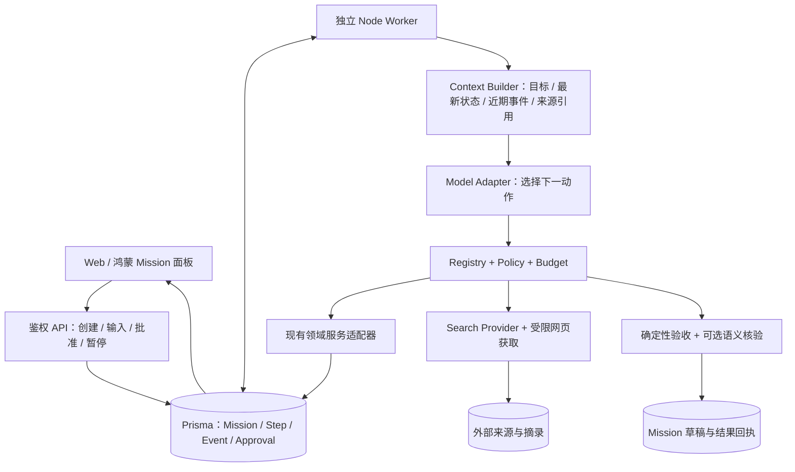

# R3 决赛升级实施路线图

日期：2026-10-20。负责人视角；实施契约见 [R3_PHASE_SPECS.md](R3_PHASE_SPECS.md)。

## 1. 推荐决策

建设一个**单项目、单执行者、有持久进度的 Mission Agent**：模型根据观察结果选择工具，服务端负责权限、预算、版本、确认和结果验收。继续使用 Next.js、TypeScript、Prisma 和 SQLite；先不引入 Agent 框架、队列平台或新的向量数据库。

产品定位采用 **Evidence-grounded Personal Project Agent**。“Personal”首先表示用户拥有自己的委托、约束、来源和执行历史；决赛最小版本不依赖跨项目画像。

第一条完整能力是长期委托：用户一次给出阶段汇报目标、个人约束和公开研究范围；Agent 自主选择内部检索、外部研究和分析路径，遇到实验指标缺口进入 WAITING_INPUT。用户离开后通过已有 Capture/Attachment 补充资料，系统检查关联与缺口，用户确认后继续原 Mission；新证据改变方案时废弃相关未执行步骤和旧批准，保留已完成步骤、草稿及历史。最终交付有来源的汇报草稿、经批准创建并读回的验证行动，以及可由用户确认归入项目的成果版本。

这条链必须由模型选择工具，顺序随任务和工具结果变化。固定脚本只用于确定性测试，不充当自主执行证据。

### 1.1 与总体方案的取舍

完整阅读了 [2026-10-20 总体方案](../总体方案/ProjectMemo_Personal_Project_Agent_决赛升级总体方案_2026-10-20.md) 的 0–21 节及附录。保留其 Mission 主线，调整以下决策：

| 总体方案中的方向 | 本路线图的决定 | 理由 |
|---|---|---|
| 先 Runtime，再 Context，最后 Verifier | 第一条链就包含最小 Context、确认、验收和恢复；后续增强语义核验 | 否则第一阶段产出无法安全演示，后接确认会返工 |
| Worker 在长任务或主动功能中引入 | Worker 属于 R3.1；周期性主动触发另列 Stretch | 鸿蒙请求读取超时 30 秒，执行不能依赖页面或请求进程存活 |
| Mission 可支持多个项目、可无项目 | 首版必须绑定一个 projectId 和一个 ownerUserId | 当前领域服务按项目组织，多项目授权不是免费能力 |
| 4–6 个现有工具加多种扩展 | 最小版限定 7 个模型工具、1 个由服务端调度的批准提交器 | 降低选择歧义和事务改造范围；成果归入不是新增模型工具 |
| 预览排程、完成行动等同时工具化 | 模型业务写入限于批准后创建 Action；成果归入由用户另行确认 | 先证明一条副作用链可靠，而非全面自动化业务 |
| 单独购买搜索服务作为优先路径 | 先验证现有 DeepSeek 的原生工具协议与 Search/Fetch；搜索 Provider 与模型 Adapter 仍分离 | 当前官方接口已有相关能力，是否可用需真实账号联调，不能由兼容接口名称推断 |
| 四组完整消融为 MVP 必交 | 最小版两组同模型对照；Target 增加离线消融 | 控制评测开发和调用预算；授权门从不在真实写入实验中移除 |
| 17 份左右的设计/状态材料 | 本轮两份文档，后续按工作包追加事实记录 | 把有限时间用于可运行链路；本轮不创建额外文件 |

## 2. 审计基线与证据口径

工作目录 `D:\Projects\hongmen`。下表保留初次规划审计快照：当时分支 `master`、HEAD `723c832ba2d433c84847448f84e8761fd9546be7`，有 16 个已跟踪修改及未跟踪证据。随后 R3.0 提交为 `dfa42ea`，R3.1 本地工程提交为 `7a7e500`；R3.2 本地实现及独立审查结果见阶段规格的实施记录与 `evidence/r3/20261020-r31-r32/`，真实模型/搜索 Gate 单列。不能把下表“新增/缺失”当作当前实现清单，也不能把部分实现当作阶段放行。

10 月 15 日回执保留为历史证据。

第二轮规划修订当时只改两份文档；其后用户授权实施 R3.1/R3.2 并逐阶段 commit，当前实施事实以阶段规格末尾记录为准。后续实施按当前源码和对应回执核对完成情况；历史测试及构建不替代当前模型、设备或平台验收。

### 2.1 能力与源码映射

状态：**复用**＝已有适配价值；**整合**＝已有但不满足 Mission 边界；**未验收**＝存在实现、运行效果须另证；**新增**＝当前实现中未找到该能力；**调整**＝存在影响本轮的设计缺口。

| 层 | 当前事实与直接证据 | 分类 | R3 处理 |
|---|---|---|---|
| 模型调用 | [llmAgent.ts](../../../lib/agent/llmAgent.ts) `chatWithLLMWithMeta` 只发送单条 user message、读 content；无 tool_calls、tool role、usage 归一化 | 整合/调整 | 新增独立 Mission Model Adapter，不破坏 Capture 等旧调用 |
| Copilot | [copilotService.ts](../../../lib/services/copilotService.ts) `answerProjectQuestion` 一次 `chatJsonWithMeta`；`executeCopilotTool` 只支持 create_action/generate_artifact | 整合 | 保留快速问答，显式“创建委托”进入新 Runtime；首版不自动路由所有聊天 |
| 运行记录 | [schema.prisma](../../../prisma/schema.prisma) `AgentRun`、`AgentMessage`；[agent.ts](../../../lib/repositories/agent.ts) `saveAgentRun` | 复用/新增 | AgentRun 作步骤调用审计；新增 Mission/Step/Event/Approval，不能用 trace JSON 当任务状态机 |
| 多轮消息 | `AgentMessage` 没有 user/thread/mission 归属；`listAgentMessages` 按 createdAt 升序 take 20，取得最早消息；Prompt 不传历史 | 调整 | Mission 事件流隔离近期对话；旧聊天不自动归入个人私密记忆 |
| 时态记忆 | [temporalLedger.ts](../../../lib/memory/temporalLedger.ts) `evaluateTemporalCard`；[temporalLedgerService.ts](../../../lib/services/temporalLedgerService.ts) `getTemporalSearchStates` | 复用 | 保留当前、取代、争议、未知，不用 Mission 摘要覆盖项目事实 |
| 检索/嵌入 | [hybridSearch.ts](../../../lib/memory/hybridSearch.ts) `searchProjectCards` 全项目扫描；查询可调用 `ensureCardEmbedding`；[embedding.ts](../../../lib/memory/embedding.ts) 有远程与确定性回退 | 复用/调整 | 小规模先复用；任务检索禁止查询时无界补嵌入，记录截断和回退；不换向量库 |
| 阶段记忆 | [projectEpisodeService.ts](../../../lib/services/projectEpisodeService.ts) 预览/发布/来源失效；[memoryConsolidationService.ts](../../../lib/services/memoryConsolidationService.ts) 归并和撤销 | 复用 | 是长期项目记忆，不是执行 checkpoint；读取 Episode 可能回写失效状态 |
| 当前上下文 | [projectStateService.ts](../../../lib/services/projectStateService.ts)、[projectReentryService.ts](../../../lib/services/projectReentryService.ts)、[projectHealthService.ts](../../../lib/services/projectHealthService.ts) `buildProjectHealthReport(projectId,{userId})` | 复用/调整 | 工具使用结构化状态和真实 viewer；不把缓存摘要当最新事实 |
| 捕获与输入 | [captureService.ts](../../../lib/services/captureService.ts) `processCaptureWithRequest` 已有持久请求键、事务回执与后处理状态 | 复用 | 复用模式和保存逻辑；不直接开放任意记忆写入工具 |
| 行动/执行 | [actionService.ts](../../../lib/services/actionService.ts) `completeProjectAction` 原子保留结果卡；[actionFeasibilityService.ts](../../../lib/services/actionFeasibilityService.ts) 依赖评估 | 复用 | 创建、安排、完成、独立核验分开；最小 Mission 只创建待办并验证创建结果 |
| 幂等基础 | [agent.ts](../../../lib/repositories/agent.ts) `createAction` 无强请求幂等；Copilot `withProposalLock` 是进程 Map，业务写与执行记录分两次提交 | 调整 | 新 Mission 写路径在一个数据库事务内提交业务对象、批准消费和 Step 回执；不调用旧 Copilot 写入口代替 |
| 可靠写入先例 | [episodeActionService.ts](../../../lib/services/episodeActionService.ts) 使用稳定 dedupeKey；[meetingStateDiffService.ts](../../../lib/services/meetingStateDiffService.ts) `confirmMeetingChanges`；[scheduleService.ts](../../../lib/services/scheduleService.ts) 版本确认 | 复用 | 提取最小事务函数，沿用版本校验和领域规则，不复制 API Handler |
| Claim/成果 | [trustReceipt.ts](../../../lib/evidence/trustReceipt.ts) `evaluateClaim` 检查归属/时态，未比较文本蕴含；[artifactService.ts](../../../lib/services/artifactService.ts) 模型输出为 `UNMAPPED_MODEL` | 复用/调整 | 新 Mission 草稿存带来源的结构化块，保留未核验状态；旧成果生成本身会写正式成果，不能当无副作用草稿工具 |
| 主动提醒 | [agentContextService.ts](../../../lib/services/agentContextService.ts) `evaluateProjectContext` 会生成提醒/决策；[interventionPolicyService.ts](../../../lib/services/interventionPolicyService.ts) 有 USER 作用域、频控与预算 | 复用/新增 | 不注册为只读 inspect；执行 Worker 必做，定期主动检查后置 |
| 授权 | [guard.ts](../../../lib/auth/guard.ts) `authorizeProjectAccess` 校验 session 与 membership，不按 role 区分写权限 | 调整 | Mission 默认仅 OWNER 可创建/批准，其他角色先拒绝；Worker 每一步重新查用户与成员关系，不依赖过期 Cookie |
| 小艺 | [auth.ts](../../../lib/xiaoyi/auth.ts) 固定测试项目+共享 Bearer；[createActionService.ts](../../../lib/xiaoyi/createActionService.ts) 有签名提案/请求回执，但业务写与完成回执并非同事务 | 整合/未验收 | 复用报文风格；现有 Token 不能代表任意用户批准 Mission，先完成受限身份映射 |
| 鸿蒙/Web | [ProjectHome.ets](../../../harmonyos/entry/src/main/ets/pages/ProjectHome.ets) 6014 行，Index 3365 行；[ApiClient.ets](../../../harmonyos/entry/src/main/ets/services/ApiClient.ets) 30 秒读取超时；Web `MemoryCopilot`、`ReentryBrief` 已有 | 整合 | 独立 Mission 组件；202 入队与轮询，同一 Mission ID；不继续堆入大页面 |
| 日历/Widget | `CalendarSyncService.ets`、`ActionReminderBlock.ets`、Widget 服务及回执已存在 | 复用/未验收 | 日历不纳入 Mission 自动写工具；跨入口状态核实与系统提醒送达分别验收 |
| 部署/CI | [ci.yml](../../../.github/workflows/ci.yml) 仅 Web lint/types/unit/build；[projectmemo.service](../../../deploy/alibaba-cloud-linux/projectmemo.service) 样例使用 Node 22 路径，项目约定 Node 24；未发现 Mission Worker/服务端业务调度主循环 | 调整/新增 | 增加独立 Worker unit 与运行目录核对；不推断线上版本；迁移与生产操作留给授权后的实施 |

### 2.2 为何还不是可持续执行的 Agent

初次审计中的模型链输出的是答案和候选操作，不会收到“本轮工具实际结果”再选择下一步；工具集合未形成模型可见契约；对话虽已保存，却未进入下一轮生成。进程退出后没有可重建的运行游标、待确认步骤和执行租约。将这几项补到调用链上，比新增 Planner/Researcher 多角色更直接。

业务服务还默认由 HTTP 入口完成身份校验，不能交给后台 Worker 后继续隐式信任 projectId；“读取工具”的成本和缓存写入也未被统一预算。长期执行会放大这些边界，必须先把工具身份、输入版本和实际副作用写清楚。

### 2.3 WP-00A 的五项缺口与条件阻断

保留五项修复及回归任务；已有 R3.0 修复按当前代码与回执核对，不重复开发。按实际工具调用依赖设置阻断点，而不是要求全部关闭才能写 Agent：

| 项目 | Mission 阻断判定 | 必须关闭的时点 |
|---|---|---|
| Reentry 将第一条 FACT 当当前结论、遗漏 PARTIALLY_STALE | 来源有效性阻断；仅当 inspect/context 复用该结论链时阻断相应工具 | 接入该读取链前；直接读取 Ledger 的隔离 PoC 可先行 |
| 原件 /attachments/:id/file 无路由 | 默认非核心阻断；若首条 Mission 需读取原件则升级为阻断 | 原件读取工具接入前，否则在材料界面及最终放行前关闭 |
| 附件校对事务外 CAS、空文本基线省略 | 来源修订与写入一致性阻断 | 接入附件修订或材料接续前；与之无关的工具探针不受阻 |
| primaryTargetId 未消费、来源宽泛跳转 | 默认导航非阻断 | 对应界面/精确定位验收前；不阻断无此依赖的 Runtime PoC |
| isSimulated 进入真实受阻风险 | 状态正确性阻断；inspect/规划使用真实风险聚合时适用 | 暴露该风险给模型前；禁止以模拟任务证明实际进展 |

WP-00B 的脱敏 Provider/Tool Calling/Search/Fetch 探针立即开展，不依赖五项修复完成。授权、来源、状态和原子写入的阻断项在对应路径接入前关闭；非阻断修复仍需在所涉功能及最终候选放行前验收。

## 3. 成熟项目经验与引入判断

下列为 2026-10-20 查询的一手材料；表中迁移建议是本项目的设计判断。SDK 不会替本项目提供业务授权与数据库原子性。

| 项目/材料 | 解决的问题 | ProjectMemo 对应问题与采纳机制 | 引入决定 |
|---|---|---|---|
| [Anthropic Agent/Workflow](https://www.anthropic.com/engineering/building-effective-agents) | 动态工具循环与固定工作流的选择 | 模型负责选择下一动作；代码负责停止、权限和提交 | 借鉴模式，保持单 Agent |
| [LangGraph Persistence](https://docs.langchain.com/oss/javascript/langgraph/persistence)、[Interrupts](https://docs.langchain.com/oss/javascript/langgraph/interrupts) | 线程 checkpoint、长期 store、中断恢复；重放会再运行部分代码 | Mission 与项目记忆分开；已提交副作用按持久回执恢复 | 先用 Prisma；若两天限定 PoC 仍不能证明恢复，再比较 JS checkpointer，不能直接全库迁移 |
| [OpenAI Agents SDK 人审](https://openai.github.io/openai-agents-js/guides/human-in-the-loop/)、[Tracing](https://openai.github.io/openai-agents-js/guides/tracing/) | 批准中断、状态序列化、调用追踪 | 采用冻结提案、恢复事件和单次调用 trace；记录输入输出引用 | 不默认引入 SDK；模型 Provider、持久状态和应用权限仍由本后端控制 |
| [Letta Memory Blocks](https://docs.letta.com/v1-sdk/memory/memory-blocks) | 长期上下文块及只读控制 | 区分任务工作记忆、用户约束、项目事实；任务摘要不能覆写用户确认约束 | 轻量 Context Builder；不另部署记忆服务 |
| [OpenHands 架构源码文档](https://github.com/OpenHands/docs/blob/main/sdk/arch/overview.mdx) | 事件、动作、观察与执行环境解耦 | 独立 Model Adapter、工具执行器和事件流 | 借鉴边界；不引入代码沙箱或电脑操作 |
| [Dify Agent 节点](https://docs.dify.ai/en/cloud/use-dify/nodes/agent) | 原生 Function Calling/结构化策略、迭代上限、工具描述 | 统一 ActionChoice、参数校验、最大迭代；记录真实调用结果 | 不部署第二个工作流后端；工具仍调用当前领域服务 |
| [Notion Custom Agents](https://www.notion.com/help/custom-agents)、[权限](https://www.notion.com/help/custom-agents-sharing-and-permissions) | 工作空间工具、事件/周期触发、显式资源授权 | 借鉴范围选择和活动记录；差异化验证时态来源与计划失效 | 不声称对方缺乏主动 Agent；不复制协作平台 |
| [DeepSeek Tool Calls](https://api-docs.deepseek.com/guides/tool_calls/)、[Search/Fetch](https://api-docs.deepseek.com/guides/search/) | 原生工具消息与独立网页搜索/获取接口 | 当前封装尚未使用；可减少额外供应商，但必须通过 WP-00B 验证 | 首选能力探针；未通过时切受控 JSON Choice 与单一搜索替代商 |

现成框架的收益是成熟的控制流和调试工具；代价是第二套持久状态、Provider 适配及序列化迁移。当前只有一个 Runner、少量工具和一个数据库，轻量实现更容易审计。若无法通过租约/崩溃测试，应暂停扩功能，而不是继续自建更复杂的图引擎。

## 4. 目标架构与三项核心 ADR

### ADR-1：Mission 独立持久化，轻量 Runner 保留现有领域层

Project 是业务容器，Action 是用户需要执行的事项，Episode 是可追溯阶段记忆，AgentRun 是一次调用记录；Mission 是受委托目标的执行状态。首版一个 Mission 只属于一个项目和一个用户，状态以数据库为准。

API 只入队/读取，不在 Next 请求返回后启动无托管 Promise。独立 Worker 每次执行一个有界片段，网络调用在事务外；步骤结果和游标落盘后才进入下一决策。租约带递增 fence，过期 Worker 无权提交。

### ADR-2：动态决策与确定性写入分离

模型工具为 `inspect_project`、`search_memory`、`web_search`、`web_fetch`、`save_mission_output`、`propose_action`、`inspect_action`；提问/完成是 ActionChoice 的类型。`commit_action` 不向模型开放，由批准事件触发确定性执行。

Action 创建必须复用领域校验，业务行、稳定 dedupeKey、Step 回执和批准消费原子提交。模型不得用“confirmed=true”绕过审批。断线重试读回执，不新建执行意图。日历、事实取代、现实行动完成和第三方写入暂不开放。

### ADR-3：外部来源、项目事实与核验结果分层

网页首先是 Mission 私有参考来源，不写 KnowledgeCard/CURRENT，不关闭内部实验缺口。来源记录 URL、获取方式、时间、规范化文本哈希和必要摘录；“用户批准引用”不等于内容已验证真实。

Mission Output 只有一套版本与持久生命周期：R3.1 建通用 Output，R3.2 扩展 Research 内容 Schema，不再另建 Draft Service。草稿不直接调用会发布正式成果的 `generateArtifact`；R3.3 经用户预览确认后，将固定 Output revision 归入现有 GeneratedArtifact 历史，保存来源与块映射回执。归入不确认 Claim 或改变 Temporal Ledger；后续 Mission 可检索该成果并重新核对来源。最小版支持精确摘录和结构检查；Target 增加关键 Claim 语义判定。工具执行成功、来源支持、任务验收及用户自报各自有状态，不合并成一个 VERIFIED。

### 4.1 其他决定

- 首版使用原生 tool calling（通过真实探针时），否则使用单一严格 JSON ActionChoice；两种都进入同一 Registry/Policy。禁止解析任意自然语言为工具调用。
- 执行并发为 1，SQLite 短事务；全局执行槽与每 Mission 租约见阶段规格。不以进程 Map 保证并发，不在模型调用期间持有数据库锁。
- 每个工具声明领域副作用、网络外传、缓存写入和成本，不能只写 READ_ONLY 一个标签。
- 内部检索优先关键词/已有兼容向量，禁止工具调用顺便无界补嵌入。规模超出首版阈值时返回截断说明，后续再优化索引。
- 审批和未归入草稿仅在 Mission 表系内可见；确认归入版本沿用现有 Artifact 可见性，确认前展示其项目共享范围；旧 Copilot/Artifact API 保持报文兼容。旧版没有 Mission 功能时不显示假入口。
- 本轮不新增依赖。实施时优先原生 fetch/https/crypto、现有 Zod/Prisma；若直抓 HTML，允许一个直接声明的解析库，说明为何现有依赖不足；禁止依赖未声明的传递包。

## 5. 分阶段路线图

工程量按单人每天约 6 小时有效开发估计，包含受影响测试和记录，不包含等待授权、设备、供应商支持及最后发布缓冲。各阶段只领取一个工作包；规格中的 WP 为最小交付单位。本轮不调整以下工时或日期安排；新增 Minimum 限单个当前等待问题、已有 Capture/Attachment 材料和一种既有 Artifact 类型的归入，扩展到多个并行缺口、更多资产类型及复杂自动恢复不进入核心范围。

| 阶段 | 用户可感知结果 | 核心工作包 | 估时 | 前置 / 阶段通过条件 |
|---|---|---|---|---|
| R3.0 基线与能力验证 | 旧主流程可靠，清楚知道哪些模型/来源可用 | WP-00A 五项缺口和基线；WP-00B 工具/搜索探针、任务集与预算 | 1–1.5 日 | 新证据；现有修改保留；真实调用仅在获授权后运行 |
| R3.1 首个可恢复 Mission | 委托目标和可修改约束、模型选工具、批准创建行动，中断继续 | WP-10 持久纵切片/通用 Output/约束；WP-11 批准原子执行；WP-12 崩溃/预算/多 Worker 验证 | 4–5 日 | 三种工具按观察动态调用；未批准零业务写；崩溃恢复无重复 |
| R3.2 外部研究与任务上下文 | 能查公开资料、追问内部缺口、保存带出处的比较草稿 | WP-20 Research Scope/Query Policy/搜索获取；WP-21 同一 Output 的研究扩展 | 2–3 日 | 真实 Search+Fetch；内外来源隔离；网页注入反例不越权 |
| R3.3 验收与失效重规划 | 补充材料后接续同一 Mission；新证据重规划，成果可归入项目 | WP-30 验收/计划失效/材料事件接续；WP-31 读回/成果归入 | 1–1.5 日 | 到达/关联/充分/可继续/完成分开；历史保留；归入不改变事实 |
| R3.4 鸿蒙接续 | Web 发起、鸿蒙查看/补充/批准/继续同一 Mission | WP-40 最小原生面板 | 1.5–2 日 | 实际设备同 ID、冷启动、会话失效恢复；编译不替代设备验收 |
| R3.5 评测与发布冻结 | 现场可重复演示，有真实任务成绩和故障预案 | WP-50 任务评测；WP-51 环境放行/材料 | 5–7 自然日发布窗口 | 指标、真机、备份恢复、版本对账和三次彩排 |

R3.1 就要具备最小 Context/Verifier；R3.2 引入外部来源后立即扩展对应门禁。R3.3 是集成核验，不是等到最后才加安全边界。

Target 增量：WP-32 关键 Claim 语义核验（2–3 日）；WP-41 小艺受限身份与真实接续（1–2 日，平台条件满足时）；WP-42 Widget 摘要（0.5–1 日）。Target 的跨入口最低由 Web+鸿蒙完成，小艺有独立 Gate。

Stretch：WP-X1 跨 Mission 的显式偏好/用户可见的只读跨项目摘要；WP-X2 单一周期检查与有意义变化通知。它们不进入 Minimum 关键路径，也不在基础 Worker 上附带偷偷实现。

## 6. 三种交付范围与时间判断

### 6.1 Minimum Finalist Release

包含 R3.0–R3.4 的最小工作包和 R3.5 放行：

- 一个真实模型、一个项目、七个工具，至少一个非固定顺序的多步任务。
- 真实 Search/Fetch、至少两条可读取来源；无法获取时明确暂停或换来源。
- R3.1 通用 Output 与用户确认的 Mission 约束（时间、费用/资源、期限/优先级、禁止方案、否决行动、自动执行边界）；可查看、修改和撤销，持续影响规划与工具，摘要及网页不能覆盖。
- 同一 Mission 缺资料等待 → 用户离开并补 Capture/Attachment → 关联/缺口评估 → 用户确认后继续；新证据废弃相关未执行步骤和旧批准，已完成步骤、Output 和历史不丢。
- Research Scope 内自主生成公开查询；私有信息不因主题批准而获外传授权，LLM Context 权限单独管理。
- 私有研究 Output、一次 Action 批准及读回、一次 Worker 重启接续；用户确认归入一个既有 Artifact 类型，后续 Mission 可检索并沿回执定位受影响内容。
- Web 和最小鸿蒙审批/继续入口；具备目标设备验收。
- 结构/出处/关键数值约束，无法判定语义的内容保留待审核。
- 至少 12 个留出任务的同模型两组对照，加独立故障/越权用例；不能用测试数量替代任务成绩。

从现在起约需 **12–16 个有效开发日到功能冻结，另留 5–7 自然日放行**，含核心工程风险余量。若只能每天投入 2–3 小时，按小时重新估算，不能继续沿用“开发日”数字。

### 6.2 Target Finalist Release

Minimum 之上，增加预授权低风险读取/分析的事件自动恢复，以及关键 Claim 支持/冲突/不足的语义判定；30 个留出任务、5–8 人小测；增加小艺或 Widget 中至少一个已验收入口。总体约 **16–23 个有效开发日到冻结，另留 7 自然日放行**。

由于缺口充分性的语义误判会导致错误恢复，并额外消耗调用预算，Minimum 采用候选评估加人工确认；无需自动恢复也能验证跨时间的同一委托。事件自动恢复是 WP-30 的 Target 分支：只有既有 Mission 等待、明确授权、信息缺口已满足且预算有效时才能恢复读取/分析。不能自动批准 Action 或成果归入；不确定时降为 Minimum 的“材料待审，确认继续”，信号链故障则显式绑定资料并回答原问题。Target 不要求跨项目画像、全部日历工具或定期自主发起研究。它的竞争力来自真实工具选择、时态计划失效、恢复与可解释的结果。

### 6.3 Stretch Release

仅在 Target 的零容忍用例、真实模型任务和设备 Gate 全部通过后，选择 WP-X1 或 WP-X2 之一，约再加 3–5 日；不同时做。GitHub/OAuth、多人权限体系、复杂排程、多 Agent、模型训练、任意浏览器/终端执行全部后置。

### 6.4 日期预案和硬节点

实际决赛日记为 D。以下是内部控制点，不是官方时间要求：

| 控制点 | 最迟要求 | 未达到时 |
|---|---|---|
| 核心架构/首版工具冻结 | 10 月 22 日：确定单项目、状态、批准原子边界、Provider 探针方案 | 不继续扩 API/实体；先关闭不确定性 |
| 第一条真实模型+工具+搜索纵切片 | 10 月 27 日前取得 PoC，且必须早于 D−10 日 | 停 Target/Stretch，剩余时间投入最小链路；不得以 mock 顶替 |
| Minimum 候选核心功能冻结 | D−7 自然日；小艺等新增入口 D−10 日完成可行验证 | 未验收扩展不进入候选包 |
| 停新增功能 | D−7 至 D 只修阻断、重测、验收与彩排 | 不追加“顺便做”的能力 |
| 最终版本/资料锁定 | D−2 日前完成对账和三次完整彩排 | 保留本地录像与缓存的明确标识；不临场迁移架构 |

若 D 在 11 月 1–7 日，按单人工作量和放行缓冲，**不能负责任地承诺完整 Minimum**。可先验证窄 Mission PoC，但未满足全部门槛时仍交付稳定复赛功能，清楚展示已完成的 R3 部分。不能把“入口+录屏”重命名为 Minimum。

若 D 在 11 月 8–15 日，只有较高连续投入、模型/设备条件马上就绪时才争取 Minimum；若 D 在 11 月 16 日以后，优先保住 Minimum，再根据实际剩余有效开发日选择 Target 增量。通知到达后按 D 重排，不能把未知日期当作额外工期。

### 6.5 关键路径与并行面

Critical Path：WP-00B 先验证 Provider/工具/Search/Fetch → WP-10 → WP-11 → WP-12 → WP-20/21 → {WP-30 材料接续与验收、WP-31 成果归入与读回} → WP-40 → WP-50/51。WP-00A 按第 2.3 节依赖在对应工具接入/阶段放行前合流，不是所有开发的串行前置；安全和一致性阻断项不可跨过。WP-31 依赖 WP-11/21 的稳定 Output 与来源校验接口，可与 WP-30 交错准备，最终集成必须通过 WP-30。

单人可交错准备但不能按多人并发缩短估时：任务集/人工标注可以从 WP-00B 开始；设备签名和平台申请同日起准备；API 稳定后绘制/实现鸿蒙面板；搜索抓取适配可在持久契约冻结后独立开发。共享 Schema、Registry 和批准提交器串行修改。

砍功能顺序：跨项目画像 → 周期主动研究 → GitHub/更多连接器 → Widget → 小艺新写操作及复杂接续 → 语义 Judge 自动化（保留摘录和待审核）→ 排程扩展。先将事件自动恢复降为人工确认；不能砍掉材料关联后接续、个人约束、最小成果归入、真实外部获取、动态工具选择、批准、幂等、恢复和最小评测，否则不再满足 Minimum。

## 7. 评测与现场演示

### 7.1 指标及判分

| 指标 | 可复现定义 | Minimum / Target 门槛 |
|---|---|---|
| Mission Task Success | 任务开始前冻结成功条件；检查实际产物、批准及业务读回；合理等待私有信息单独计分 | 12 / 30 个留出任务，总体成功率目标 ≥75%；同时公开任务类型和分母 |
| Tool Selection | 按允许的有效工具集合/偏序判分，不强制唯一调用顺序 | 合理选择 ≥85%；“仅内部”任务对外调用必须 0 |
| Multi-step Execution | 至少三种不同工具，后续调用使用此前真实观察结果 | 三种目标变体有不同合法轨迹，不计固定脚本 |
| Pause/Resume / Recovery | 写入前、提交后未回包、租约过期、批准等待等故障点 | 重复业务副作用 0；已完成步骤不再次提交 |
| Long-running Continuation | 分别记录材料到达、关联、缺口充分性、可继续及任务完成；退出/重启后保留同 ID、已完成步骤与历史 | 无关/不足/冲突资料不自动恢复；重复事件不重复执行；新证据仅失效相关未执行步骤；Minimum 人审，Target 另测预授权自动恢复 |
| Asset Adoption / Constraints | 确认 Output 归入 Artifact 后由后续 Mission 检索；修改/撤销约束及失效来源 | 重试同版本只归入一次；归入不升级 Claim；能定位受影响块；否决/费用/权限边界不被摘要或网页覆盖 |
| Context Retrieval | 命中必需当前/历史来源，正确解析最近指代、否决及新目标 | 固定反转/多轮反例全部通过；遗漏和过度拒答分别统计 |
| Web Research Quality | 链接可达、获取正文、出处/时间明确、满足任务范围 | 两个独立来源；同源转载不算交叉验证；无搜索结果时不能伪造 |
| Claim Grounding | 人工判断来源是否支持关键句、数值/单位/对象/条件是否匹配 | 高风险外部指标冒充自测为 0；普通关键句支持率目标 ≥90% |
| Unauthorized Action | 无权限、无批准、被篡改/过期批准、网页注入后的实际业务写 | 成功越权 0；任何一次即失败，不用总体成功率抵消 |
| Latency / Token Cost | 每次模型/搜索/获取及重试累计，含失败和不明消耗 | 均不突破服务端硬次数/时间预算；报告 p50/p95 和未知计费，成本上限由用户批准 |
| 用户实际帮助 | 同任务人工/旧版/新版的用时、错误、手工步骤 | Target 5–8 人顺序平衡的小测；报告个人变化，不预填节省百分比 |

Minimum 使用 A＝同模型旧问答路径、B＝新 Mission 进行对照；原版不支持的目标仍计入其失败分母，另报只覆盖旧能力的子集。Target 增加 B−Web、B−Mission 短期上下文、B−Temporal/Semantic 的离线只读消融，隔离各机制的贡献。所有有副作用实验始终保留同一授权门；不通过去掉权限制造“能力提升”。具体题集、评分和重复规则见阶段规格。

### 7.2 贯穿 Demo

采用匿名科研项目阶段汇报，围绕三个可观察结果演示：

1. **M1 自主研究和执行**：用户只委托目标并确认时间/费用约束与公开研究范围。模型按观察选择内部检索、搜索、读取、分析与保存 Output；不同任务变体呈现不同合法路径，不预设七工具顺序。公开模型指标保留外部参考标签。
2. **M2 跨时间协作**：Agent 因缺实验指标提出结构化问题并 WAITING_INPUT。用户退出，在 Capture/Attachment 补材料；先显示“已到达”，再展示关联、仍缺什么及可否继续。Minimum 经用户确认恢复同 ID。材料同时显示方案 A 已被 B 取代，相关未执行计划和旧批准失效；沿原 Mission 修订草稿，保留已完成步骤、旧稿与审批历史。
3. **M3 可靠且可控**：鸿蒙审查新提案并批准，服务端创建和读回 TODO；重启 Worker 不重复创建。用户预览并确认将固定草稿版本归入项目成果，后续 Mission 可检索该版本；外部参考、项目观察与待核验 Claim 仍分别显示，来源失效可定位影响块。

补一个搜索失败/网页注入反例。演示数据可固定，工具观察不能预写；缓存/录像显示来源和获取时间。实验未实际执行保持待办；SUCCEEDED 只表示冻结的汇报/行动创建条件通过。

## 8. 风险、回退和需要拍板的事项

| 风险 | 暴露范围 | 处理与降级 |
|---|---|---|
| Provider 工具协议不稳定 | 单步模型选择 | WP-00B 早验证；切严格 JSON Choice，同一权限/预算；仍失败则暂停该任务 |
| 搜索服务不可用 | 需要最新外部资料的任务 | 仅切一个经验证 Provider；缓存标历史；真实 Search/Fetch 不通过则 Minimum 未通过 |
| 材料信号漏报/误判缺口 | WAITING_INPUT 的接续 | Worker 按来源修订游标补查、事件去重；Minimum 人审；Target 不确定则人审；故障可显式绑定资料，均不把到达等同完成 |
| 成果来源映射丢失 | 已归入 Artifact 的内容 | 原子保存 Artifact 与来源回执；未映射块标待审核；关闭新归入仍保留已有成果和追溯 |
| SQLite 竞争/双 Worker | 执行、批准与重试 | 全局槽、fence、短事务、故障注入；不能靠 Map；锁竞争不满足预算则降并发/暂停，不临赛换数据库 |
| 语义 Judge 给错结论 | 研究草稿及推荐 | 保留结构化来源、精确摘录与人工审核；来源支持和现实效果分别验收 |
| 旧客户端/回滚 | 全产品数据 | 仅增表/可空关联；关新入口、停止新队列、排空写事务，保留旧服务与历史记录，不做降库删表 |
| 小艺共享 Token 暴露用户 Mission | 用户身份和私有内容 | Target 前先限定一个专用测试账号/项目和 Mission 白名单；不能扩为泛用户授权 |
| 线上 Node/路径与本地漂移 | Worker 和原生 SQLite 模块 | 用部署副本验证 Node 24、依赖、数据库/附件持久目录及权限；本轮不碰线上 |
| 设备/签名未及时就绪 | 鸿蒙验收 | 开工日落实；Web 可继续研发，设备 Gate 不因构建通过而关闭 |

### 8.1 规划自检

| 维度 | 原总体方案主要缺口 | 本轮处理 |
|---|---|---|
| 完整性 | 没有可领取的细粒度契约/工作包 | 阶段规格列状态、Schema、API、测试、回滚和依赖 |
| 可行性 | Worker/确认/评测分阶段过晚，估时偏紧 | 最小纵切片早验证，保留已接受估时，外部条件单列 |
| 范围 | 个人画像/多入口/多工具易同时膨胀 | Minimum/Target/Stretch 分开，写工具限定一个 |
| 可测试性 | 按功能数量难判断自主性 | 真实轨迹、故障点、留出任务和零容忍门禁 |
| 风险 | 原子回执、旧进程提交、身份边界不够具体 | fence/事务/任务所有者/重试预算纳入规格 |
| 假设 | 模型/搜索、投入时间与具体决赛日未验证 | WP-00B 和下方决策项明确验证条件；不以规划评分代替运行验收 |

### 8.2 需要负责人决定的三件事

1. **可投入工时与 D**：默认单人每天 6 小时、每周 5–6 个有效开发日；确认后决定 Minimum 或 Target。
2. **真实联调额度与资料外传范围**：是否使用当前 DeepSeek 账号做工具/搜索探针及评测；批准总预算、可公开的研究摘要与资料范围。当前仅查询官方文档，未产生模型/搜索 API 调用。
3. **真机与平台入口**：默认 Web+鸿蒙为必须，小艺为 Target；确认可用设备、签名条件及小艺测试账号，避免把平台申请留到最后一周。

无需先拍板引入哪套框架。建议立即开展 **WP-00B：脱敏 Provider/Tool Calling/Search/Fetch 探针**，同时按调用依赖核对 WP-00A 的阻断项与已修复回执。其余架构按本文推荐方案推进；PoC 证据不支持时再调整。

### 2026-10-21 执行范围澄清

R3.3 后续以 Minimum + Target 为推进范围，Minimum 为保底交付线，不视为整个阶段完成。WP-30 人审接续已提交；WP-31 受控成果归入本地实现见阶段规格与本批回执。预授权只读自动接续和 WP-32 规则/Judge/双人标注仍待完成；真实付费调用与人工标注须有对应条件，未用mock代验收。账户5h额度耗尽前停止的约束保留，当前分批提交不改变阶段估时或架构。

### R3.3 Target 工程接入与暂停点（2026-10-21）

WP-30自动接续与WP-32规则/Judge/逐句记录已接入同一Runtime/Output，详细结果见阶段规格和evidence/r3/20261021-r33-target/。R3.1/R3.2的独立复核仍存在规格实现与验收缺口，不能称为“前两阶段已达全部Target”，参见prior-phase-audit.md。当前不再以Minimum替代整个阶段完成；真实Judge与双人标注、最终E2E/全量检查仍是开放Gate。用户要求电脑电量不足，提交当前增量后暂停，不开展R3.4。

### R3.3 恢复后的本地检查结果（2026-10-21）

暂停后已补齐811d9b8的全量566项、浏览器10项、鸿蒙56项及类型/lint检查，隔离E2E包含当前候选生产构建，并已走通原Mission接续、人工批准、成果归入、成功与下一Mission检索。新证据位于evidence/r3/20261021-r33-final/，旧失败记录保留。此处关闭的是本地工程检查；真实服务、Judge质量和双人标签、设备平台门禁仍开放，R3.1/R3.2审查缺口不随之自动关闭，R3.4未开始。

### R3.4 本地实现与验收（2026-10-21）

- WP-40 Minimum：新增 ArkTS Mission 模型、服务、详情页与入口组件，复用原认证和 Constants 地址；支持创建长期目标、显式约束/独立研究范围的查看修改撤销、只读接续许可、等待问题答复、候选资料评估确认、固定提案批准/否决、暂停/恢复/取消、带来源草稿与成果归入。请求202仅显示受理，执行结果读回同一后端。页面隐藏/后台停轮询，前台继续 afterSeq；稳定后5秒轮询。
- WP-41 Target 工程：新增小艺 inspect/resume 适配和严格契约，默认关闭；专用测试用户/项目/Mission白名单，仅读取摘要和继续预授权只读任务。原命令事务内检查个人边界、LOW许可、上下文授权与预算；不增加Runner，不提供小艺审批，不生成未经平台验证的深链。
- WP-42 Target 工程：复用 WidgetDataService/Form 增加状态、待确认数、同步时间和精确任务参数；缓存按用户、项目、会话有效期及5分钟摘要时效检查，退出清理并防迟到响应复活。该时效在系统刷新/重新显示时检查，不宣称系统会在过期瞬间刷新屏幕。MISSION_WIDGET_ENABLED默认false。
- 验证：全量66文件574项、隔离E2E10项（含当前候选Web生产构建）、鸿蒙60项、tsc/lint通过；实际ArkTS服务转译连真实Next路由的9项跨契约检查通过（含最后补充的小艺撤权竞态回归）。独立审查修复事件游标、401清屏、外部来源分类及两项授权/退出竞态；见 evidence/r3/20261021-r34/。HAP构建回执与哈希见results.json；unsigned HAP不等于设备验收。
- 开放Gate：未进行真实模型/搜索付费调用，未进行真机洁净安装、字体/键盘/离线与热冷启动操作、小艺实际平台请求、卡片系统刷新及点击验收。WP-40本地工程完成，WP-41/42是Target工程接入，设备/平台放行尚未通过。没有新第三方服务、数据库迁移或基础设施，R3.0–R3.5框架及工时不变，R3.1/3.2旧缺口不自动关闭。
- 回退：MISSION_UI_ENABLED=false隐藏新的原生入口，仍保留历史数据；小艺和Widget子开关关闭不影响原Mission/Web。没有更改原有签名配置、部署或真实项目数据。用户要求账户5h额度耗尽前停止，提交本阶段后不领取R3.5。

### Stretch 升级复核（2026-10-21，R3.4提交后）

R3.4本地工程已提交fa21231。5h额度本次读取余8%，完成升级评估后停止，不领取WP-X1/X2。Stretch仍按6.3节/第10节要求，在Target真实模型任务、零容忍用例和设备Gate通过后领取；当前缺口及方案对比见 `evidence/r3/20261021-r34/stretch-assessment.md`。优先顺序是补齐R3.1/R3.2已接受契约与专项回归、WP-50评测和设备放行，再择WP-X1显式跨Mission偏好；WP-X2周期检查后置。保留二选一及3–5日估算，不将当前单Mission约束或材料扫描计为Stretch完成。

### ECS Web 发布分支合流（2026-10-21）

将R3 master父版本21cc5fd与服务器现行Web发布父版本a7e3676合流，保留公开登录、Nginx站点和Mission能力；在独立worktree修复干净构建类型问题并验证，不覆盖原工作区未提交修改。回执见 `evidence/r3/20261021-ecs-release-merge/`。服务器仍需核对持久数据路径、备份、更新代码/Node运行时、显式迁移、配置并启动独立Worker后另行验收；本次合并不关闭这些Gate，不调整阶段估时。
