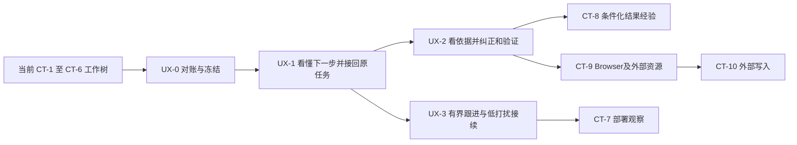

# R4 Agent UX Integration Roadmap

规划基线：`codex/ct5-ct6-research` @ `e8281d6b8bb8781447eb1ebfb1a60ebcfcd0dd3a`。本轮交付 UX-0 审计与 UX-1～3 实施方案；未实施业务代码。CT-7 暂缓启动，CT-1～10 的能力目标和原验收要求保留。

本文件是统一实施入口，完成日期为 2026-10-30（北京时间）。详细证据见 [代码与 Demo 对账](D:/Projects/hongmen/planning/r4-agent-ux-integration/CODE_DEMO_AUDIT.md)，交互合同见 [核心页面方案](D:/Projects/hongmen/planning/r4-agent-ux-integration/CORE_PAGE_DESIGN.md)，第一阶段执行说明见 [UX-1 Prompt](D:/Projects/hongmen/planning/r4-agent-ux-integration/UX1_IMPLEMENTATION_PROMPT.md)。来源及工作树快照见 [SOURCE_SNAPSHOT.json](D:/Projects/hongmen/planning/r4-agent-ux-integration/SOURCE_SNAPSHOT.json)，规划检查见 [PLANNING_VALIDATION.json](D:/Projects/hongmen/planning/r4-agent-ux-integration/PLANNING_VALIDATION.json)。

## 1. 产品目标：三个任务，一条持续协作链

| 用户任务 | 成功时用户实际得到什么 | 主要入口与对象 |
|---|---|---|
| **回来后知道项目变了什么** | 当前工作重点、重要变化、上次结果及现在等谁；可以纠正 | 今日焦点 → 原项目、Conversation、Handoff、Action 回执 |
| **把眼前问题查清楚** | Agent 自主挑工具、追原文、比较条件、给出判断和仍未知之处；用户能就近改正 | 同一 Conversation → Goal Reasoning / Investigation → 证据与合法操作 |
| **把一段工作交代下去** | 一次核对范围、期限和总预算后继续原 Mission；必要时协作；跨端找回进度 | 原委托 → 有界调查、Attention → 原批准及结果回执 |

用户是同时推进课程、科研或竞赛项目的学生。目标不是让用户维护“Agent 配置”，而是减少找入口、重复解释、误认完成和无效确认。当前方案改变的是现有对象的可理解性与可操作性，不增加新的任务身份。

三项任务不是三套新模块，也不要求把所有页面变成聊天。UX-1 保留现有“焦点／项目／记忆／行动”导航和深链；焦点内突出原委托入口，项目内沿用“概览／委托／资料／行动／成果”。UX-2 改造记忆内容，UX-3 在焦点加入可筛选的委托集合。暂不另增全局 Mission 页面或五项 Demo 导航，避免首页和项目页各养一套列表。

设计依据：`rule/one-primary-action`、`rule/structure-before-containers`、`rule/preserve-mental-model`、`rule/smallest-intervention`。以下尺寸、排序及研究门槛均为本项目建议，不冒充平台规定。

## 2. 当前基线与能力映射

Demo 固定在 master `e87b8ee`，本地还包含 CT-4、CT-5/6。不能按 master 重做这些工具。原 CT 规划中的“拟新增”是历史设计状态，实施记录后段和当前代码优先决定“已经有什么”。

分类：**U**＝现有合同上的 UI／调用接合；**S**＝现有服务内的小规模补全；**L**＝后续 CT 能力；**V**＝真实质量、设备或渠道验收。一个项目可同时有多类工作。

| 能力 | 当前可复用实现 | 本轮真实增量 | 类型／阶段 |
|---|---|---|---|
| 今日焦点 | [globalFocus](D:/Projects/hongmen/lib/server/globalFocus.ts:12)、[ProjectAgentContext](D:/Projects/hongmen/lib/projectAgentContext.ts:7)、双端 Focus | 共享首要事项；分开用户待办、观察等待、普通故障；有界覆盖与分页 | U+S，UX-1 |
| 当前方向、运行中改道 | [directiveService](D:/Projects/hongmen/lib/continuity/directiveService.ts)、[turnCoordination](D:/Projects/hongmen/lib/continuity/turnCoordination.ts)、双端 Continuity | 就近调整／撤回，时限到达刷新，跨端变化后旧控件重核；不重做 Admission | U+S，UX-1 |
| 跨会话接续 | [handoff](D:/Projects/hongmen/lib/continuity/handoff.ts)、[readback](D:/Projects/hongmen/lib/mission/readback.ts) | 下一责任方与恢复条件准确；始终返回原 Mission、原结果与原问题 | U+S，UX-1 |
| 自主调查与生成式 UI | [investigationService](D:/Projects/hongmen/lib/conversation/investigationService.ts)、[presentationRuntime](D:/Projects/hongmen/lib/conversation/presentationRuntime.ts)、[uiActions](D:/Projects/hongmen/lib/conversation/uiActions.ts) | 依据／纠正入口附着于原判断；按任务渐进展开；保留动态布局和工具选择 | U+S，UX-1/2 |
| PR-6、CI、文档、指标、论文 | 原 Conversation/Mission tools、CT-4～6 adapters | 同一来源阅读体验；准确区分摘要、正文、物理页、元数据、报告指标、固定核算 | U，UX-2；现有审批回执在 UX-1 不退化 |
| Memory 事实视图 | [temporalLedger](D:/Projects/hongmen/lib/memory/temporalLedger.ts)、[globalWorkspace](D:/Projects/hongmen/lib/server/globalWorkspace.ts)、原记录和来源 | 按主张显示依据、有效期和使用策略；用户确认与客观证实分开 | U+S，UX-2 |
| Dream 待验证视图 | Investigation 的 GoalGap／证据状态、Output INFERENCE、Decision 候选 | 联合只读投影、反证与下一验证动作；稳定原对象定位；没有新 Dream 表 | U+S，UX-2 |
| 记忆整理与经验 | [memoryConsolidationService](D:/Projects/hongmen/lib/services/memoryConsolidationService.ts)、[experience/service](D:/Projects/hongmen/lib/experience/service.ts) | 原整理建议按需出现；停止隐含写入的只读页面调用；条件经验深化留 CT-8 | U+S，UX-2；L，CT-8 |
| Always On | [investigationDelegation](D:/Projects/hongmen/lib/mission/investigationDelegation.ts)、[delegationObservation](D:/Projects/hongmen/lib/mission/delegationObservation.ts)、原 worker | 原许可预览、累计消耗、观察时点、等谁、暂停／撤销；不建总开关 | U+S，UX-3 |
| Attention | 原 USER Policy、BudgetLedger、Decision、Anchor、私人 Mission SEEN | 跨入口投影去重、个人偏好一致、合并摘要、到时再判；不新建通知系统 | U+S，UX-3；V，设备 |
| 鸿蒙桌面卡片／系统提醒 | [WidgetDataService](D:/Projects/hongmen/harmonyos/entry/src/main/ets/services/WidgetDataService.ets)、[NotificationService](D:/Projects/hongmen/harmonyos/entry/src/main/ets/services/NotificationService.ets) | 校准可用状态、隐私和点击回原任务；私人 Mission 不自动接系统推送 | U+S+V，UX-3 |
| 小艺／穿戴 | [missionAccess](D:/Projects/hongmen/lib/xiaoyi/missionAccess.ts)、inspect/resume；当前 module 无 wearable | 小艺测试身份与只读限制明示；正式账号绑定和穿戴独立设备 Gate | U+V；正式渠道后续专项 |

工程证据：CT-2/3 合并回执是 1158 测试、Web 24 通过／2 跳过；CT-5/6 最终记录是 1189 测试、Web 全量 26 通过／2 跳过、鸿蒙 86 测试和 HAP 构建。它们是历史源码快照的工程证据。本轮核对原记录与文件哈希，不重新跑业务测试。真实手机、多日用户研究、部分联网／论文质量 Gate 仍开放。

## 3. 必须补齐的五个合同

### S1：统一“现在等谁、该做什么”的只读投影

扩展原 `ProjectAgentContext`、Mission readback 和 Handoff，三个入口共用一个投影函数；不加 Mission 状态枚举、任务表或 Planner。拟增可选结构：

```text
workState: phase, nextActor, requiresUser, reasonCode, reasonText
           originalRef, exactQuestionRef?, exactApprovalRef?, lastReceiptRef?
           observedAt, checkedAt, nextCheckAt?, nextBoundary?
           freshness, coverage, safeNavigation / allowedActionRefs
```

`phase` 是显示投影：RUNNING、QUEUED、WAITING_OBSERVATION、WAITING_USER、WAITING_APPROVAL、PAUSED、UNKNOWN、COMPLETED、UNAVAILABLE。它不写回代替原状态。

- `WAITING_INPUT` 不能一律标为“等你”：结合原 `waitStateJson`、是否已解决、原问题类型、有效 continuation policy、观察事件和下一检查时间。仍需用户提供私有材料／决策时显示“等你”；明确等待获准观察且没有待答阻碍时显示“等待新变化”。
- 当前记录不足以区分时显示“等待条件需核对”；在**原** waitState/plan JSON 补版本化 `waitingFor` 原因，优先从真实状态转移写入。模型自由文字不能决定责任方。旧行不批量猜测回填。
- `READY` 是待执行，`RUNNING` 需当前租约证据；没有 worker 健康证据不写“后台正常运行”。过期 lease 或读取失败显示最后核对时间与恢复入口。
- `FAILED`、预算耗尽、授权过期、来源变化、UNKNOWN 分开。UNKNOWN 只提供原状态查询／核对，不能生成“再试一次”重新派发原外部操作。
- `SUCCEEDED` 保留完成条件、草稿核验、Action/resultCardId、现实效果的不同层级。

首要事项排序先比较当前可行动性和时间约束，再比较已有目标相关性和关注偏好，最后用稳定 ID 打破同分。普通技术故障不固定高于所有行动；授权／预算阻碍也不能被一律折叠。置顶偏好不覆盖真实紧急待办。采用原确定性候选规则和 Goal Reasoning 已存判断，不新增首页模型请求。

全局候选须先保留每项目每类最重要的可处理项，再有界聚合；不能先按更新时间取 6 条，就声称全局最重要。给 `coverage/hasMore/nextCursor`；未完整覆盖时使用“当前范围建议先处理”，保留查看全部。候选读取不能暴露其他 owner 的私人委托。

### S2：显示合同与控制合同分开

复用现有 `ConversationView.continuity`、十类 semantic block、`allowedActions` 和原 typed service。UX-1 不把“撤回”伪装成批准 Action，也不为每项能力发明新 semantic type。

就近操作由服务端绑定原对象、用户、项目、版本／hash、期限和可用状态。模型可以选择展示位置、比较项和解释，不能输出可执行 URL、任意 payload 或新的权限。没有合法 binding 时保留正文和“查看原对象”。

当前原 Continuity 路由可承担指令控制；若需把它挂入生成式消息，只扩现有 action union 的白名单控制分支，重用 `submitDirective`，不另建通用命令平台。scope、原话、解释候选、应用回执必须仍可核对。

到 `nextBoundary`、回前台、换账号／项目、源版本变化时重新取有效视图；客户端可立即标记需重读并停用旧控件，最终失效仍由服务端时间／版本 guard 保证。保留草稿和原 requestId；丢回包先读取／重放同请求。

### S3：Memory / Dream 是有依据的投影

只读投影身份为 `(owner, project, original object, revision, claim/block locator)`，时间与 scope 进入有效性计算。没有唯一原对象就显示历史线索，不给“已核实”或可执行确认。

| 视图内容 | 来自哪里 | 可做什么 | 禁止的晋升 |
|---|---|---|---|
| 已记录 | Capture、附件修订、Card、Action/resultCardId、Artifact manifest | 查看原文、补新记录、建立取代／反驳关系、纠正解释、停用来源 | CURRENT、用户确认、Action DONE 均不自动等于独立证实 |
| 待核实 | GoalGap、Investigation 结论、Output INFERENCE、Decision 候选 | 查看依据／缺口，继续同一调查，补材料，忽略当前候选或明确不再参考 | 不能因重复总结、模型置信度、点击采纳变成永久事实 |
| 变化经过 | Temporal relations、Lifecycle、Impact/Decision、原回执 | 比较旧新版本、谁在何时修改、哪些下游需要重核 | 归档不等于失效；撤回不恢复旧审批 |
| 方法经验 | 原 AgentExperience / Use / trajectory | 查看适用条件、支持和反例、激活 SHADOW、撤销 ACTIVE | 单个案例不自动变成跨项目方法；不改权限或系统 Prompt |

证据更新沿原 ImpactJob、sourcePolicy 和原读集 guard。投影缓存可丢弃；键包含原来源 revision、intent/reusePolicy、身份与有效时间段，截止不超过最近有效边界。来源链未知不算第二份独立证据；用户直接提供的原记录也要区分自报与实证。

纠正分流：改工作方向 → Directive；反驳判断 → 定位原 claim 后记录带来源的纠正／重评；原材料有误 → 原附件修订或新 Capture + temporal relation；不再使用 → `SUPPRESS_USE`；少提醒 → Anchor/Preference。不得把“这句话错了”直接屏蔽整份真实原文。

UX-2 推荐在原 AgentDirectiveEvent 内增加受限的 `INTERPRETATION_CORRECTION` 类型，原 SET/WITHDRAW、用户序号、scope、期限和幂等机制继续复用；这是当前四类指令之外的**拟新增合同**。命令增量为经服务端核对的 `target(originalRef, revision, block/claim locator, contentHash)`、用户原话和原 sourceIds；target/定位信息存原事件的版本化 metadata，不建纠正数据库。对未映射的 Artifact 只能定位整个原对象／已知块，不能编造逐句血缘。

纠正是用户对解释的声明，不进入 workingObjective、不生成业务／工具授权、不直接改 VERIFIED。有效视图单列 corrections，目标版本变动后原纠正保留为历史并要求重评；适用的纠正必须进入上下文、复用 hash、摘要／Artifact／经验及待批提案的消费 guard，不能只存 metadata。未知 locator 先澄清或回原对象，未知来源不伪造 sourceId。物理字段及旧客户端兼容在 UX-2 探针确认，但“可撤回、目标定位、失效传播、无权限晋升”是完成条件。

“忽略这条推测”默认只改变当前候选／主题的展示偏好；“以后不要参考这个判断”才登记明确使用抑制。恢复是撤回该限制后重新核对，旧批准不会复活。完整内容删除与备份清理不混在这两个动作里。

整理触发：用户主动整理；同项目出现原服务判定的重复候选；来源换版、纠正或原结果到达使已有结论需重核；授权持续 Mission 观察到有意义变化。打开记忆页、日历过一天、无新信息不产生新的模型整理任务。后台仅做原 ImpactJob 的失效标记；需要语义重评时进入原调查及其预算。原 `listExperiences` 会调用 `syncExperiences`，新的“只读记忆视图”不得不知情地调用这条写入路径。

### S4：调查执行与注意力分离

现有 CT-3 已做固定 SHA 的定时 CI 观察、稳定观察零模型、累计预算、私人注意力和 SEEN。UI 不应重新要求用户逐次批准合法只读工具，也不把 FOLLOW 或联网许可当成持续付费调查许可。

| 事件 | 原执行链 | 用户看到什么 |
|---|---|---|
| 新资料／附件修订／真实 Action 结果 | 原输入指纹 → 同 Mission → Goal Reasoning 动态调查 | 有意义结果才更新摘要；需要协作时给一个问题或批准 |
| 到期的已授权 CI 检查 | 原 worker → Step/HTTP 账本 → 比较已收录 SHA 状态 | 同状态只更新核对时间；不承诺自动发现任意新 head |
| 无新信息 | 保持等待；远程元数据检查可能消耗已授权 HTTP 预算 | 无新通知、无新模型解释；“暂无重要变化”按需可见 |
| 安静时段／LATER | 合法调查继续；注意力 QUEUE／SUPPRESS | 回来看到合并后的当前事项；明确 STOP 不因新 revision 解除 |
| 期限／预算／授权失效 | 原 guard 停止新派发，保留 UNKNOWN 和已用预算 | 原因、已做结果、恢复所需条件；不自动加预算 |

合并在原 Focus/Anchor/Intervention 投影完成，按 owner + 原任务／主题 + 有效版本／待决对象去重。`已读`、`曝光`、`已批准`、`平台已接受通知`分别记录；不能用“全部已读”消耗审批，不能用页面一次加载虚报 SEEN。

个人“少提醒我”复用 USER policy / GoalQuestionPreference / Anchor；不得改其他成员的项目偏好。无新事件但静默结束、日预算边界、指令到期仍须再判。提醒评价同时测噪声和漏报，不能以全静音降低打扰数。

CT-3 私人任务当前 `systemPush=false`。现有共享 Intervention 的本地系统通知、Action reminder 与私人任务是不同通道。UX-3 统一可用性及回执展示，真实后台投递缺口留设备／渠道专项；不新建 push 服务，不宣称关闭 App 仍能收通知。

### S5：能力可用、已获授权、运行健康分别表达

扩原 capabilities 与 Mission DTO 的可选字段；区分 feature 支持、当前用户权限、资源授权、执行环境、可用操作和暂不可用原因。功能开关不是授权，按钮出现不是已可后台执行。缺字段的旧客户端走原正文与对象入口，写入仍走原 guard。

Web 与 App 共享原 Mission/Conversation/Action ID、版本、source hash 和回执，不共享本地缓存当权威。跨端确认、撤权、租约替换、迟到响应、离线恢复都以服务端结果决定。系统卡片只携带最小导航参数；打开 App 后登录并重新解析目标，不携带审批令牌。

## 4. 实施阶段与依赖



箭头表示复用关系，CT-7 的功能实现不依赖 UX-3 才具备技术可行性；本次产品顺序明确先 UX。推荐实际执行 UX-1 → UX-2 → UX-3。UX-3 可复用 UX-1 合同独立开发，不必等待 CT-8/9/10。

### UX-0：本轮审计和冻结，P0

交付本目录四份文档、源码／未提交修改快照及验证索引；保留 Demo 和原 CT 规划。登记完整能力映射、静态可复现缺口、真实验收欠账和 UX 案例。不开业务 PR、不安装设备、不使用真实数据跑探针。

### UX-1：打开后看懂下一步，继续同一件事，P0

**纵向旅程**：D1 Web 留下一个真实 Mission 和待确认方案；D3 用户打开今日，看到真正需要自己处理的项；改“本周先稳演示”；原调查按新目标改道，旧提案后端拒绝；从鸿蒙进入原 Mission 补材料／确认合法提案、记录原 Action 结果；Web 新会话读回同一 resultCardId 和剩余缺口。

内部检查点只为定位问题，最终交付必须完整：

1. **状态与候选**：S1/S5，修正全局焦点优先级、等待原因、精确对象指向；为有限候选覆盖给出真实标记；无首页模型调用。
2. **原位协作**：共享首要事项投影进入 Web Focus、鸿蒙 GlobalFocusPanel、Mission、Continuity；当前重点一行、必要证据折叠；明确停止保持易达；原动态 Investigation/GenUI 全保留。
3. **完整回执**：Web→App→Web 同对象；原批准与 Action/resultCardId；旧版本、草稿、到期、UNKNOWN、flag-off 和恢复全部覆盖。

复用 `/api/workspace/focus`、`/api/projects/{id}/agent-context`、`/api/conversations/{id}/continuity`、原 turn/reconcile/ui-actions/work、`/api/missions/{id}`/readback/input/approvals/pause/resume。小增量限定为投影、必要 wait reason、capabilities 和这些入口的调用适配；不新增执行链。

Web 改 FocusAgentWorkspace、ConversationContinuity、MissionPanel/Readback 和原项目入口；鸿蒙改 GlobalFocusPanel/Presentation、FocusConversation、ConversationContinuity、MissionDetail 及对应 DTO/Service。未改到的复杂证据页继续原路访问。

**完成证据**：案例 UX-J01/02/03/07/08/10/12；原数据库 IDs 和回执一致；双端合同、Web E2E、HAP；实际设备单独签收。只出新首页或只出 DTO 不算完成。没有真实多日使用证据时，只报“工程闭环完成，真实多日 Gate 开放”。

### UX-2：看懂依据，纠正后继续调查，P1

**纵向旅程**：用户问论文方法是否适合当前项目；Agent 可自行读 PR-6、PDF 页、Crossref 元数据、CSV/JSON 条件；用户指出“这是自报结果，没有独立验证”，再上传修订资料。旧判断成为需重核，Agent 比较冲突与缺失条件，必要时走原固定核算批准；用户从已记录／待核实视图追到同一证据和新结果。

增量是 S2/S3 的 claim locator、事实／推测／变化投影、上下文纠正与来源停用动作。沿原 `sourcePolicy`、Temporal Ledger、ImpactJob；不做无人批准的记忆合并，不为 Dream 建新任务队列。

Web 改全局记忆／项目知识、KnowledgeCardView、来源查看器、AgentMessageBlocks 和原整理／经验组件；鸿蒙改 GlobalMemoryTab、MemoryTimeline、原来源查看器／AttachmentViewer、AgentMessageBlocks。PDF 自动页跳转先做能力探针：能按真实物理页导航才显示，不能实现时保留原件与明确页码。

进入本阶段先关闭审计 F07 的 revoked candidate 采纳缺口：在原 `actOnSignal` 与展示投影补当前连接／版本校验和幂等重放边界，不能只隐藏按钮。记忆关系或整理的新快捷确认也必须先检查原 endpoint 是否有足够源版本绑定；不足则在原服务补齐，不把老接口存在当成合同已完整。

**完成证据**：UX-J04/05/06/09/10/14；根来源去重、抑制派生闭包、A 项目纠正不污染 B、论文元数据不当全文、异条件指标不核算成方法结论。CT-5/6 的完整真实 Conversation＋GenUI 质量 Gate 随此阶段补，不能用已有 Mission pilot 代替。

### UX-3：交代后持续推进，需要时才协作，P1

**纵向旅程**：用户在原 Mission 核对“到周五、只读这些来源、累计额度、安静时段”；离开应用；无重要变化时不刷屏；新原始结果改变调查；关键问题留在私人收件箱；手机稍后处理／暂停／撤销，Web 重新进入读同一任务，卡片或小艺只做合法接续。

复用原 continuation-policy、研究 scope、连接 ci-grant、attention、Anchor、InterventionPolicy/Decision/Delivery、GoalQuestionPreference、worker/Step/预算。增加可读授权预览与差异、观察时点和下一条件、跨入口摘要去重及真实投递可用性。无新的远程数据源；观察仍受当前已收录 SHA 与工具许可约束。

Web 和 App 都能查看／调整／撤销原许可、区分“暂停调查”与“停止提醒”、读取已用总预算和 UNKNOWN 预占。退出账号清除本地私人内容；已明确批准的持久委托按其期限／撤销继续，不依赖手机常驻。未选择持续许可的普通会话不产生离线承诺。

桌面卡片先验 owner、项目、过期、退出清理、点击原任务。小艺沿原 inspect/resume 做只读测试通路；`BOUNDED_INVESTIGATION` 不在当前小艺 resume 允许条件内，不悄悄放宽。正式多用户身份绑定／平台发布及穿戴留独立设备 Gate，不阻塞双端主旅程的本地工程验证。

**完成证据**：UX-J03/07/08/11/12/13；无变化零模型、重复事件零新增提醒、静默仍调查、截止／撤权竞争、两 worker 恢复、跨任务 USER 预算、关键提醒不丢失。真实 ≥3 天观察与设备验收另列，不用快进时钟代替。

## 5. CT-7～10 的边界与后续接法

| 切片 | UX 现在完成 | 随该 CT 交付 | 当前不应增加 |
|---|---|---|---|
| CT-7 部署观察 | 通用证据层级、观察时点、来源不可用、等待／回执布局 | 固定环境/release 来源、build/deploy/health/user-path 区分、日志权限、实际查询与验收 | 虚构线上健康状态、自动部署、第二监控系统 |
| CT-8 结果经验 | 已有案例／SHADOW／ACTIVE 展示、撤销、出处、纠正、当前任务结果重评 | 结构化适用条件、反例归因、Focus case 读取、负迁移和效果评测 | 每晚自动“做梦”改永久记忆、跨项目自动激活 |
| CT-9 Browser | 来源卡的阅读层级／定位／过期合同，Fetch 不足时真实说明缺口 | 隔离只读浏览器、页面状态与截图/DOM 证据、登录／注入边界 | 任意网页操控按钮、假浏览器进度 |
| CT-9 外部应用 | 统一授权差异和返回原对象的位置 | 选定 Mail/Docs/Calendar 的账号、OAuth scope、资源版本、时区 | 复制工具列表充当可用授权；假定已有系统提醒等于外部日历读写 |
| CT-10 外部写入 | 保留具体操作预览、待批准／UNKNOWN／回执这些现有语义槽位 | 每种 write 的 payload/目标/幂等/effect 查询/撤销语义及端侧批准边界 | 通用“允许自动操作”开关；把当前创建内部 Action 当成已实现外部写 |

上述后续 adapter 进入同一证据、状态与批准组件，按真实能力添加字段；现在不先造通用 connector/control schema。小艺正式身份和穿戴是渠道条件，不强塞进 CT-9 的工具授权模型。

## 6. 跨端交付矩阵

| 端 | 本阶段职责 | 不能假定 | 验收 |
|---|---|---|---|
| Web | 深入证据、修改方向、审批、输入、恢复；键盘可完成 | 读到旧页面即拥有当前批准；浏览器关闭还能本地轮询 | 桌面＋360/390/430，刷新／回退／多标签竞争／网络失败 |
| HarmonyOS App | 同一状态／权限；单列、就近操作、底部输入；复杂证据展开 | HAP 构建＝手机可用；Web CSS px 可直接套 fp/vp | 当前 target 6.1.1(24)、compatible 6.1.0(23) 的设备实测；深色、大字体、输入法、读屏 |
| 原桌面服务卡片 | 最小状态快照、核对时间、打开原任务 | 私人问题正文／审批载荷可在锁屏缓存；卡片是 Runner | TTL、换账号、离线、回前台、Want 参数重验 |
| 小艺测试入口 | 查询指定 Mission；仅合法 LOW_RISK_READ_ANALYZE 接续 | 测试用户＋allowlist 是正式用户认证；语音可批准原业务效果 | 错 owner/项目、过期版本、超预算、需 App 跳转；平台真机另验 |
| 穿戴 | 先做目标设备可行性；未来最小摘要和打开手机 | 当前 module 支持 wearable、所有表支持同一卡片/API、手表能审批 | 选机型/系统/渠道后实测；本轮无“已支持手表”声明 |

官方 Intents Kit 把应用能力分发到小艺等系统入口；这不替代本产品身份绑定和审批。[官方 Intents Kit](https://developer.huawei.com.cn/consumer/cn/sdk/intents-kit)。穿戴设备分不同开发体系，需按目标设备选型。[官方穿戴概览](https://developer.huawei.com/consumer/cn/multidevice/wearables/)。当前仓库只声明 phone/tablet/2in1，正式渠道能力以代码和实机为准。

## 7. 验收案例与指标

以下是新增开发／回归场景，继承原 CT-J/X 与 R1 负例；不是已完成的用户研究，也不是独立留出集。时钟快进用于工程，跨自然日研究另计。

| ID／阶段 | 可复现任务 | 核心断言和失败反例 |
|---|---|---|
| UX-J01／1 | 新用户空项目→记录一条材料→提出一个真实问题→第一次有依据回答 | 先得到价值，再按需要请求云上下文／公开研究许可；无 Worker 时不承诺后台；无空白控制台 |
| UX-J02／1 | A 项目一批近期 FAILED，B 有待批准，C 有重要期限；Web/App 打开今日 | 同一快照相同主事项／精确对象；普通错误不能覆盖可处理决策；超过候选上限如实标 coverage |
| UX-J03／1,3 | 同一 Mission 分别等用户材料、等固定 CI 状态、PAUSED、UNKNOWN、READY | 等谁和主操作正确；待观察不算待回应；FAILED 不显示 Agent 正在接续；UNKNOWN 不重新派发 |
| UX-J04／2 | 同一问题先 PR-6 摘要，再 PDF 原页／论文元数据，证据充分后结束 | 自主选择和停止，不强制固定路径；reading level/物理页/覆盖准确；不为展示工具而多读 |
| UX-J05／2 | 用户“这个数字只是我说的”→补原实验文件→修订文件→新会话追问 | 区分纠正解释与改原文；旧主张需重核；原输入保留；正负结果都可改变下一步 |
| UX-J06／2 | 同根来源派生三份摘要；停用根来源；另一项目有相似资料 | 三份不算三源；Artifact/推测/经验/待批提案都受约束；B 不误失效 |
| UX-J07／1,3 | Web 编辑→App 撤回／换账号→旧 Web 点击；离线保存失败后返回 | 后端拒绝旧操作；草稿保留且隔离账号；登录后重读；不自动提交旧草稿 |
| UX-J08／1,3 | 模型／工具在途时改方向，到期无新事件，随后迟到响应 | generation/lease/原预算守恒；UI 与实际调查一起改道；旧答案不重新发布 |
| UX-J09／2 | 不同 split 的指标与论文高分对照；同条件下降走原固定核算 | 不可比保持未知；核算先原批准；真实 job 回执不说“已复现方法”；保留 Action/resultCardId |
| UX-J10／1,2 | capabilities 部分关闭、旧消息、新字段缺失、原来源撤权 | 正文／原对象 fallback；不露不可用按钮；旧引用不能成为有效支持 |
| UX-J11／3 | 同状态 CI 重复四轮，静默跨夜，随后出现关键问题 | 无变化零模型；HTTP 成本照记；普通变化合并；STOP 不复活；关键项能被主动打开看到 |
| UX-J12／1,3 | D1 委托→D3 新会话/手机→D5 原 Action 完成→原 Mission 读回 | 同 Mission/Action/resultCardId，无重复批准效果；工程快进与真实自然日证据分开 |
| UX-J13／3 | 小艺／桌面卡片读状态，进入审批、切账号、离线过期 | 小艺不发批准令牌；受限恢复；卡片重新认证并导航原任务；穿戴无实现时不冒充可用 |
| UX-J14／2 | 两端同时纠正／整理，原来源在预览后改版，撤回整理 | 当前 guard 拒绝过期确认；重放原回执；撤销不覆盖后来的独立用户修改 |

### 体验与 Agent 质量分开量测

| 指标 | 定义／记录方法 | 建议放行目标，评测前冻结 |
|---|---|---|
| 首次价值 | 从有权访问的空项目开始，到用户能指出一项有来源的判断／下一步；权限选择与等待分开计时 | ≥80% 新用户无主持人提示完成；中位主动操作 ≤3 分钟 |
| 下一步理解 | 展示页面后，用户正确说出项目、等谁、下一动作、结果层级的次数/机会 | ≥90%；中位识别 ≤15 秒；样本小则报 n/N |
| 接续成功 | 新会话找到并继续原对象且无重复效果/应接续机会 | 工程集 100%；用户任务 ≥90% |
| 纠正有效 | 同 scope 纠正后不再错误使用的决策点/全部暴露机会；误伤他项目单列 | ≥95%；跨项目错误传播 0 |
| 自主推进 | 授权、预算、资料足够时实际执行必要调查/可推进机会 | 不低于当前 CT 基线；不得靠多问用户、逐工具确认“降噪” |
| 调查适应 | 新观察使合理换工具／结束／移交的案例；按允许下一步集合评，不规定唯一链 | 正向、负结果、证据已足三类都通过 |
| 提醒质量 | 有价值的用户打断/全部打断；应及时可见却遗漏/关键事项 | 重复提醒 0；关键漏报 0；噪声较基线下降，静默不能充当高分 |
| 误完成／误授权 | 用户把元数据当全文、READY 当运行、回执当现实成功、FOLLOW 当付费许可的次数 | 硬负例 0；用户研究逐例报告和修订 |
| 成本与耗时 | 原模型、工具、HTTP、UNKNOWN 预占和主动操作时长；分别统计 | 无变化模型调用 0；相同任务能力不退化；不清账缩分母 |

对照采用同一 CT-1～6 工具集、同一数据／模型／预算的 **当前 UI** 与 **新 UX**，先只比较表达和用户成本；S1/S3 服务补全作为单独因素标记，不把后端修复全部归因于视觉改版。旧 Q&A / 固定流程仅是补充对照，不能以删调查换取快响应。

独立质量：延续原 CT 24 条隐藏多轮题，非实现者准备、双人盲评；另用至少 5 名目标用户做首次使用、纠正与相隔 ≥3 日接续，覆盖三类项目。模型裁判仅辅助；执行结果由 SQL/原回执核对。新场景暴露给开发后不得继续叫隐藏集。真实模型预算使用新 campaign 和硬上限，历史 UNKNOWN 不移出账本。本轮未调用付费模型。

## 8. 验证、发布与回滚

实施时按阶段先跑受影响测试，再做发布集合：`npm.cmd exec tsc -- --noEmit`、`npm.cmd run lint`、`npm.cmd test`、`npm.cmd run test:e2e`、`npm.cmd run harmony:test`、`npm.cmd run harmony:build`。Web E2E 脚本包含隔离构建，成功后不为凑次数重复 build。独立构建需要时再跑 `npm.cmd run build`。

沿现有 Vitest/E2E 隔离库与 Windows 清理脚本；模型、HTTP、真实容器、合成结果、真实用户分别标注。HAP 构建、模拟器安装、目标设备、平台联调、上线各有回执，互不替代。

API 加可选投影字段，默认不迁移数据。若必要 wait/claim locator 可放既有 JSON，写 schemaVersion 和旧记录 fallback；验证旧库副本，不操作真实库。原 feature flags 管能力；若需要 UI 灰度只增加一个双端可读的 UX projection capability，不另设授权体系。

回滚可退呈现层，原 guard、有效指令和回执保持；新 JSON 旧客户端可忽略，但必须有自然文本入口。不能退回会放行旧源或忽略停止限制的写路径。每阶段维护拟新增 `R4_AGENT_UX_IMPLEMENTATION_NOTES.md`，记录真实验证、Deviations 与未关闭 Gate。

## 9. 裁决、延期与实施探针

已作出的产品裁决：以三个用户任务收敛；保留动态调查与生成式布局；Memory/Dream 用中文“已记录／待核实”；Always On 显示为具体委托的“持续跟进”；复杂授权和证据渐进展开；真实批准的对象、范围、费用及后果不能折叠到看不见。

| 待探针／条件 | 阶段 | 可证伪的检查与处理 |
|---|---|---|
| 旧 WAITING_INPUT 能否无歧义投影 | UX-1 首项 | 观察等待与人工待答混合样本；不足就在原 waitState 增加原因，不靠文案猜 |
| 全局排序和响应成本 | UX-1 | >6 项目、>6 普通失败、私人权限、部分查询失败；记录查询量/p95和 coverage，避免 N+1 全表装载 |
| claim 级纠正／抑制身份 | UX-2 | 同句不同 source/版本不串改；来源链未知只允许重新调查；不能把未知 locator 当新权威根 |
| 原记忆快捷确认 guard | UX-2 | 预览后 source/relation 变化、双端并发、重放；旧服务不足则在原事务补校验 |
| 跨来源去重与静默后关键项 | UX-3 | 同 Mission 来自 Anchor/GoalQuestion/Intervention 三入口；不重扣预算，也不漏当前有效审批 |
| 小艺正式账号与设备渠道 | 渠道专项 | 明确平台账号映射、目标机型及发布条件后验收；测试 allowlist 不升格正式身份 |
| 独立人评与真实多日样本 | 各阶段质量 Gate | 人员／样本尚未取得；可继续本地工程，不能提前标质量通过 |

延期事项：CT-7 部署 adapter；CT-8 条件化经验学习；CT-9 Browser/外部资源；CT-10 外部写；无人值守“夜间做梦”；穿戴 App；正式小艺多用户发布；私人 Mission 系统后台推送。延期不影响现在把已有自主调查、长期委托和结果链做好。

规划自审：完整性、范围、可测试性、风险、假设均已落到合同和案例；可行性仍依赖上表探针，不能以自评分代替实现证明。本轮“独立审计”指重新按源码和原回执核对 Demo，不表示已取得外部评审或真实用户研究。
