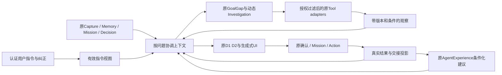

# 有效上下文、任务交接与持续调查

> **R1 定向修订 · 2026-10-28（Asia/Singapore）**：新增§3A运行中状态机与§8A消费路径抑制合同；§2/§3的manifest按这两节补齐。保留原动态Investigation、Goal Reasoning、PR-6、Mission、AgentExperience和生成式UI。

## 1. 架构裁决

在 `workspaceContextService` 和原 Investigation/Mission context入口之间增加薄的 `effectiveContext` 解析模块。它只取原对象、解析有效性、输出manifest和可读指针。原 `investigationService` 决定下一步；原Mission Runner执行长期委托；原Decision负责取舍；原业务服务提交效果。没有新调度引擎或平行记忆库。



## 2. EffectiveContext合同

```ts
type ContextManifest = {
  schemaVersion: 1;
  actorScope: { ownerUserId: string; projectIds: string[]; missionId?: string; conversationId?: string };
  questionHash: string; asOf: string; timezone: string;
  intent: { hash: string; eventRefs: string[]; nextValidityBoundary: string|null;
    evaluatedAt: string; validitySegmentIds: string[] };
  reusePolicy: { hash: string; suppressionRefs: string[]; lineagePolicyVersion: string };
  originalObjectRefs: Array<{ kind: string; id: string; revision: string }>;
  evidence: Array<{ sourceId: string; revision: string; excerptHash: string;
    readLevel: string; rootRefs: string[]; lineageState: 'RESOLVED'|'PARTIAL'|'UNKNOWN';
    temporalState: string; applicability: string; usePermissionRevision: string }>;
  correctionRefs: string[]; commitmentRefs: string[]; experienceUseRefs: string[];
  dependencies: Array<{ derivedRef: string; inputRefs: string[]; purpose: string }>;
  exclusions: Array<{ ref: string; reason: string }>;
  coverage: { sufficientFor: string[]; missing: string[]; truncated: string[] };
  manifestHash: string;
};
```

intent.hash取作用于本题目标/效果的指令及scopeEpoch，不取全用户序号；完整manifestHash记录本轮所有输入。效果guard只比较该效果的相关read-set，表达偏好、无关source或无关项目变化不让有效操作无故失效。用于展示的guidanceHash可单独变化。

manifest包含身份/用途/版本，不默认复制全部正文。原source snapshot仍放原Turn/ExternalSource/附件修订；上下文缓存只是可丢弃投影，不能变成新的根证据。原 `Source[]` 不塞伪造的“intent来源”；manifest作为既有Turn.readManifestJson、MissionStep.protocolJson、Decision.baseManifest、AgentRun.trace中的可选伴随合同，原source验证照常执行。

持久化读写映射：Turn保留本轮manifest和原网页观察；MissionStep.protocolJson记录该step使用的continuityManifest；Decision.baseManifest增加同一hash及refs；CopilotToolExecution的原提案/AgentRun.trace记录发布时hash。GeneratedArtifact.sourceRefs与MissionArtifactReceipt继续保存内容来源，新增lineage只补原链没有的根指针，不能取代原审计。

### 解析顺序

1. Resolve Scope：以认证身份、当前project/entityRef及私有Mission绑定为准；目录摘要只帮助定位，不能授权。
2. Resolve Intent：应用[指令合同](R4_CONTINUITY_INTENT_CORRECTION_CONTRACT.md)，区分原正式目标与当前工作目标；收取所有适用硬限制，不能用topK遗漏禁止项。
3. Resolve Commitments：优先读本题相关原Mission/Action/Anchor；新会话可索引同owner同项目未决对象，再按指针深读，不复制别的会话全文。
4. Retrieve Evidence：先用现有摘要定位，再按问题读原文/章节/真实结果；当前目标缺口决定工具，工具返回不能反过来改目标。
5. Reconcile：按版本、适用期、测量条件、纠正和provenance排除失效支撑；冲突并存，记录各自为何相关。
6. Compose：关键原话、关键证据span和待决问题优先进入上下文；支持分页/按需展开，不能因来源增多把刚找到的关键反证裁掉。
7. Validate：工具调用前、回答/提案发布前、业务确认事务内、恢复执行前重验对应manifest。

工具选择依然是每次观察后重新决定。可以回到内部记忆、比较多个外部来源、读取结果、条件式回答或交给既有Mission，不固定为web→repo→experiment流水线。

## 3. 失效与依赖传播

优先采用**精确read-set即时校验 + 原ImpactJob有界传播**。前者保证正确性，后者改善UI/通知及时性。不上全局递归重算，不在每次修订自动启动付费模型。

| 变化 | 即时效力 | 后续处理 |
|---|---|---|
| 当前目标/限制改变 | 旧依赖intentHash的未提交操作不可确认 | 只重审命中的提案/任务；无关项目保持可用 |
| 来源A→B→A | 版本身份仍已变化，旧预览不可复活 | 复用现有来源revision，不只比较正文hash |
| 官方新规则发布但下月生效 | 新资料不自动替代本月要求 | 保留当前/未来两条适用关系；必要时读公告或文档 |
| 原研究scope撤销 | 停新外发，旧私有观察停止用于新判断 | 原历史按权限隐藏/脱敏；已归入项目副本按单独用途政策处理 |
| 用户反驳实测记录 | 标CONTESTED，事实不直接改写 | 按目标价值继续寻找原始记录/复算；重要判断暂停采用 |
| 经验源被删除/方法版本改变 | 停该经验新注入 | 原Use记录保留最小历史；目标相关结果重新读取 |

派生结论带 `rootRefs`，相同根的多个摘要不增加独立支持数。图有环、链断或超过有界深度时lineage=UNKNOWN，不能用环证实自身。外部镜像转载和同论文多数据库条目按规范身份去重，独立性未知时不算多源一致。

关键区分：`CURRENT`说明关系当前适用；`SUPPORTED`说明某主张被具体片段支持；`CHECKED`说明通过明确核验合同。三者不能互相替代。

旧记录没有continuityManifest时：已COMMITTED效果始终按原身份精确回读；未提交提案若存在相关新指令，必须重新预览并绑定当前manifest，不能以“兼容旧版”为由绕过。无相关指令才沿原source/目标/版本校验。过期、被拒和已撤权状态均不能因升级恢复可执行。

### 发布时目标改变

保留实际完成观察及费用审计，禁止发布陈旧可操作提案。若仍有预算且资料/授权可复用，回到原turn中有界再协调；否则显示已取得哪些观察及“方向已更新，正在按新目标接续”的原状态。不能无声从头调用所有工具。继续原有UNKNOWN费用预占，不把改目标当自动重发许可。

当前 `mutateTurn`严格校验Conversation.version=baseVersion+1，且modelResults/operation按原步骤身份缓存；不能只增一个intentHash就宣称支持运行中改道。CT-1需在原manifest增加 `coordinationGeneration`：新意图使尚未发布的答案/布局缓存失效，新模型阶段key带generation，成功且仍有权的相同原文读取按canonical input+revision复用。UNKNOWN操作跨generation仍阻止相同请求重发，根callCount/reservation/外部额度不重置。

【R1 调整】控制入口使用directive目标CAS，不改原turn的baseVersion。活动Turn期间由continuity投影即时显示持久控制回执；普通聊天回执按§3A延后物化，不推高正在执行的Conversation.version。R1冻结采用这条路线，不能临时跳过原CAS或重写baseVersion。明确STOP不再协调；纯表达变更不重跑调查。再协调由剩余根预算、用户新增信息和可复用观察决定，不设“只能改道一次”的能力上限；模型、工具、外部请求及活跃时间跨generation累计，连续无增益或预算到界才结束或接续原Mission。

【R1 调整】取消/改道后的operation结算采用§3A的execution与settlement双重条件：允许记实际费用/结果hash或保持UNKNOWN，禁止重新激活Turn、生成提案或修改业务效果。lease已经失效的旧worker不再拥有结算写权。

## 3A. 【R1 新增】In-flight Recoordination冻结合同

### 原Turn内的状态，不增加Runner

`ConversationTurn.status`保留既有受理/执行/终态语义，在原readManifestJson增加：

```ts
type CoordinationState = {
  generation: number; // 从0开始，激活新有效上下文时才递增
  state: 'ACTIVE'|'INVALIDATED'|'DRAINING'|'RECOORDINATING'|'STOPPING'|'TERMINAL';
  activeIntentHash: string; activeReusePolicyHash: string;
  pendingReason: Array<'DIRECTIVE'|'TIME_BOUNDARY'|'SUPPRESSION'|'SOURCE'|'GRANT'>;
  pendingScopeEpochs: Array<{ scopeKey: string; eventId: string }>;
  evaluatedAt: string; nextValidityBoundary: string|null;
  drainDeadlineAt: string|null;
};
```

generation区分同一执行权下的新旧认知，lease区分执行者。generation改变**不产生新lease、新Turn或新预算**；worker替换才CAS更换lease。CT-1启用路径的同步与异步执行都须使用持久token，不能因token=null而放过旧调用；现有`assertTurnLease`的可空行为须适配，不是只加UI状态。

| 当前状态 / 事件 | 持久转换及执行规则 |
|---|---|
| ACTIVE(g)收到已Admission的相关修订/抑制，或越过时间边界 | INVALIDATED(g)。立即使旧语义发布和相关业务确认不成立；不等worker轮询或ImpactJob。已知当前Turn可同事务记标记，其他会话Turn最迟在下一guard比较有效hash时发现 |
| INVALIDATED无在途调用 | RECOORDINATING(g)，重新解析当前有效指导/来源/可用工具 |
| INVALIDATED存在已取得派发权的模型/工具请求 | DRAINING(g)。停止新派发，尝试取消；在原请求deadline与配置最大drain时长的较早界限内接收/结算。无确认响应则UNKNOWN，不无限等旧请求 |
| DRAINING结算完成或到deadline | RECOORDINATING(g)。UNKNOWN可以保留并调查其他必要信息，原不确定操作不可重发；预算不足则按原Turn终态/原Mission接续 |
| RECOORDINATING解析到最新可用manifest | 事务CAS检查当前lease、g、根未停止、最新有效hash；激活ACTIVE(g+1)，保存新manifest。若期间又有修订则重读合并，不发布中间版本 |
| 任一未终结状态收到STOP、session/访问权撤销 | STOPPING；不得激活新generation。仅受限结算/审计，随后原CANCELLED/UNKNOWN/失败终态，原因分别保留 |
| 当前generation发布成功 | 通过最终guard和原Conversation CAS后TERMINAL；原Action/Mission效果与回执照原事务提交 |
| lease超时/进程死亡 | 新worker用原claim CAS拿新token，从原状态恢复；未确认派发保留UNKNOWN，先重新检查时间/意图/抑制，不能重置到ACTIVE(0) |

控制命令用指令目标CAS，不修改执行者的baseVersion/lease。活动Turn期间不把控制记录直接追加为改变Conversation.version的普通消息：原指令事件保存认证请求及原句，continuity投影即时显示；需要的聊天回执在原发布协议内物化。这样保留`version=baseVersion+1`不变量；若实施发现不能满足，该rebase路径必须先独立证伪/设计验证，不能直接绕过原CAS。

### 操作派发与提交的线性化点

每次模型/工具请求记录`operationId/createdGeneration/inputHash/readSetHash/intentHash/reusePolicyHash/leaseAtDispatch`。规范输入、角色消息和Prompt/Tool版本均参与指纹。三件事分别发生：

1. **RESERVED**：原根预算事务预占一次，尚无网络派发权。
2. **DISPATCH_COMMITTED**：在短事务内重验当前lease+generation=ACTIVE、原会话CAS、访问/grant、当前时间有效视图、SUPPRESS_USE及读集，并CAS把该operation从RESERVED改为DISPATCH_COMMITTED；这是派发许可线性化点。
3. **真实响应/结算**：网络在事务外发送。DISPATCH_COMMITTED不证明字节已发；该事务后、HTTP前崩溃同样保持UNKNOWN，不自动重发。取消不能承诺收回已取得派发权的在途数据。

修订/撤权先提交，步骤2必失败；步骤2先提交，该次请求属于已授权在途，修订阻止其**新的语义消费和后续派发**。预占、授权派发、真实发送、响应收到、可用于当前判断是不同状态，不能把DISPATCHING笼统当作全部已完成。

回答/UI Plan/提案发布需同一事务检查`current lease + activeGeneration + 当前intent/reusePolicy + source/grant + time boundary + 原Conversation版本`。原业务确认/采纳/恢复还在各自原服务事务重算当前有效视图；旧UI未刷新也必须被拒。表达偏好只重组呈现，不因guidanceHash改变重跑有效调查或作废无关业务效果。

已经发布、等待用户确认的Proposal记录`publishedGeneration`及冻结读集。它的确认走原业务服务自己的事务/执行权和当前有效视图，**不要求已经终结的ConversationTurn仍有ACTIVE状态或活跃lease**。generation/lease校验约束在途认知发布，当前意图/使用策略/来源/时间校验约束后续业务效果；这两道保护不能混成使所有正常确认都不可用的条件。

### 两类写权与迟到结果

| 写入 | 必须满足 | 结果 |
|---|---|---|
| execution write | 未停止的ACTIVE、当前generation、当前未过期lease、全部guard通过 | 可更新当前认知、生成原提案、按原服务提交效果 |
| settlement write | **当前**有效lease、原operationId/inputHash/dispatch身份匹配、未结算或可按原回执精确重放；不要求仍是createdGeneration | 仅更新原operation的终态/实际usage/结果hash及允许保留的审计；不能改generation、预算上限、业务对象或发布消息 |
| 旧lease/已释放token的响应 | 无写权；null也不能匹配旧token | 丢弃旧执行者写入；新owner能对账则查询原operation，否则UNKNOWN及原预占继续存在 |

旧generation模型结果即使JSON正确、费用已知，也不能进入当前Route/Goal/Answer/UI或被保存成当前有效指令；只结算用量和保留允许的历史诊断。旧工具的真实观察可记为成功但`usability=INELIGIBLE_PENDING_RECHECK`，不是直接进入当前context。抑制/撤权不允许保留正文时仅记最小状态/hash/计费，不保存迟到秘密片段。

STOPPING状态的heartbeat只在有界drain内续租以完成原结算，不能派发或无限延长；lease失效后停止续租。需新增受限heartbeat/settlement分支，不能继续调用会因stopRequested失败的通用mutateTurn，也不能删掉其停止检查。终态后的对账只更新原审计，不重新领取执行权。

### 缓存复用与预算

- Route/Goal/调查决定/Answer/UI Plan缓存key包含generation及完整上下文指纹；不同generation不能复用旧认知输出。相同generation恢复只在指纹/有效边界都匹配时回读。
- 已成功原始读取可跨generation复用，前提是Tool版本、规范参数、原资源revision、actor、grant使用规则、时间适用性、来源链和suppression均重新通过。它节省读取费用，但新Goal/Decision仍重新判断。已知失败只复用失败状态，不能冒充空结果。
- `unknownReplayKey`绑定根Turn、provider/工具和实际目标/payload，排除generation/步骤序号/随机ID等包装字段。新generation换operationId不能洗掉同一未知请求；只有原operation查询/对账，或用户明确知悉旧请求未知后批准的**新尝试**才允许后者，并继续计入原总预算。
- 模型/工具/外部次数、token、费用预占、UNKNOWN及活跃时间在**根Turn累计**；保持`已知实耗 + 未结算预占 <= 原上限`。真实发过的迟到请求照算，缓存复用不虚计新HTTP。新generation不清callCount/steps预算/seen身份；lease交接不重复累计同一活跃区间。
- 原usage回执以operation/callId唯一结算，重复响应不二次扣/退额度；UNKNOWN→已知结果允许收敛一次，结算不能抬高可用预算到越过硬上限。纯取消/超时或generation失效不等于provider未收费。

若provider真实报账超出预占上界，保留真实费用并标预算异常、停止新派发和进入对账，不能截断费用记录来伪造守恒。其输入/输出上界和provider计费口径需实施探针验证。

每一步观察仍由原Investigation选择下一合法工具、询问、结束或移交原Mission；状态机只约束执行一致性。没有固定工具链，也没有固定“只能改道一次”。

## 4. Handoff是原状态投影

```ts
type CommitmentView = {
  ref: { kind: 'MISSION'|'ACTION'|'TURN'|'ANCHOR'; id: string; projectId: string };
  ownerUserId: string; intentHash: string; versionToken: string;
  nextActor: 'USER'|'AGENT'|'EXTERNAL'|'NONE';
  state: 'RUNNABLE'|'WAITING_USER'|'WAITING_EXTERNAL'|'PAUSED'|'UNKNOWN'|'TERMINAL';
  waitingFor: Array<{ kind: string; ref?: string; description: string }>;
  resumeGuards: string[]; pendingApprovalRef: string|null;
  lastOutcomeRef: string|null; lastVerifiedAt: string|null;
  safeNextActionBindings: string[];
};
```

| 原状态 | 下一责任方及可用行为 |
|---|---|
| Mission WAITING_INPUT | USER，显示原questionId；若原等待条件明确绑定外部run/事件，则EXTERNAL。不能仅凭模型一句“等结果”推断。 |
| WAITING_APPROVAL | USER，进入原冻结批准；批准过期则重读原状态。 |
| READY/RUNNING且许可/预算/worker可用 | AGENT，表示真实可执行下一步；不能把worker离线写成“正在推进”。 |
| PAUSED/STOP/撤权/预算尽 | 原因及恢复guard；不能自动继续或暗中换工具绕过。 |
| Turn外部请求UNKNOWN | UNKNOWN，读原operation；有provider查询能力则查同operation；无能力则说明需明确发起新尝试。 |
| Action TODO/DOING/DONE | 待用户/授权执行器；DONE有resultCardId仍是具体结果层级，目标是否达成另判。 |

大部分字段从已有对象推导。真正新增的承诺元数据仅记录原对象没有的 `waitingFor(kind/ref)`、用户认可的触发/截止、最后核对及意图绑定，放原Mission.waitStateJson/planJson和Anchor.originEntryJson，不另建Commitment任务表。

没有原对象支撑的“我明天继续查”不能只写在回答里。要么按已有范围创建/关联一个真实Mission并记录授权，要么清楚提出该委托的预览。模型自由文字不产生后台承诺。

## 5. 持续自主调查：原Mission内的调查委托

保留此能力为下一阶段核心交付，而非无限延期的扩展点。用户可说：“到周五前继续查清影响演示的阻碍，只读，不超过这次给的总额度；需要我决策时提醒。”

在原 `continuationPolicySchema` 增加版本化的 `BOUNDED_INVESTIGATION` 模式，保持原MANUAL/LOW_RISK_READ_ANALYZE语义。一次授权明确：目标与scope、可用连接/公开概念、允许的只读工具、触发事件或nextCheckAt、到期/停止条件、模型和外部请求总预算、通知等级。预算属于原Mission；后台每次唤醒不重新领取一份额度。

原worker按AgentMission.nextAttemptAt/合法source事件唤醒，原runner先协调意图再动态调查；可以保存私有Output和提出方案，业务效果仍走原批准。无新信息则等待或结束，不为保持活跃而循环搜索。用户无需每一次Search/Fetch/CI读取都点确认。

持续委托的授权身份是原owner加已批准的持久policy，不借用过期HTTP session冒充在线用户。创建/修改policy必须有当前认证；每次唤醒重验用户/项目/资源访问及policy。退出登录会结束该session的活动Turn；长期委托是否继续由用户已确认的委托政策决定并在退出界面可见，撤销委托或账号失效立即停止新派发。

已有公开搜索许可只足够当前研究，不默认授权后台活动；FOLLOW只表示关注展示，不等于付费调查许可。政策可通过一次自然语言预览组合批准；之后Agent拥有完整范围内的调查自主性。

公平调度、总预算、最大活跃时长、nextAttemptAt退避、到期及撤权检查进入原worker/lease测试。先读缓存和增量元数据，再决定是否值得深查；HTTP 304/相同run状态不触发新语义模型。Cloud模型私有上下文授权和工具外发范围仍分别检查。

## 6. Attention：不中断调查，只控制何时叫用户

输出 `INTERRUPT / DIGEST / SILENT`；研究执行策略与通知展示策略分离。静音不取消有许可的研究，停止研究也不删除已有结果。

先执行owner/连接撤权、STOP/LATER、用户时区安静时段和总预算等硬规则；再判断变化是否影响当前目标、是否出现新的用户决策、等待条件是否解除、截止前是否需要处理、是否重复。模型可提出相关性说明，不能绕过硬规则。

- INTERRUPT：新的且时间敏感的目标阻碍，需要用户现在决策；使用原InterventionDecision/Delivery与USER预算。
- DIGEST：可继续自主处理的进展或非紧急新信息，聚合到原Focus/Anchor；不消耗系统通知次数，不新增聊天轰炸。
- SILENT：无关、同版本重复、已停止、没有新信息或无适用来源；保存最小理由与游标。

统一去重身份为 `(owner,topic,resourceRevision,decisionRequired,intentHash)`；不能简单含fetchedAt导致每次刷新成新事件。LATER到期合并期间变化，只呈现当前仍有用的一项；用户明确STOP不因新revision自动解除。用户静音下重要事件进入可见digest，不擅自越过安静时段；需要紧急例外必须在策略中明确。

复用原InterventionPolicy/Preference/BudgetLedger/Decision/Delivery和GoalQuestionPreference；Anchor投影调用同一注意力决策，生成/曝光/送达各自计数。拟议默认仍是现有3次/用户自然日上限，重复事件0次新增打扰；具体产品频率见决策记录。

现有InterventionPreference按project+trigger保存，不是私人user偏好。私人“这周不要提醒我A”写入该用户指令/Anchor政策并在attention resolver合并，不能改项目级偏好影响其他成员。真正团队共享的降频仍沿原项目权限。

## 7. Outcome：立即修订判断，条件化积累经验

当前任务不等两个样本：一个适用真实结果到达，即可让原GoalGap/D1/D2重新判断和改变下一工具。原 `AgentExperience` 的多样本激活门槛只管可复用方法，不阻止当前任务学习。

扩展原 `applicabilityJson`、`counterExamplesJson`和轨迹投影：目标/意图版本、候选与实际选择、数据集/模型/代码/设备/指标定义/环境、原结果和核验口径、适用/不适用条件及过期边界。Focus与Mission都通过同一只读case adapter读取。

工程成功、用户采用、行动完成、自报效果、独立工具核验分别统计。未采用可能是时间变化或用户离开，不能自动当作方法无效的反例；失败分类也不能把全Mission最后一个protocol错误归因给所有失败step。对照/因果效果未知时保持未知。

候选案例可作为明确标注的历史类比供Agent主动参考；已激活方法才作为过程建议注入。案例绝不更改System Prompt/权限/长期偏好。结构化条件不匹配则排除；缺关键条件可以读原case或提出验证，不能直接当同条件成功。

## 8. 撤回、屏蔽与删除

WITHDRAW取消当前指令效力；SUPERSEDE保留历史而改当前；HIDE只改变展示；SUPPRESS_USE阻止指定内容影响未来；DELETE清除内容及派生副本，不能把软隐藏叫删除。

失效/删除覆盖面：原事件或source → 相关context缓存/向量或关键词索引 → Anchor快照和待发摘要 → 未确认提案与可复用经验 → Artifact/Tool snapshot的相关派生内容。派生物保留明确已发布的独立用途时需向用户说明；缺该许可的私有副本不得通过复制逃过撤权。删除过程用有界原服务任务记录进度，先立SUPPRESS_USE防新消费，再清理副本，最终核对索引。备份和法定/操作审计留存期限是需确认的产品政策。

本阶段不自动回填或重新生成所有旧历史。已经执行的行动、第三方写入和用户导出的文件不会因本地删除凭空撤销。重放幂等所需只保留无正文、无秘密的最小effect tombstone，如何留存见决策记录。

## 8A. 【R1 新增】SUPPRESS_USE & Provenance全路径合同

### 效力与传播

SUPPRESS_USE绑定owner、原source/directive/claim引用及revision选择（指定版本或全部版本）、用途和scope。原句的作用范围须经Admission，不能默认跨用户或全项目删除事实。接受后同步更新有效使用策略hash；**清理索引和反向影响任务可以异步，关键消费guard即时生效**。HIDE和原授权撤销分别处理，不能代替使用抑制。

复用原源清单/关系/Artifact manifest/AgentExperience样本指针计算有界来源闭包；不建平行provenance库。为原source/claim投影增加`rootRefs/derivedFromRefs/lineageState/useState`，其中useState为ALLOWED/SUPPRESSED/REVOKED/UNKNOWN。可在原manifest/resultJson保存。缓存key至少包括actorScope、相关revisions、intentHash和reusePolicyHash；无根指针的旧缓存不直接命中。

| 关键消费路径 / 实际入口 | R1必需保护与抑制后的行为 |
|---|---|
| 检索与原文：`lib/mission/memorySearch.ts`、`lib/conversation/toolAdapter.ts`、`lib/mission/projectMaterialReader.ts`、`lib/mission/sourceSignals.ts` | 结果和定向读取都检查使用策略；不能只过滤搜索列表却允许按ID读回。命中被抑制来源时不给新认知正文；保留有权限的历史查看须单独模式 |
| 初始观察/指针：`lib/services/workspaceContextService.ts`、`lib/conversation/sourceObservation.ts` | 包括title、excerpt和指针metadata，避免被屏蔽事实通过目录摘要进入模型 |
| Investigation/Goal/近期对话：`lib/conversation/investigationService.ts`、`lib/conversation/promptSpecs.ts` | 检查观测、recentDialogue、原summary和已缓存modelResults；已有prompt发出后不可撤回，返回的派生结果不再新消费，按§3A重协调 |
| PR-6与研究总结：`lib/conversation/researchTools.ts`、`lib/conversation/researchSummary.ts` | 回读旧网页、reuseWebSources、总结PREVIEW/CONFIRM均重验；不得把抑制的片段再次写入新Artifact |
| Artifact及摘要：`lib/mission/artifactProvenanceService.ts`、`lib/mission/projectMaterialReader.ts`、`lib/repositories/artifacts.ts` | 按block/claim处理；完整映射时仅排除受影响块，无映射时整份不作新判断依据。项目显式归入的独立用途不自动覆盖后来明确针对同来源派生物的SUPPRESS_USE |
| Mission/Decision：`lib/mission/contextBuilder.ts`、`lib/decision/goalState.ts`、`lib/decision/reviewPersistence.ts` | action result、Output、旧Review和原成功条件上下文都不能藏带被抑制的二手结论；正式业务状态仍保留，语义判断重建 |
| 经验：`lib/experience/trajectoryIndex.ts`、`lib/experience/extract.ts`、`lib/experience/injection.ts` | ACTIVE不豁免。样本根来源/适用条件重验，受影响经验停止注入和新增支持计数；一份Artifact的多次采用不能成为多份独立结果 |
| 待确认提案：`lib/conversation/presentationRuntime.ts`、`lib/conversation/commands.ts`、`lib/conversation/workService.ts`、`lib/mission/approvalService.ts` | 生成catalog、预览、确认事务全检查相关reusePolicy和闭包；旧binding可见也不能提交。已COMMITTED效果只读原幂等回执，不重新执行 |
| Anchor、UI和草稿：`lib/conversation/anchorService.ts`、`lib/conversation/service.ts`、原Web/ArkTS renderer | 待发摘要/历史重投影不得注入被抑制内容；旧controls失效，草稿可保留但标需复核，不能成为后端绕过入口 |

原用户指令的quote、错误总结的否定复述和模型审计也可能重复被抑制内容：传给新模型时使用不含正文的抑制引用/规则，不能靠“不要使用X”再次泄露X。用户当前明确重新提供的信息与历史被抑制来源分别标识；解除抑制需针对该规则的明确命令，不凭当前话题相似自动解除。

### 来源链未知与恢复

已知派生链命中被抑制根则SUPPRESSED；无根映射、断链、环或超过有界深度则UNKNOWN，**不能把二手摘要当独立一手证据或给可操作结论增信**。UNKNOWN不妨碍继续调查：只给安全且有权的原来源定位，重新读取独立原文。无法证明不含被抑制内容的旧正文/模型输出不进入新prompt；来源链解析失败不退回“默认允许”。

明确解除抑制会产生新策略版本，再重验权限/原文/当前条件；不会自动恢复旧审批/旧生成结果。完整内容删除、备份清理留在原治理路线；CT-1必须先覆盖上述消费guard及legacy未知链处理，不能推迟到CT-8才阻止被屏蔽内容参与判断。
